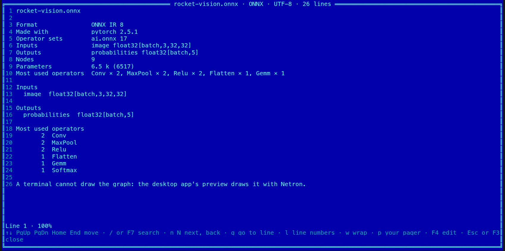

[← README](../../README.md) · [Docs index](../README.md) · [The preview pane](README.md)

# Neural network models

A neural network model file holds a graph of operations (convolutions, matrix products,
activations) and the weights they use. Coxswain shows what a model is in both apps: its
format, what made it, its operator set or format version, every input and output with its
shape, and how many nodes and parameters it has. The desktop app's preview pane also draws the
graph with [Netron](https://github.com/lutzroeder/netron), bundled with the app and run
offline. Coxswain only reads a model: it never runs it, reads no Python pickle and runs no code
from the file.

![The desktop app's preview pane on rocket-vision.onnx: its facts at the top (ONNX IR 8, made with pytorch 2.5.1, ai.onnx 17, the input image float32[batch,3,32,32] and the output probabilities float32[batch,5], 9 nodes, 6.5 k (6517) parameters, Conv, MaxPool and Relu twice each), Netron's graph under them in its dark colours: image, Conv with its weights, Relu, MaxPool, Conv, in the Cyber theme](../screenshots/neural-networks.png)

- [Using it](#using-it)
- [The facts](#the-facts)
- [The graph](#the-graph)
- [Files it reads](#files-it-reads)
- [Safety](#safety)
- [Questions](#questions)

## Using it

**Desktop app.** Put the cursor on a model and open the preview pane (**Space** or **F3**). At
the top of the pane are the model's facts (the first four inputs and outputs, and how many more); under them Netron draws the graph, a box for each
node with arrows from inputs to outputs. Netron's own buttons sit at the bottom left of the
graph: zoom in, zoom out, the model's properties and the properties of the graph shown. Click
a node for its attributes and weights in Netron's side panel; the wheel scrolls, **Ctrl** with
the wheel zooms. While the model is read, the pane says *Reading the model…*; a model Netron
cannot draw shows *Netron cannot draw it:* and Netron's reason, with the facts still above.
Under the graph, *Drawn by Netron, offline, in a frame of its own.*

**Terminal app.** A terminal has character cells, not pictures, so it shows the facts, not the
graph:

| Key | What you see |
|---|---|
| **F3** | The facts card in the viewer, titled with the format: the facts, then each input and output on a line of its own with its shape (up to 64 of each, then how many more), then up to 40 operators by how often they are used, and the line *A terminal cannot draw the graph: the desktop app's preview draws it with Netron.* A Core ML package is a folder: **F3** does not open it, **Alt+Enter** shows its facts. |
| **Alt+Enter** | Properties: the file's size and dates, then the same facts, each on one line (the first four inputs and outputs, and how many more) |

*View* (**F3**) and *Properties* (**Alt+Enter**) are in the action menu (**Shift+F10**) and the
command list (**F9**) too. The graph itself is desktop-only, because drawing it needs a web view.

## The facts

| Fact | ONNX | TensorFlow Lite | Core ML | Keras |
|---|---|---|---|---|
| **Format** | ONNX and its IR version | TensorFlow Lite and its schema version | Core ML (or Core ML package) and its specification version | Keras and its version |
| **Made with** | The producer and its version (`pytorch 2.5.1`) | The converter's description (`MLIR Converted.`) | coremltools' version and what it converted (`torch==2.5.1`) | — |
| **Operator sets** | Each domain and version (`ai.onnx 17`) | — | — | — |
| **Kind** | — | — | The model type: neural network, ML program, pipeline, tree ensemble, … | The model's class: `Sequential`, `Functional` |
| **Inputs**, **Outputs** | Name, element type and shape; a named dimension (`batch`) as its name | Name, type and shape, `?` for a dimension that may change | Name and type: an array with its shape, an image with its size and colours | The input layers with their shapes (outputs are not stored) |
| **Nodes** | Nodes of the main graph | Operators in all subgraphs | Layers, or an ML program's operations | Layers |
| **Parameters** | The elements of every initializer | The elements of every tensor with stored data | — | — |
| **Most used operators** | The five most used, with counts | The five most used | An ML program's five most used | — |

Weights a model lists among its inputs (older ONNX exporters do) are not counted as inputs.
Large numbers are shown short and exact: `6.5 k (6517)`.

## The graph

Netron draws the model's main graph; a model with functions or subgraphs gets a list at the
bottom left to pick one, and a node that holds a graph opens it on a click, with a back arrow.
Netron's *Model Properties* button lists the model's metadata, inputs and outputs; *Target
Properties* the shown graph's. Netron's menu (open, export, find) is left out: the app opens
the file, and nothing is saved from the frame.

Netron draws in its own colours, dark in a dark theme and light in a light one, not in the theme's.

## Files it reads

| Ending | What | Graph |
|---|---|---|
| `.onnx` | ONNX, also with its weights in a separate file next to it (`model.onnx.data`) | Yes |
| `.tflite` | TensorFlow Lite (LiteRT) | Yes |
| `.mlmodel` | Core ML | Yes |
| `.mlpackage` | A Core ML package, a folder: its `Manifest.json` names the model, its weights are in `Data/` | Yes |
| `.keras` | Keras 3: a zip with `config.json` and `metadata.json` | Yes |
| `.h5` | Keras 2 in HDF5, when the file's bytes hold a model's configuration; any other HDF5 file gets no facts and no graph, and is shown as any other file (as text, or in the hex view) | Yes, for a Keras model |

Not read: PyTorch (`.pt`, `.pth`, `.bin`), TorchScript, pickles (`.pkl`) and joblib files. They
are Python pickles, and TorchScript holds code: reading them means running Python. Export such
a model to ONNX to see it here. GGUF and safetensors files are not drawn either.

## Safety

- **Nothing runs.** The facts come from the file's structure, read in Coxswain's own code with a
  cap on everything: how many fields are read, how large one part may be, how many inputs and
  operators are kept. A broken or hostile file gives no facts, not a hang.
- **Netron runs in a frame of its own.** It is sandboxed to scripts alone: no origin, so it
  cannot reach the app, its files or its storage. Its policy allows no connection of any kind,
  so it cannot fetch or send anything. The app hands it the model's bytes, and the files the
  model names next to it (weights, external data), only from inside the model's folder and at
  most 64 of them. Nothing comes back from the frame but "drawn" or an error, and no link it asks
  for is opened.
- **What is in the bundle.** `gui/public/vendor/netron` is Netron 9.3.2 (MIT), made by
  `gui/netron/build.mjs` from the release's source with a checked SHA-256: Netron's own view
  and the readers of these four formats, with Coxswain's host in place of Netron's browser
  host. Netron's telemetry, its update check, its Python and pickle readers and every other
  format are left out (each resolves to an empty stub); the build fails if the telemetry's
  addresses or the PyTorch or pickle readers end up in it anyway. Its licence is in the
  [bills of materials](../reference/bills-of-materials.md).
- **Size.** A model up to 512 MiB is drawn, and each file next to it that it reads may be up to
  512 MiB too; a bigger one shows the facts and *Netron cannot draw it:* with the reason.

## Questions

#### Does Coxswain run the model?

No. It reads the file's structure only: no pickle is read, no code in the model runs, and
Netron's frame has no network. The facts are counted from the file, not from running it.

#### Why is my PyTorch .pt file not shown?

PyTorch files are Python pickles, and TorchScript holds code: reading them means running
Python, so Coxswain leaves them out. Export the model to ONNX (`torch.onnx.export`) to see it.

#### How do I see a model's inputs in the terminal app?

Press **F3** on the file for its facts card, with each input and output on a line of its own,
or **Alt+Enter** for the short facts in Properties.

#### Why does the graph not follow the theme?

Netron draws with its own style sheet, in its dark colours under a dark theme and its light ones
under a light theme. Coxswain does not change Netron's drawing, so its updates can be taken as
they come.

#### Why does a parameter count say nothing for Core ML or Keras?

Core ML keeps an ML program's weights in a separate file, and Keras keeps them in HDF5; Coxswain
does not read those for the count. Netron's node properties show each weight's shape.

#### Does the desktop app send the model anywhere?

No. Netron is in the app, its frame may not connect anywhere, and the app opens no link for it:
the links in Netron's side panel (an operator's documentation) do nothing, so nothing the frame
was handed can leave the machine.

---
[← Previous: Xiangqi games](xiangqi.md) · [Next: Media and files →](media.md)
