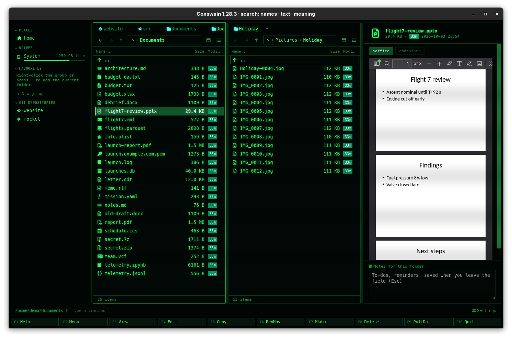

[← README](../../README.md) · [Docs index](../README.md) · [The preview pane](README.md)

# PowerPoint and Office: quick view and LibreOffice's exact view

PowerPoint decks show at once, drawn in the app with nothing installed. Where LibreOffice is
installed, or podman or docker can run its container (Gotenberg's image), its exact rendering
follows and takes the quick view's place. Older and other Office formats (`.doc`, `.odt`, `.rtf`,
`.ppt`, `.vsdx`, …), the old ones of the 1990s (Works, Windows Write, WordPerfect, Lotus 1-2-3,
StarOffice, AbiWord, ClarisWorks) and Windows clip art (`.wmf`, `.emf`) are shown as the PDF
LibreOffice makes of them.

## How to use it

1. Put the cursor on the deck or document and press **Space** or **F3**.
2. A PowerPoint deck shows its slides at once. With LibreOffice there, it starts by itself once
   the file has stayed under the cursor for 0.6 s; the exact view replaces the slides when it
   is ready.
3. The engine buttons at the top (**soffice**, **podman libreoffice…**) choose who renders; a
   click renders again with that one.
4. **Enter** opens the file in its program.

| Key | Desktop app | Terminal app |
|---|---|---|
| **Space** / **F3** | Shows or hides the pane | – |
| **Enter** | Opens the file in its program | The same |

## Formats

| Files | Quick view, in the app | Exact view |
|---|---|---|
| `.pptx` `.pptm` `.ppsx` `.potx` | The slides at once: layout, text, pictures and tables ([pptx-to-html](https://github.com/javier-mora/pptx-to-html)); not every font, colour scheme, effect or chart | LibreOffice's PDF |
| `.docx` | The document, by mammoth ([Documents](documents.md)) | – (never goes to LibreOffice) |
| `.xlsx` `.xlsm` `.xls` `.ods` | The sheets as tables, by SheetJS ([Data](data.md)) | – |
| `.doc` `.docm` `.dotx` `.odt` `.ott` `.rtf` | – | LibreOffice's PDF |
| `.ppt` `.pps` `.pot` `.odp` `.otp` | – | LibreOffice's PDF |
| `.odg` `.vsd` `.vsdx` `.pub` | – | LibreOffice's PDF |
| `.wps` (Works), `.wri` (Windows Write), `.wpd` (WordPerfect), `.lwp` (Lotus WordPro), `.wk1` `.wks` `.123` (Lotus 1-2-3) | – | LibreOffice's PDF |
| `.sxw` `.sxc` `.sxi` `.sxd` (StarOffice, OpenOffice.org 1), `.abw` (AbiWord), `.cwk` (ClarisWorks, AppleWorks), `.pages` `.key` `.numbers` (Apple iWork, a single file), `.fodt` `.fods` `.fodp` `.fodg` (flat OpenDocument), `.cdr` (CorelDRAW), `.pmd` (PageMaker) | – | LibreOffice's PDF |
| `.wmf` `.emf` (Windows clip art and metafiles) | – | LibreOffice's PDF of the picture |

What LibreOffice opens depends on its import filters: a file of a version too old or too new for
them stops with LibreOffice's *source file could not be loaded*, shown with **Try again**. dBase
(`.dbf`) is not on the list: Gotenberg's LibreOffice has no dBase filter.

Decks saved by PowerPoint for the web (whose parts start with a byte order mark and name each
other by absolute paths) are mended before they are drawn, so they show too.

## What you see

- **Quick view:** the slides one under another, 16:9, scaled to the pane.
- **While LibreOffice works:** *Shown at once; the exact rendering with soffice is on its way…*
  above the slides.
- **Exact view:** the PDF in the webview's viewer, fitted to the width.
- **If LibreOffice fails:** its first error line above the quick view, which stays.
- **Formats with no quick view, LibreOffice's container not pulled yet:** **Render**, with
  *First run pulls docker.io/gotenberg/gotenberg:8-libreoffice (about 440 MB)* under it; a click
  pulls it once and renders.
- **Formats with no quick view, without LibreOffice or a container runtime:** *soffice is not
  installed. Neither podman nor docker is installed. Install the program, or let a container
  make this preview.* Under it, *Install it:* with the line for this system
  (`sudo apt install libreoffice`, `brew install --cask libreoffice`, `winget install --id
  TheDocumentFoundation.LibreOffice -e` …) and **Copy**, and a **Settings → Previews** button
  ([Installing what is missing](tools.md#installing-what-is-missing)).
- **While another format renders:** *Rendering with soffice…*; on an error, the message with
  **Try again**.

## Settings and config.toml

| Settings → Previews | config.toml | Type, default |
|---|---|---|
| *How previews are made* | `[preview] prefer` | `"auto"`: an installed program, else a container |
| – | `[preview.prefer_tool] libreoffice` | Overrides `prefer` for LibreOffice |
| – | `[preview.images] libreoffice` | String, `"docker.io/gotenberg/gotenberg:8-libreoffice"`; `""` never uses a container |
| *Timeout (seconds)* | `[preview] timeout` | 120 |

Coxswain looks for `soffice` and `libreoffice` on the `PATH`, and in LibreOffice's usual
install folders on macOS and Windows. A LibreOffice image you set must provide `soffice`. See
[Previews made by tools](tools.md) and [Containers](containers.md).

## In the terminal app

No preview pane: slides and PDFs need the desktop app's webview. **Enter** opens the file in
LibreOffice or PowerPoint. To get a PDF from the command line: `soffice --headless --convert-to pdf file.pptx`.

## Questions

#### Why do the slides look slightly different, then change?

The first view is drawn by the app, quickly, and misses some fonts, effects and charts. When
LibreOffice is there, its exact rendering follows and takes the quick view's place. That one is
kept in the [cache](tools.md#the-preview-cache), so the next look shows it at once.

#### Do I need LibreOffice to see a PowerPoint deck?

No. The quick view needs nothing installed. LibreOffice only adds the exact rendering, and is
needed for `.ppt`, `.odp` and the other formats without a quick view.

#### Why is a Word `.doc` file not shown?

`.doc` needs LibreOffice: install it (so `soffice` is found; the pane shows the line for your
system with **Copy**), or let its container make it: with podman or docker installed, click
**Render** once and Gotenberg's image (about 440 MB) is pulled. `.docx` needs nothing.

#### Does it disturb a LibreOffice I have open?

No. Coxswain runs LibreOffice with a profile of its own in the cache folder
(`libreoffice-profile`), so a running LibreOffice neither takes over the conversion nor sees
it. Conversions run one at a time.

#### Why Gotenberg's image, when LibreOffice has none of its own?

The LibreOffice project publishes no image. Gotenberg's `8-libreoffice` holds a current
LibreOffice, rebuilt every few weeks; Coxswain runs only its `soffice`, once per file, with no
network, and never Gotenberg's server. Set another one you trust in `[preview.images]
libreoffice`; it must provide the `soffice` command.

#### Can I see old Works, Write or Lotus 1-2-3 files?

Yes, as far as LibreOffice's import filters reach: `.wps`, `.wri`, `.wpd`, `.wk1`, `.wks`,
`.123` and the others in [Formats](#formats) are shown as the PDF LibreOffice makes. With
LibreOffice installed, Find reads their words too ([Scans, pictures and older Office
files](../search/scans.md)).

#### Why does a WMF or EMF picture go through LibreOffice?

Browsers cannot draw Windows metafiles. LibreOffice opens them as drawings and makes a PDF of
the picture, which the pane shows, sharp at any zoom.

#### The deck shows but the exact view never comes.

Either LibreOffice is not found (the engine button is greyed; hover it for the reason), or the
only engine is a container whose image is not pulled yet: that never starts by itself. Click
**Render** under the quick view (or the container's button), or **Pull** it in Settings.

#### Why did LibreOffice stop with "Stopped after 120 s"?

A conversion is stopped after the timeout. Large decks can take longer: raise *Timeout
(seconds)* (10 to 3600) in *Settings → Previews*.

---
[← Previous: HTML pages, sandboxed](html.md) · [Next: Data →](data.md)
