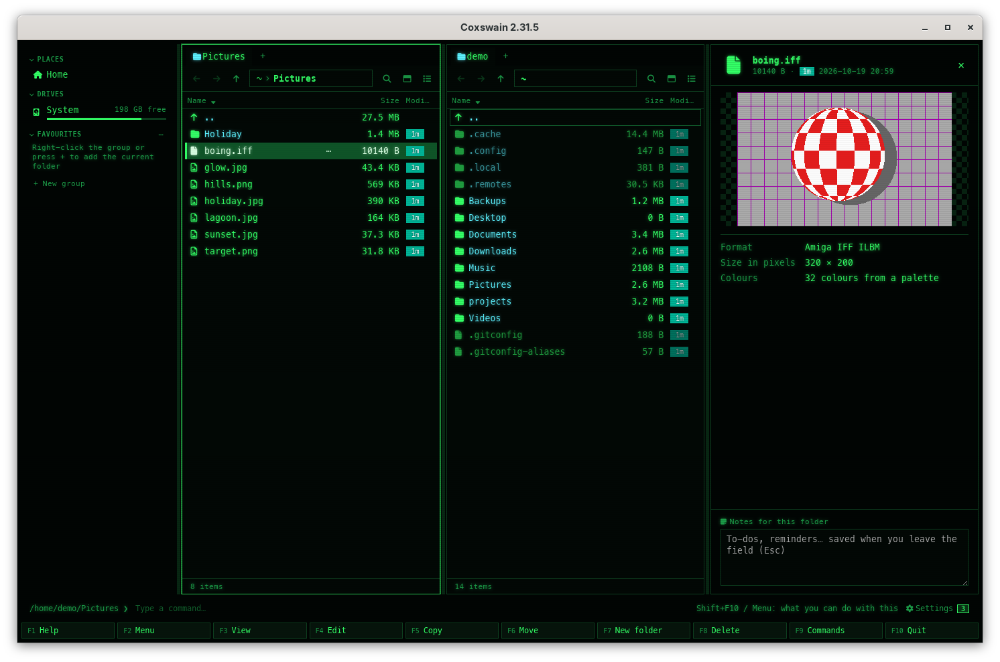
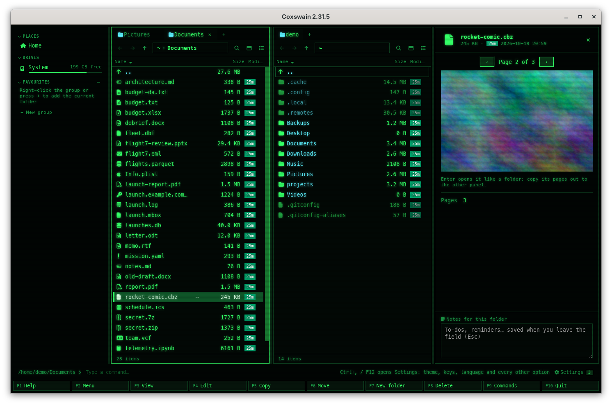
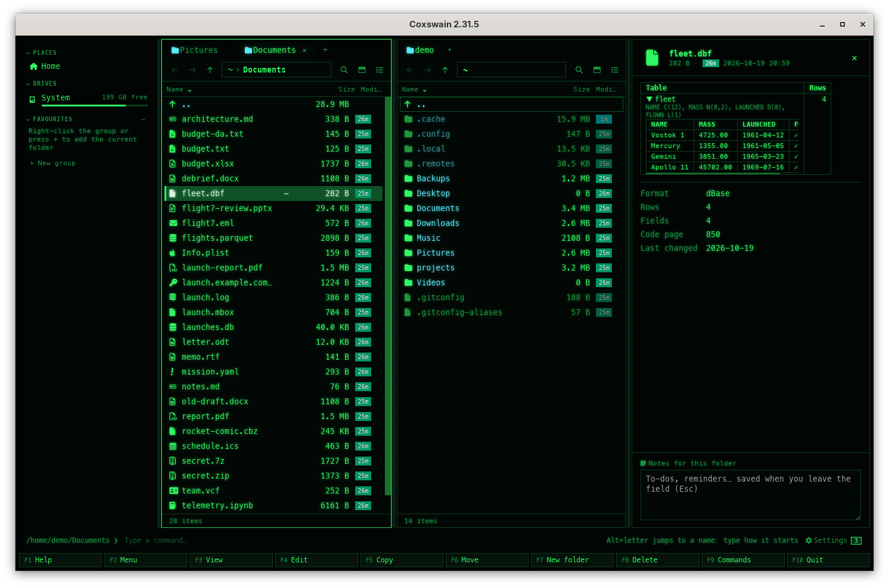

[← README](../../README.md) · [Docs index](../README.md) · [The preview pane](README.md)

# Old pictures and files

Pictures from TIFF scans to Amiga paintings and Photoshop documents, comics page by page, a
mailbox opened like a folder of its messages, Outlook's `.msg`, dBase tables and tracker music:
Coxswain reads them all itself, in pure Rust, with no program to install. The desktop app's
preview shows them; both apps say what each file holds, in the desktop app under the preview
and in the terminal app in **Properties** (**Alt+Enter**) and **F3**.

*An Amiga IFF picture in the preview, with its facts under it.*

## Contents

- [How to use it](#how-to-use-it)
- [Formats](#formats)
- [Pictures](#pictures)
- [Comics](#comics)
- [Mailboxes](#mailboxes)
- [Outlook messages](#outlook-messages)
- [dBase tables](#dbase-tables)
- [Tracker music](#tracker-music)
- [Search](#search)
- [In the terminal app](#in-the-terminal-app)
- [Settings and config.toml](#settings-and-configtoml)
- [Questions](#questions)

## How to use it

1. Put the cursor on the file.
2. Desktop app: press **Space** or **F3**; the preview pane shows the picture, the comic's page,
   the message or the table, and the facts under it.
3. Terminal app: press **Alt+Enter** for **Properties**, which lists the facts, or **F3**, which
   shows them (and a module's sample names, a message's text) in its built-in viewer; **h**
   there shows the file itself.
4. A mailbox or a comic: **Enter** opens it like a folder, in both apps.

| Key | Desktop app | Terminal app |
|---|---|---|
| **Space** / **F3** | Shows or hides the preview | **F3**: the facts, a table or a message as text in the built-in viewer |
| **Alt+Enter** | **Properties**, with the facts | The same |
| **Enter** | A `.mbox` or `.cbz` opens like a folder; anything else opens in its program | The same |
| **F5** | Copies a message or a page out of the mailbox or comic | The same |

## Formats

| Files | Desktop app's preview | Facts (both apps) |
|---|---|---|
| TIFF `.tif` `.tiff` | The picture, a page at a time | Format, size in pixels, colours, pages |
| Truevision `.tga`, Netpbm `.ppm` `.pgm` `.pbm` `.pnm` `.pam`, DirectDraw `.dds`, Radiance `.hdr`, OpenEXR `.exr`, `.qoi`, farbfeld `.ff` | The picture | Format, size in pixels, colours |
| JPEG XL `.jxl` | The picture | Format, size in pixels, colours |
| Amiga IFF `.iff` `.lbm` `.ilbm` | The picture (ILBM with HAM6, HAM8 and Extra Half-Brite, and Deluxe Paint's PBM) | Format, size in pixels, colours |
| PCX `.pcx`, X11 `.xpm` `.xbm` | The picture | Format, size in pixels, colours |
| Photoshop `.psd` `.psb` | The flattened picture | Format, size in pixels, colour mode, layers |
| Comics `.cbz` | One page at a time, with ‹ and › | Pages |
| Mailboxes `.mbox` | Its messages, listed | Messages |
| Outlook `.msg` | Subject, from, to, date, attachments and the text | – |
| dBase `.dbf` | Its fields and first 200 records as a table | Format, rows, fields, code page, last changed |
| Tracker music `.mod` `.xm` `.s3m` `.it` | The instrument and sample names | Format, title, channels, patterns, instruments, samples, length, made with |

A `.hdr` that is another program's header (ENVI, Analyze) and a `.mod` that is Modula-2 or a
Go module file are no picture or music: Coxswain looks at the first bytes, and shows them as text.

## Pictures

The desktop app's webview cannot draw these formats, so Coxswain draws each picture into a
PNG, at most 2,048 pixels on its longest side, keeps it in the preview cache and shows it on the
checkerboard as other pictures are. The next look at the same file shows it at once. With the
panel in **Thumbnails** ([Views](../panels/views.md)) each one gets a thumbnail the same way.

- **TIFF:** a scan or a fax with several pages shows *Page 1 of 4* above the picture, with **‹**
  (*Previous page*) and **›** (*Next page*) beside it. Under the picture, *Pages 4*.
- **Amiga IFF:** bitplanes of 1 to 8 colours deep, HAM6 and HAM8 (4,096 and 262,144 colours),
  Extra Half-Brite, 24- and 32-bit true colour, compressed with ByteRun1 or not; palettes of old
  programs that wrote 4 bits a colour are made 8-bit. A colour marked clear is clear.
- **PCX:** 1, 2, 4 and 8 bits a pixel, EGA's 16 colours in four planes, and 24- and 32-bit
  colour; the 256 colours after the pixels where a file has them.
- **XPM and XBM:** the C source X11 keeps its icons in; colours as `#rrggbb` or by the common
  names, `None` clear.
- **Photoshop:** the picture Photoshop keeps after the layers (*Maximize compatibility*, on by
  default), in RGB, CMYK, grey, indexed, bitmap, duotone or multichannel mode, 8, 16 or 32 bits.
  The layers are counted (*Layers 3*), not drawn one by one. A document saved without that
  picture, or in Lab mode, says *This picture could not be read* with why.
- **Radiance HDR and OpenEXR:** brighter than white is shown as white.

Pictures of more than 64 million pixels, and files over 256 MB, say *too large to show here*.

## Comics

A `.cbz` is a zip of pictures. The preview shows its first page, *Page 1 of 24* above it with
**‹** and **›**, and under it *Enter opens it like a folder: copy its pages out to the other
panel.* The pages are its pictures in the order of their names (`2.jpg` before `10.jpg`), and
each is copied out of the comic when it is shown. **Enter** opens it like any zip
([Archives as folders](../files/archives.md)): **F5** copies pages out, and pages copied in are
added. A `.cbr` (RAR) opens like a disk image, with 7-Zip ([Disk images](../files/disk-images.md)).

## Mailboxes

A `.mbox` (Thunderbird's, `mutt`'s, Google Takeout's) opens like a folder, read-only, in both
apps. Each message is a file in it, named by its number, date, sender and subject:
`001 2026-09-28 - Ada Lovelace - Go for launch.eml`, dated as it was sent. The desktop app's
preview shows the message under the cursor as any `.eml` ([Documents](documents.md#formats)),
**F5** copies messages out (one `.eml` each), and **Ctrl+E** on the mailbox unpacks all of them
into a folder. Nothing is ever written into it: the panel's title says *[Read-only]*, and a
copy into it says *Read-only: Coxswain never writes into a disk image, a CHM help file, a CBR
comic, a mailbox or a container image. Copy its files out instead.* The preview of the mailbox itself lists its
messages, under *Enter opens it like a folder, read-only: copy files out of it to the other
panel.*

## Outlook messages

A `.msg` that Outlook saved shows as a mail does: *Subject*, *From*, *To*, *Date*, the
*Attachments* with their sizes, and the text. The text is the message's plain text, else its
HTML made plain, else its RTF unpacked and read. In the terminal app **F3** shows the same in the [built-in viewer](../commands/view-and-edit.md#the-built-in-viewer).
Attachments are listed, not opened: save them from Outlook, or open the message there.

## dBase tables

A `.dbf` (dBase, FoxPro, Clipper, and the attributes of a shapefile) shows as a database does
([Data](data.md#formats)): its name, the record count, its fields (`NAME C(20), MASS N(8,2),
LAUNCHED D(8)`) and the first 200 records, records marked deleted left out. Dates show as
`1969-07-16`, yes/no fields as ✓ and ✗, memo fields as *(memo)* (their `.dbt` or `.fpt` file
is not read). The text is read in the code page the table names: DOS 437 and 850, Windows 1250
to 1256, and the Asian ones; a shapefile's `.cpg` beside it wins. In the terminal app **F3**
shows the fields and the first 20 records as a table.

## Tracker music

Modules from ProTracker, FastTracker 2, Scream Tracker 3 and Impulse Tracker are not played.
The preview says *Tracker music: what it holds is listed here, nothing is played. Enter opens it
in your music player.*, lists the instrument and sample names (where the composers often left
their greetings), and the facts say *Format*, *Title*, *Channels*, *Patterns*, *Instruments*,
*Samples*, *Length* (*42 positions in its order*) and *Made with*.

## Search

[Find](../search/README.md) reads the text of `.msg` messages (subject, sender, receivers, text,
attachment names) and of `.dbf` tables (field names and records). A mailbox was read before and
still is, as mail. Pictures, comics and modules have no words to find; their names are found as
always.

These two readers are new, so the [search store](../search/settings.md) reads every `.msg` and
`.dbf` file once again after the update, and only those.

## In the terminal app

A terminal has only character cells, so no picture is drawn. **Properties** (**Alt+Enter**)
lists the facts of every kind above, and **F3** shows them in the built-in viewer, titled with
the file's name and its format (*boing.iff · Amiga IFF ILBM*): a picture's facts with *A terminal
cannot draw it: the desktop app's preview shows the picture.*, a module's facts and sample
names, an Outlook message's headers, attachments and text, a dBase table's fields and records.
**Enter** opens a mailbox or a comic like a folder, as in the desktop app, and opens any other
file in its program.

## Settings and config.toml

None. Everything here is built in and always on.

## Questions

#### Why does the terminal app not show the picture?

A terminal has only character cells. **Alt+Enter** (Properties) and **F3** say what the
picture is: its format, size in pixels, colours, pages and layers. The desktop app's preview
draws it.

#### How do I read one message of a mailbox?

**Enter** on the `.mbox` opens it like a folder, one `.eml` file a message, read-only. In the
desktop app the preview shows the message under the cursor; **F5** copies messages out to the
other panel, in both apps.

#### Where is a comic's next page?

In the desktop app's preview: the **›** button beside *Page 1 of 24* above the picture, **‹**
for the one before. A TIFF with pages has the same buttons.

#### Why does a Photoshop file say it could not be read?

Coxswain shows the flattened picture Photoshop saves after the layers. A document saved with
*Maximize compatibility* turned off has none (only an empty one), and Lab mode is not converted.
Its facts (size, colour mode, layers) still show.

#### Why does my `.mod` file show as text?

A `.mod` is a tracker module only when its content says so: a tag such as `M.K.` at byte 1080.
Modula-2 source and Go's `go.mod` share the ending and show as text, highlighted.

#### Are the PNGs kept forever?

They are kept in the preview cache with the other previews made by tools; *Settings → Previews*
shows its size and **Clear** empties it ([Previews made by tools](tools.md)). A picture that
changes gets a new one.

---
[← Previous: Media and files](media.md) · [Next: E-books →](ebooks.md)
