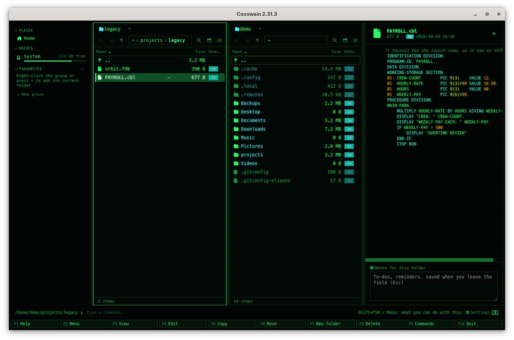

[← README](../../README.md) · [Docs index](../README.md) · [The preview pane](README.md)

# Text and code

Source code, config files, logs and plain text show highlighted in the current theme's colours;
Markdown shows rendered, with Mermaid diagrams and typeset math; a file git sees as changed can
show its diff. Use it to read a file without opening an editor.


*main.rs with **Diff** on, and launch.log with its WARN and ERROR lines coloured.*

## Contents

- [How to use it](#how-to-use-it)
- [Formats](#formats)
  - [Languages](#languages)
  - [Markdown](#markdown)
  - [The git diff](#the-git-diff)
- [What you see](#what-you-see)
- [Settings and config.toml](#settings-and-configtoml)
- [In the terminal app](#in-the-terminal-app)
- [Questions](#questions)

## How to use it

1. Put the cursor on the file and press **Space** or **F3** to open the pane.
2. For Markdown, choose **Rendered** or **Source** at the top right.
3. For a file git shows as changed (a coloured git glyph in the panel), choose **File** or
   **Diff**.
4. **Enter** opens the file in its program, **F4** in your editor.

| Key | Desktop app | Terminal app |
|---|---|---|
| **Space** / **F3** | Shows or hides the pane | **F3** opens the file in the [built-in viewer](../commands/view-and-edit.md#the-built-in-viewer), full screen |
| **F4** | Opens the file in your editor | The same |
| **Enter** | Opens the file in its program | The same |

## Formats

| Files | Preview |
|---|---|
| Source code, config, plain text | Highlighted by [highlight.js](https://highlightjs.org/): all of its 190-odd languages, and five more grammars for what it lacks (COBOL, Zig, Svelte, Terraform/HCL, Solidity). See [Languages](#languages). Colours come from the theme, so every [theme](../customise/themes.md) matches |
| `.log` | Each line coloured by its level: `ERROR`, `FATAL`, `CRITICAL`, `PANIC` red; `WARN` yellow; `INFO`, `NOTICE` green; `DEBUG`, `TRACE`, `VERBOSE` grey |
| Binary files | A hex dump: offset, 16 bytes in hex, and the printable characters |
| Encodings | UTF-8 (with or without a byte order mark), UTF-16 with its byte order mark, and anything else read as Windows-1252 (Latin-1 with Windows's curly quotes, dashes and €), so a file from an old Windows machine keeps its accented letters |
| `.md`, `.markdown` | Rendered by [marked](https://marked.js.org/); ```` ```mermaid ```` blocks drawn as diagrams by [Mermaid](https://mermaid.js.org/); `$…$`, `$$…$$`, `\(…\)` and `\[…\]` typeset by [KaTeX](https://katex.org/) |

A file counts as binary when its first 8 KB hold a zero byte (UTF-16, which has one in nearly
every character, is told apart by its byte order mark). Anything the app has no special
view for is shown as text or hex, so every file has a preview.

### Languages

The language is picked the same way in both apps, by one table in `coxswain-core`
(`code::language`):

1. **The whole name**: `Makefile`, `Dockerfile`, `CMakeLists.txt`, `Gemfile`, `PKGBUILD`,
   `.bashrc`, `.vimrc`, `nginx.conf` …
2. **The extension**. Old ones are known too:

   | Language | Extensions |
   |---|---|
   | COBOL | `.cob` `.cbl` `.cpy` |
   | Fortran | `.f` `.for` `.f77` `.f90` `.f95` `.f03` `.f08` |
   | Pascal and Delphi | `.pas` `.pp` `.dpr` `.dpk` `.lpr` |
   | BASIC, QuickBASIC, Visual Basic | `.bas` `.bi` `.vb` `.vbs` |
   | Assembly (x86, ARM, MIPS) | `.asm` `.nasm` `.s` `.inc` |
   | DOS batch | `.bat` `.cmd` |
   | Modula-2 | `.mod` `.def` (with Pascal's colours: highlight.js has no Modula-2) |
   | Lisp, Scheme | `.lisp` `.lsp` `.cl` `.el`, `.scm` `.ss` `.rkt` |
   | Erlang, Elixir, Haskell, OCaml, F# | `.erl` `.ex` `.exs` `.hs` `.ml` `.fs` `.fsx` |
   | Prolog, Smalltalk, Tcl | `.pro` `.pl`, `.st`, `.tcl` |
   | VHDL, Verilog, SystemVerilog, Coq | `.vhd` `.vhdl`, `.v` `.sv` |
   | AppleScript, AutoHotkey | `.applescript`, `.ahk` |

3. **What the file says**, where two languages share an extension: `.mod` is Modula-2 when it
   holds `MODULE` (a tracker module is binary and shows as hex); `.pro` is Prolog unless it
   reads like a Qt project; `.v` is Coq when it has `Theorem`, `Proof.` or `Require Import`,
   else Verilog; `.s` is ARM, MIPS or x86 assembly by its registers; `.inc` is PHP, Pascal or
   assembly; `.m` Objective-C or MATLAB; `.pl` Perl or Prolog; `.pp` Pascal or Puppet; `.fs`
   F# or a GLSL shader; `.bas` line-numbered BASIC or Visual Basic.
4. **The first line**: `#!/usr/bin/env python3`, `#!/bin/sh`, `<?php`, `<?xml`.

A file none of these name is guessed by highlight.js among its common languages (about 36),
so a guess stays quick. Only the grammar a file needs is loaded, the
first time it is needed, so the app starts as fast as before.

No grammar with a licence we may ship exists for REXX, PL/I (both GPL-3.0) or Clipper and
dBase (`.prg`), so those show plain or guessed.

The search store reads the code endings above as code too (its passages keep their lines and
are cut at items, [Search by meaning](../search/meaning.md)). A store from before this version
reads the files with these endings again, once, and only those.

### Markdown

The rendered view is the default; **Source** shows the Markdown itself, highlighted. Math is
typeset only when the file holds a `$`, `\(` or `\[`, so plain notes load quickly. A mistake in
a formula shows the formula in red instead of stopping the page. A Mermaid block that does not
parse shows Mermaid's error in its place. The diagrams take the theme's colours: green in
Cyber, grey in Windows 95. The whole result is cleaned by DOMPurify, so no script in a
Markdown file runs ([Safety](safety.md)).

### The git diff

**Diff** shows `git diff HEAD` for the file: staged and unstaged changes together, added lines
green, removed lines red. It is offered for files that are modified, staged, renamed, deleted
or conflicted, not for untracked or ignored ones. A file whose changes cancel out shows
*(no changes against HEAD)*. See [Git in the panels](../panels/git.md).

## What you see

- The text, with the language's colours, in the pane's monospace font.
- Under a file larger than 512 KB: *Showing the first 512 KB*.
- Files under 200 KB are highlighted; larger ones stay plain, so scrolling stays smooth.


- A hex dump in place of text for binary files: its first 64 KB (*Showing the first 64 KB*).

## Settings and config.toml

None of its own. The colours follow the [theme](../customise/themes.md); the monospace font is
`[gui] mono_font` ([Glyphs and fonts](../customise/glyphs-and-fonts.md)). **Rendered / Source**
and **File / Diff** are remembered in the session, not in `config.toml`.

## In the terminal app

There is no preview pane, because the terminal draws character cells only. **F3** opens the
file full screen in the [built-in viewer](../commands/view-and-edit.md#the-built-in-viewer),
highlighted in the theme's colours: each kind of token takes the same theme colour as in the
desktop app (keywords the symlink colour, strings the git-added green, comments the hidden
colour, numbers the search-hit colour), from one table in `coxswain-core`
(`view::TOKENS`). Its grammars are [syntect](https://github.com/trishume/syntect)'s and
[two-face](https://codeberg.org/CosmicHarper/two-face)'s (bat's, about 200), picked by the same
table as the desktop app's. It has none for COBOL, BASIC and Visual Basic, PowerShell, Prolog,
Coq, Smalltalk, AutoHotkey and ARM or MIPS assembly, so those show plain there.

It reads a file of any size: a 50 MB log opens at once, and only the lines on the screen are
read. Over 16 MB it shows the text without colours. Binary files show as the same hex dump as in
the desktop app.

Set `viewer` in `config.toml` to use another program on **F3**, as before; **p** in the viewer
hands the file to `$PAGER` (else `less`). **F4** opens it in `$VISUAL` / `$EDITOR` (or
`editor`, else the [built-in editor](../commands/editor.md)), and **Shift+F4** always in the
built-in one. For a diff, type `git diff HEAD -- file` on the command line.
See [View and edit](../commands/view-and-edit.md).

## Questions

#### Space types a space in the command line instead of opening the preview.

When the command line has text, **Space** belongs to it. Press **Esc** to clear the line, or
use **F3**, which always toggles the pane.

#### Why is a large file shown without colours?

Highlighting a file over 200 KB would make scrolling slow, so it stays plain. Over 512 KB, only
the first 512 KB is read at all (*Showing the first 512 KB*); a hex dump stops after 64 KB.
Press **F4** to see all of it in your editor.

#### Why is my text file shown as a hex dump?

Its first 8 KB contain a zero byte, which is how the pane tells binary from text. A UTF-16 file
is read as text only when it starts with its byte order mark; one without shows as hex.

#### Why do pictures in my Markdown not show?

A picture given by a path next to the file (``) is not found: the Markdown
preview does not resolve relative paths. A picture from the web (``) is loaded
by the webview, as a browser would.

#### Why is there no Diff button on a new file?

Git has no earlier version of an untracked file to compare against. Once you `git add` it,
**Diff** appears and shows the whole file as added.

#### Which languages are highlighted?

About 200, old ones too: COBOL, Fortran, Pascal, BASIC, assembly, VHDL and Verilog among them
([Languages](#languages)). The terminal app's viewer has no grammar for a few (COBOL,
PowerShell, Visual Basic, Prolog) and shows those plain. Where two languages share an ending
(`.mod`, `.pro`, `.v`), the file's text decides.

#### The language is guessed wrong.

The name and the extension decide, then the first line (`#!…`); a file none of them name is
guessed by highlight.js from its content, which can miss on short files. Give the file its
usual extension, or a `#!` line for a script.

#### My `.mod` file shows as hex, not Modula-2.

It holds a zero byte in its first 8 KB, so it is binary: most likely a tracker music module
(`M.K.` at byte 1080). A Modula-2 `.mod` is text and is highlighted.

#### Can I choose Source by default?

Yes: press **Source** once. The choice sticks for every Markdown, HTML, diagram and data file
until you press **Rendered** (or **Tree**, **Table**) again, also after a restart.

---
[← Previous: The preview pane](README.md) · [Next: Documents →](documents.md)
