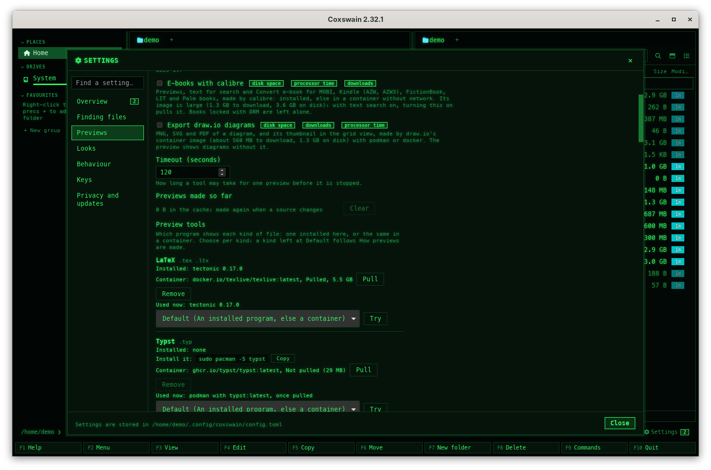
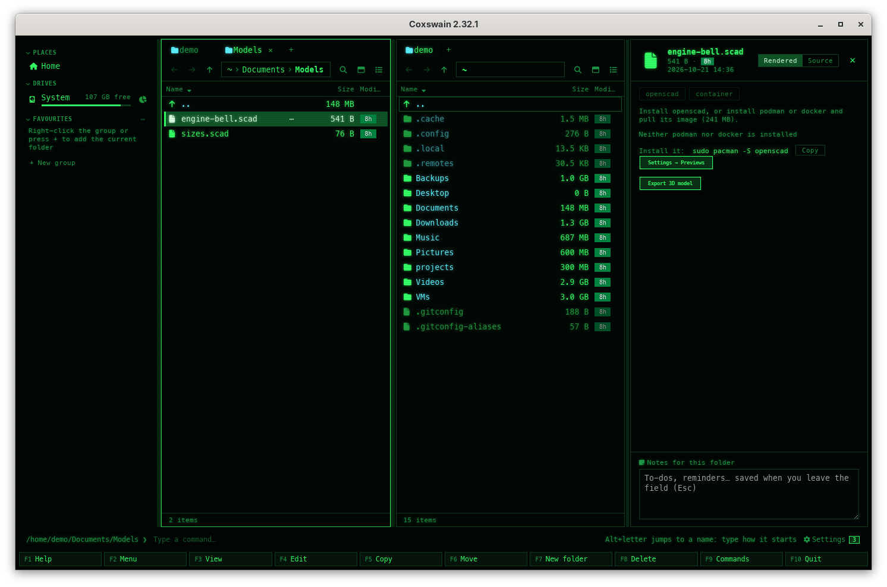

[← README](../../README.md) · [Docs index](../README.md) · [The preview pane](README.md)

# Previews made by tools

Some formats need a real program: a TeX distribution, Typst, LibreOffice, Ghostscript, PlantUML,
D2 and the other diagram programs, pandoc, DuckDB, ffmpeg, ImageMagick, GDAL, OpenSCAD, KiCad, and
calibre for [e-books](ebooks.md) when turned on.
Coxswain uses one that is installed, or runs it in a [container](containers.md) (podman or
docker), so nothing has to be installed for a preview you only need now and then. Results are
kept in a cache, so each file is made once.


*The engine buttons at the top of a tool preview: here the installed `plantuml` is used; the container is greyed, as there is no podman or docker to run it.*


<!-- screenshot: previews-tools-settings.png: desktop app, Cyber theme, Settings open at Previews (the area list on the left with Previews chosen): How previews are made, Container runtime, LaTeX image, Build LaTeX by itself, Timeout (seconds), Previews made so far with its size and Clear, Container images, each with the line that says what it gives, its size and cost, and Pull and Remove, then Keep images up to date and Remove images not used for 90 days -->

## Contents

- [The tools](#the-tools)
- [How to use it](#how-to-use-it)
- [How it works](#how-it-works)
- [The preview cache](#the-preview-cache)
- [What you see](#what-you-see)
- [Installing what is missing](#installing-what-is-missing)
- [Settings and config.toml](#settings-and-configtoml)
- [In the terminal app](#in-the-terminal-app)
- [Questions](#questions)

## The tools

| Files | Tool | Installed programs it looks for | Container image (default) | Result | Runs by itself |
|---|---|---|---|---|---|
| `.tex`, `.ltx` | LaTeX ([LaTeX projects](latex.md)) | `latexmk`, `tectonic`, `pdflatex` | `docker.io/texlive/texlive:latest` (about 2.8 GB to download, 5.9 GB on disk) | PDF | After 0.8 s, when `latex_auto` is on |
| `.typ` | Typst ([Documents](documents.md#typst)) | `typst` | `ghcr.io/typst/typst:latest` (about 29 MB to download, 65 MB on disk) | PDF | At once |
| `.doc` `.docm` `.dot` `.dotx` `.odt` `.ott` `.rtf` `.wri` `.ppt` `.pptx` `.pps` `.ppsx` `.pot` `.potx` `.odp` `.otp` `.odg` `.vsd` `.vsdx` `.pub` `.wpd` `.wps` `.wk1` `.wks` `.123` `.lwp` `.sxw` `.sxc` `.sxi` `.sxd` `.abw` `.cwk` `.pages` `.key` `.numbers` `.fodt` `.fods` `.fodp` `.fodg` `.cdr` `.pmd` `.wmf` `.emf` | LibreOffice ([Office](office.md)) | `soffice`, `libreoffice` (also its usual macOS and Windows install folders) | `docker.io/gotenberg/gotenberg:8-libreoffice` (about 440 MB to download, 1 GB on disk) | PDF | After 0.6 s |
| `.ps`, `.eps` | Ghostscript ([Documents](documents.md#postscript-and-xps)) | `gs`, `gswin64c` | `docker.io/jbarlow83/ocrmypdf-alpine:latest` (about 310 MB, 850 MB on disk; shared with [Make PDF searchable](../files/searchable-pdf.md)) | PDF | At once |
| `.xps`, `.oxps` | GhostXPS ([Documents](documents.md#postscript-and-xps)) | `gxps` | none; set one you trust | PDF | At once |
| `.puml`, `.plantuml`, `.pu`, `.iuml`, `.wsd` | PlantUML ([Diagrams](diagrams.md)) | `plantuml` | `docker.io/plantuml/plantuml:latest` | SVG | At once |
| `.d2` `.ditaa` `.bob` `.svgbob` `.pikchr` `.nomnoml` `.noml` `.wavedrom` `.vg` `.vega` `.vl` `.vegalite` `.dbml` `.er` `.erd` `.bytefield` | Kroki's programs ([Diagrams](diagrams.md#d2-ditaa-svgbob-and-the-others)) | `d2`, `svgbob`, `pikchr`, `erd` for theirs; none for the others | `docker.io/yuzutech/kroki:latest` (about 1.2 GB to download, 2.8 GB on disk) | SVG | At once |
| `.rst`, `.rest` | pandoc ([Documents](documents.md)) | `pandoc` | `docker.io/pandoc/core:latest` | HTML | At once |
| `.duckdb`, `.ddb` | DuckDB ([Data](data.md)) | `duckdb` | none; set one you trust | Tables, row estimates, column counts | At once |
| `.avi` `.wmv` `.mpg` and the other videos the player cannot play, and every video's thumbnail and poster | ffmpeg ([Media](media.md#video-and-sound-with-ffmpeg)) | `ffmpeg` | `docker.io/mwader/static-ffmpeg:latest` (about 126 MB to download, 315 MB on disk) | PNG of a frame | At once |
| `.wma` `.ape` `.ac3` and the other sound the player cannot play, and the waveform above a player | ffmpeg (`waveform`) | `ffmpeg` | The same | PNG of the waveform | At once |
| `.heic`, `.heif` | ImageMagick or ffmpeg (`heif`, [Media](media.md#photos-only-imagemagick-or-ffmpeg-reads)) | `magick`, `ffmpeg` | ffmpeg's | PNG | At once |
| `.xcf` `.dpx` `.cin` `.fits` `.sgi` `.sun` `.xwd` `.pict` `.miff` `.wbmp` | ImageMagick (`imagemagick`) | `magick` | `docker.io/dstmodders/imagemagick:latest` (about 60 MB to download, 152 MB on disk), first once pulled | PNG | At once |
| `.dng` `.cr2` `.nef` `.arw` and other RAW photos | ImageMagick with LibRaw (`raw`) | `magick` | none: no image reads RAW | PNG | At once |
| `.gpkg` `.shp` `.geojson` `.kml`, and GeoTIFF the picture reader cannot draw | GDAL (`gdal`, [Geodata](geodata.md)) | `gdalinfo` (and `ogrinfo`, `ogr2ogr`, `gdal_translate` beside it) | `ghcr.io/osgeo/gdal:alpine-small-3.13.3`, pinned (about 40 MB to download, 98 MB on disk) | SVG map | At once |
| `.scad` | OpenSCAD (`openscad`, [OpenSCAD models](openscad.md)) | `openscad` | `docker.io/openscad/openscad:trixie.2026-10-19`, pinned (about 241 MB to download, 635 MB on disk) | A picture of the part (an SVG outline of a flat model) | At once |
| `.mobi` `.azw` `.azw3` `.fb2` `.lit` | calibre ([E-books](ebooks.md), only with *E-books with calibre* on) | `ebook-convert`, `ebook-meta` | `docker.io/linuxserver/calibre:9.16.0`, pinned by its digest (about 1.3 GB to download, 3.6 GB on disk) | Cover, title, authors and first chapter | After 0.4 s |
| `.kicad_sch`, `.kicad_pcb` | KiCad (`kicad`; `kicad_thumb` for thumbnails, [KiCad](kicad.md)) | `kicad-cli` | `docker.io/kicad/kicad:9.0.9`, pinned (about 476 MB to download, 1.7 GB on disk; amd64 only) | PDF of the sheets or layers | At once |

"Runs by itself" never includes a container whose image is not pulled yet: a download waits for
your click.

## How to use it

1. Put the cursor on the file and open the pane with **Space** or **F3**.
2. It renders by itself (see the table), or shows a button: **Build PDF**, **Render** or
   **Read tables**. Press it.
3. To use another engine, click its button at the top; that renders again with it, and the pick
   is remembered for the tool (in the session).
4. To change what is preferred, or the container runtime, open *Settings → Previews*
   (**Ctrl+,**).

| Key | Desktop app | Terminal app |
|---|---|---|
| **Space** / **F3** | Shows or hides the pane | – |
| **Ctrl+,** | Settings | **F12**: the same *Previews* area, which sets the desktop app's previews |

## How it works

1. **The engines.** The buttons list the installed programs (one per real program:
   `libreoffice` is usually a link to `soffice`, so only one shows) and the container, labelled
   by runtime and image, e.g. **podman texlive:latest**. When none of the programs is
   installed, the first is shown greyed out; hover it for the reason (*tectonic is not
   installed*). The container is greyed with *No image for duckdb: set [preview.images] duckdb
   in the config* or *Neither podman nor docker is installed*.
2. **The default.** Without a pick of yours, the first available engine is used, in the order
   `prefer` gives: `auto` puts installed programs first and the container last (ImageMagick:
   its container first once its image is pulled, as it reads files from anywhere); `local`
   never defaults to a container; `container` puts it first.
3. **Waiting a moment.** A tool starts only once the file has stayed under the cursor for a
   moment, so moving through a folder does not start one per file.
4. **Running.** The preview says *Rendering with latexmk…*. Programs run in the file's folder;
   containers as described in [Containers](containers.md). Every program is started without
   the AppImage's own libraries, so an installed LibreOffice or LaTeX works from the AppImage
   too.
5. **Errors** show in the preview in red, with **Try again**. A run longer than the timeout is
   stopped: *Stopped after 120 s (the timeout in [preview])*. A tool that ends without a file
   says *The tool finished without producing a result.*

## The preview cache

Results go to the cache folder (`~/.cache/coxswain/previews` on Linux, `~/Library/Caches/coxswain/previews`
on macOS, `%LOCALAPPDATA%\coxswain\previews` on Windows), in a folder named after a hash of the
file's path, size and modification time, the tool and the engine; for LaTeX also the newest
change in the document's folder. So:

- A file renders once and shows at once afterwards, also after a restart.
- Editing it makes the next render fresh; the old result is simply no longer used.
- Each engine has its own result, so switching back and forth costs nothing after the first run.

*Settings → Previews → Previews made so far* shows how much room they take
(*84.2 MB in the cache; made again when a source changes*). **Clear** empties the cache (it is
greyed when the cache is empty); every preview is then made again when next shown. See [Where
things are kept](../reference/where-things-are-kept.md).

## What you see

| Line or button | Means |
|---|---|
| **Build PDF** / **Render** / **Read tables** | Waiting for a click; the engine's note is under it |
| *Runs docker.io/pandoc/core:latest without network access* | The container's image is here |
| *First run pulls docker.io/texlive/texlive:latest (about 2.8 GB)* | The first click downloads the image |
| *Rendering with soffice…* | Running |
| *Pulling docker.io/texlive/texlive:latest…* and a progress line | Downloading the image |
| *soffice is not installed. Neither podman nor docker is installed. Install the program, or let a container make this preview.*, then *Install it:* with the line for this system and **Copy**, and a **Settings → Previews** button | No engine can run: neither an installed program nor a container ([below](#installing-what-is-missing)) |
| *container: Neither podman nor docker is installed. …*, then *ditaa has no program of its own here: install podman or docker, and Kroki's image draws it.* and **Settings → Previews** | A diagram kind only Kroki's image draws, and no container can run |
| *Stopped after 120 s (the timeout in [preview])* | Too slow |
| **Try again** | After an error |

## Installing what is missing

When neither an installed program nor a container can make a preview, the pane says what is
missing, then *Install the program, or let a container make this preview.* Under it is the
command that installs the program on this system, with **Copy**, and a **Settings → Previews**
button that opens *Settings → Previews* to choose a container runtime or an image; with
*Container runtime → No containers* it opens Settings at that option. Coxswain never
runs the command: paste it into a shell, then show the file again.



The package manager is the system's own: `pkg` on FreeBSD, `pkgin` on NetBSD, `pkg_add` on
OpenBSD, `pkg` on illumos, on Linux the first of `pacman`, `apt`, `dnf` and `zypper` that is
installed, Homebrew on a Mac and `winget` on Windows.

| System | LibreOffice | LaTeX | Typst | Ghostscript | PlantUML | pandoc |
|---|---|---|---|---|---|---|
| FreeBSD | `pkg install libreoffice` | `pkg install texlive-full` | `pkg install typst` | `pkg install ghostscript10` | `pkg install plantuml` | `pkg install hs-pandoc` |
| NetBSD (`pkgin`) | `pkgin install libreoffice` | none | `pkgin install typst` | `pkgin install ghostscript-agpl` | none | `pkgin install pandoc-cli` |
| OpenBSD (`pkg_add`) | `pkg_add libreoffice` | `pkg_add texlive_texmf-full` | `pkg_add typst` | `pkg_add ghostscript` | none | `pkg_add pandoc` |
| illumos (`pkg`) | none | `pkg install ooce/application/texlive` | none | none | none | none |
| Arch (`pacman`) | `sudo pacman -S libreoffice-fresh` | `sudo pacman -S texlive-basic texlive-latexextra texlive-binextra` | `sudo pacman -S typst` | `sudo pacman -S ghostscript` | `sudo pacman -S plantuml` | `sudo pacman -S pandoc-cli` |
| Debian, Ubuntu (`apt`) | `sudo apt install libreoffice` | `sudo apt install texlive-latex-extra latexmk` | none | `sudo apt install ghostscript` | `sudo apt install plantuml` | `sudo apt install pandoc` |
| Fedora (`dnf`) | `sudo dnf install libreoffice` | `sudo dnf install texlive-scheme-medium latexmk` | `sudo dnf install typst` | `sudo dnf install ghostscript` | `sudo dnf install plantuml` | `sudo dnf install pandoc` |
| openSUSE (`zypper`) | `sudo zypper install libreoffice` | `sudo zypper install texlive-latexmk texlive-collection-latexextra` | `sudo zypper install typst` | `sudo zypper install ghostscript` | `sudo zypper install plantuml` | `sudo zypper install pandoc` |
| macOS (Homebrew) | `brew install --cask libreoffice` | `brew install --cask mactex-no-gui` | `brew install typst` | `brew install ghostscript` | `brew install plantuml` | `brew install pandoc` |
| Windows (`winget`) | `winget install --id TheDocumentFoundation.LibreOffice -e` | `winget install --id MiKTeX.MiKTeX -e` | `winget install --id Typst.Typst -e` | `winget install --id ArtifexSoftware.GhostScript -e` | none | `winget install --id JohnMacFarlane.Pandoc -e` |

D2, svgbob, Pikchr and erd come from their own projects' releases (`brew install d2`, `cargo
install svgbob_cli`, …): Coxswain has no line for them. Where the table says *none*, and for
DuckDB and GhostXPS everywhere, the pane says instead: *plantuml has no
package here: get it from its website and put it on PATH.* The programs Coxswain reads with (for
search: tesseract, pdftoppm, LibreOffice) have their own table in
[Scans, pictures and older Office files](../search/scans.md#installing-what-is-missing), and
calibre its lines in [E-books](ebooks.md#what-it-needs).

## Settings and config.toml

```toml
[preview]
prefer = "auto"          # "auto" (installed program first, else container), "local", "container"
container = "auto"       # "auto" (podman, else docker), "podman", "docker", "off"
timeout = 120            # seconds per conversion; pulling is not counted
latex_auto = true        # build LaTeX by itself when shown and changed
image_updates = "off"    # "weekly", "monthly": the desktop app pulls the pulled images again
image_prune = false      # remove an image no preview used for 90 days
ebooks = false           # e-books through calibre: previews, search, Convert e-book

[preview.prefer_tool]    # per tool, overrides prefer
libreoffice = "local"

[preview.images]         # "" means that tool never uses a container
latex = "docker.io/texlive/texlive:latest"   # or :latest-medium, about 960 MB to download
plantuml = "docker.io/plantuml/plantuml:latest"
pandoc = "docker.io/pandoc/core:latest"
libreoffice = "docker.io/gotenberg/gotenberg:8-libreoffice"
kroki = "docker.io/yuzutech/kroki:latest"   # D2, ditaa, svgbob and the other diagram kinds
typst = "ghcr.io/typst/typst:latest"
ghostscript = "docker.io/jbarlow83/ocrmypdf-alpine:latest"
ocrmypdf = "docker.io/jbarlow83/ocrmypdf-alpine:latest"   # Make PDF searchable
duckdb = ""
gxps = ""
ffmpeg = "docker.io/mwader/static-ffmpeg:latest"          # video, sound, HEIC
imagemagick = "docker.io/dstmodders/imagemagick:latest"  # GIMP and other pictures, conversions
gdal = "ghcr.io/osgeo/gdal:alpine-small-3.13.3@sha256:58e21a794e3e49c2882a078cf39625aa8d1f86188e0273f74156e9f3f3cd0253"  # geodata
openscad = "docker.io/openscad/openscad:trixie.2026-10-19@sha256:bbed39fad63b66f26113d82e2b39ce1e14b2568378426fb2cdfeb41e34d7837b"  # models
calibre = "docker.io/linuxserver/calibre:9.16.0@sha256:…"   # e-books
kicad = "docker.io/kicad/kicad:9.0.9@sha256:e638b79b0321f29395a5b783e94bb9f3c73303e8da15da27b8f5cb4b67a37729"  # schematics, boards
tika = "docker.io/apache/tika:4.1.0@sha256:06bcdbd09aca073293e5a171ad161418cc93c91d58d9e4e205064eade84889d4"  # Read other formats with Apache Tika
whisper = "ghcr.io/ggml-org/whisper.cpp:main@sha256:b3a5ce497d31f8eef2f8d6a123f834d4217150d2dd2a391f37a6881f725036af"  # Transcribe speech, when no whisper.cpp is installed
```

| Settings → Previews | config.toml | Choices, default |
|---|---|---|
| *How previews are made* | `prefer` | *An installed program, else a container* (`auto`, default), *Installed programs only* (`local`), *Containers, even when a program is installed* (`container`) |
| *Container runtime* | `container` | *podman, else docker* (`auto`, default), podman, docker, *No containers* (`off`) |
| *LaTeX image* | `images.latex` | `docker.io/texlive/texlive:latest` |
| *Build LaTeX by itself* | `latex_auto` | on |
| *E-books with calibre* | `ebooks` | off ([E-books](ebooks.md)) |
| *Timeout (seconds)* | `timeout` | 10 to 3600, `120` |
| *Previews made so far* | – | The cache size, **Clear** |
| *Container images* | `images.*` | Each image with what it gives, its size and cost, **Pull** and **Remove** ([Containers](containers.md)) |
| *Keep images up to date* | `image_updates` | *Off* (`off`, default), *Weekly* (`weekly`), *Monthly* (`monthly`) ([Containers](containers.md#keeping-images-up-to-date)) |
| *Remove images not used for 90 days* | `image_prune` | off ([Containers](containers.md#removing-unused-images)) |

Setting one image keeps the others' defaults. `prefer_tool` and the other images are set in
`config.toml` only. Every key: [Configuration](../reference/configuration.md#preview).

## In the terminal app

The terminal app has no preview pane, so it makes none of these previews; the `[preview]`
section is mostly the desktop app's. The terminal app's Settings (**F12** → *Previews*) change it all the same, for
the desktop app. Run the
tool yourself on the command line (`latexmk -pdf`, `typst compile`, `soffice --headless
--convert-to pdf`, `gs -dSAFER -sDEVICE=pdfwrite`, `plantuml`, `d2`, `pandoc`, `duckdb`) and
open the result with **Enter**. The tools it does run are OCRmyPDF, for
[Make PDF searchable](../files/searchable-pdf.md) (**Alt+P**), ffmpeg and ImageMagick, for
[Convert video or audio](../files/convert-media.md) and
[Convert or edit pictures](../files/edit-pictures.md), GDAL for
[Convert geodata](geodata.md#convert-geodata), OpenSCAD for
[Export 3D model](openscad.md#export-3d-model), kicad-cli for
[Export from KiCad](kicad.md#export-from-kicad), calibre for [e-books](ebooks.md) (**F3** on a
book, *Convert e-book*), and ffprobe and GDAL for a video's and
geodata's facts in **Properties**, with the same images and preferences; of `[preview]` it
also reads `ebooks`; and the search helper runs Apache Tika's and whisper.cpp's for it when
[Read other formats with Apache Tika](../search/tika.md) or
[Transcribe speech with Whisper](../search/transcripts.md) is on.

## Questions

#### Why does the preview show a button instead of rendering?

Either the tool waits for a click (LaTeX with `latex_auto` off), or the only engine is a
container whose image is not pulled yet. Coxswain never starts a download of gigabytes by
itself. The note under the button says which.

#### The preview says to install a program. Does Coxswain install it?

No. It shows the line for your system (`sudo apt install plantuml`) with **Copy**, and never runs
it. Paste it into a terminal, or click **Settings → Previews** to let a container make the
preview instead. The lines: [Installing what is missing](#installing-what-is-missing).

#### How do I stop using containers?

*Settings → Previews → Container runtime → No containers* (`container = "off"`),
or *Use → Installed programs only* (`prefer = "local"`), which keeps the container as a button
but never as the default.

#### I installed a program, but the button still says it is not installed.

Coxswain looks for it on the `PATH` the app was started with. A desktop session started before
the install may have the old `PATH`; start Coxswain again. On macOS and Windows, LibreOffice is
also found in its usual install folder.

#### How much room do previews take, and can I free it?

*Settings → Previews → Previews made so far* shows the size; **Clear** frees it.
Nothing is lost: previews are made again when shown.

#### Can I use a tool from a container even though it is installed?

Yes: click the container's button (the pick is remembered for that tool), or set
`prefer = "container"`, or per tool `[preview.prefer_tool] latex = "container"`.

#### Why did the timeout not stop the first run?

Pulling an image is not counted: it can be gigabytes. The timeout starts with the run itself.

#### Where is the result? Can I keep the PDF?

In the preview cache ([above](#the-preview-cache)). Copy it from there, or better, build it
yourself; the cache is emptied by **Clear** and its folders are named by hashes.

---
[← Previous: KiCad](kicad.md) · [Next: Containers →](containers.md)
