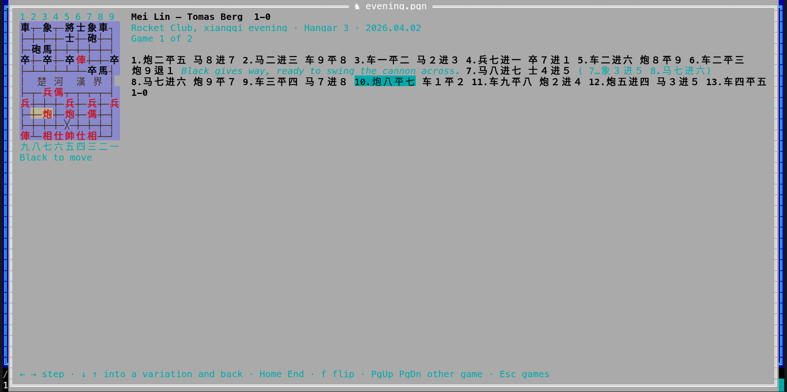

[← README](../../README.md) · [Docs index](../README.md) · [The preview pane](README.md)

# Xiangqi games

**Xiangqi**, Chinese chess, is kept in PGN files like chess: tags in brackets, then the moves.
A PGN file whose tags say `[Game "Chinese Chess"]` (or `[Variant "xiangqi"]`) opens in the same
**table of games** as [chess games](chess.md), and each game on a **xiangqi board**: nine files
and ten ranks of lines, the river across the middle, the palaces with their diagonals, the
pieces as their characters in red and black. It is stepped through move by move, a piece that
is taken goes. Both apps have it. Coxswain only reads: it does not play or check a game.

- [Using it](#using-it)
- [The table of games](#the-table-of-games)
- [A game on the board](#a-game-on-the-board)
- [Notations](#notations)
- [Finding games](#finding-games)
- [Files it reads](#files-it-reads)
- [Questions](#questions)

## Using it

**Desktop app.** Put the cursor on the `.pgn` file and the preview pane (**Space**) shows its
table of games. **⤢** at the top right, **Alt+K** or *Open games* in the action menu
(**Shift+F10**) and the command list (**F9**) open it in a window of its own; **Esc** closes
that window.

**Terminal app.** **F3** or **Alt+K** on the file opens it full screen; so does *Open games* in
the action menu (**Shift+F10**) and **F9**. **Esc** closes it.

It is the same action as for chess, [Go](go.md) and [draughts](draughts.md): the first few
times the cursor rests on a PGN file, the status line says *Alt+K opens its games: a table,
then a board with every move*. Whether the file is chess or xiangqi is told by its first tags
when it is opened. **F1** → *Features* → *Xiangqi (Chinese chess) games* has the keys and the
questions below.

## The table of games

The table is the chess one, without the opening columns:

| Column | What it shows |
|---|---|
| **#** | The game's place in the file |
| **Red**, **Black** and their **Elo** | The players, from the `Red` (or `White`) and `Black` tags, and `WhiteElo`, `BlackElo` when the file has them |
| **Result** | `1-0` (Red won), `0-1`, `½-½` or `*` |
| **Date**, **Event** | From the `Date` and `Event` tags |
| **Moves** | How many full moves the main line has |

**Filtering.** In the desktop app, the fields above the table: *Player*, the result, *From year*
and *To year*, *Rating at least*. In the terminal app: **/** player, **r** cycles the result,
**y** years, **e** rating, **c** clears them all; type, then **Enter**.

**Sorting.** Desktop: a click on a heading sorts by it, a second click reverses. Terminal: **s**
takes the next column, **S** reverses.

**Opening a game.** Desktop: **Enter** or a double-click; in the window (**Alt+K**) the table has
the keys at once, in the preview pane click it first. Terminal: **Enter**.

## A game on the board

Red is at the bottom. The pieces are their characters: Red's 帥 仕 相 傌 俥 炮 兵 in red, Black's
將 士 象 馬 車 砲 卒 in black. The river 楚河 漢界 lies between the fifth and sixth ranks; only
the edge files cross it. The palaces have their diagonals in the desktop app; the terminal app
marks their centres ╳. The files are numbered as each side counts them: Black's 1 to 9 along
the top, Red's 九 to 一 along the bottom, both from that side's right. The points the last move
went from and to are ringed yellow in the desktop app and tinted in the terminal app.

Beside the board: the players and the result, the event, place and date, *Game 2 of 7*, then the
moves as the file writes them, with move numbers, comments in italics and variations in
brackets, the move you are on highlighted. Under the board it says *Red to move* or *Black to
move*.

| Key | Desktop app | Terminal app |
|---|---|---|
| **→** / **←** | Next / previous move (click the board first) | Next / previous move |
| **↓** / **↑** | Into the variations of this move, and back | The same |
| **Home** / **End** | The start position / the last move of the line | The same |
| **f** | Turn the board round (also *Flip*) | The same |
| **PgDn** / **PgUp** | The next / previous game of the table | The same |
| **Esc** | Back to the table (*Games* too) | Back to the table |
| A click on a move | Shows it | – |

The desktop app also has **|◀ ◀ ▶ ▶|** under the board.

A move that cannot be played (no piece of the side to move where it starts, its own piece where
it goes) stops the positions of its line: the moves after it are still listed, and the line
above the board says *… could not be played*. Moves are not checked further: a move the rules
would not allow is played as written.

## Notations

| Notation | Looks like | Read as |
|---|---|---|
| ICCS | `h2e2`, `H2-E2` | From and to: files `a` to `i` from Red's left, ranks `0` to `9` from Red's side |
| WXF | `C2.5`, `H8+7`, `R1-2`, `+C.5` or `C+.5` | Piece (K A E/B H/N R C P), its file as its side counts it, `+` forward, `-` back, `.` or `=` across, then the file it goes to or the ranks it moves; `+`/`-` in place of the file for the front or rear of two on one file |
| Chinese | `炮二平五`, `马８进７`, `前車退一`, `後馬進四` | The same in characters, simplified or traditional: 进/進 forward, 退 back, 平 across, 前 and 后/後 front and rear, Red's numbers in Chinese, Black's in digits |

A game may start from a position of its own: a `FEN` tag, Red in capitals
(`rnbakabnr/9/1c5c1/p1p1p1p1p/9/9/P1P1P1P1P/1C5C1/9/RNBAKABNR w`); `h` and `e` are read as the
horse and the elephant too.

## Finding games

The search store reads xiangqi files with the chess reader: a line per game with the players,
event, place, date and result, so **Find** (**Ctrl+F**) finds a game by a player's name or a
tournament, and a hit opens that game. Nothing is read again for this: a xiangqi file already
in the store keeps its line until it changes; one read from now on has Red's name from the
`Red` tag too.

## Files it reads

| File | What |
|---|---|
| `.pgn` (also `.pgn.gz`, `.pgn.zst`) whose tags say `[Game "Chinese Chess"]`, `[Game "Xiangqi"]` or `[Variant "xiangqi"]` in its first 64 KB | Xiangqi games: tags, moves in ICCS, WXF or Chinese, comments, variations, `!` `?` and `$1` annotations, a `FEN` start |

Binary files (`.xqf`) are not read. What cannot be read is skipped; nothing in a file can stop
the app, and no nesting of variations, however deep, can run it out of stack: variations deeper
than 64 are skipped, and a game is read up to 50,000 moves with its variations.

## Questions

#### Which files does it read?

PGN files whose tags say `Game "Chinese Chess"` or `Variant "xiangqi"`, with moves in ICCS
(`h2e2`), WXF (`C2.5`) or Chinese (`炮二平五`), and a `FEN` tag for a start of their own. See
[Notations](#notations).

#### Why does my xiangqi file open as chess?

Its first tags do not say it is xiangqi. Add `[Game "Chinese Chess"]` to the first game's tags:
Coxswain looks at the first 64 KB of the file.

#### Does it check the moves?

Only that the piece is there and the point is not its own side's: a move is played as written,
and its line stops at one that cannot be. A horse jumping over a blocked leg, or a cannon
taking without a screen, is shown as the file has it.

#### Can I play a game against a program?

Not yet: Coxswain shows xiangqi games but does not play.

---
[← Previous: Draughts games](draughts.md) · [Next: Neural network models →](neural-networks.md)
