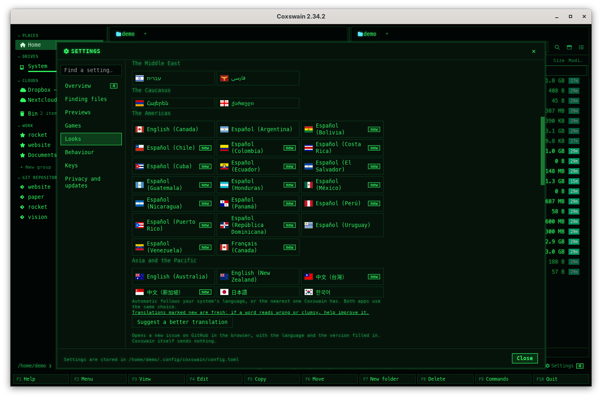

[← README](../../README.md) · [Docs index](../README.md) · [Reference](README.md)

# Configuration: every key

Both apps read one TOML file, `config.toml`. Set only what you want to change; everything else
keeps its default. This page lists every key, with its type, its default, what it does, which
app reads it and which Settings item writes it.


*Settings (**Ctrl+,** or **F12**, in either app) write single values into `config.toml`. The path is shown at the bottom: "Settings are stored in /home/demo/.config/coxswain/config.toml".*

## Contents

- [The file](#the-file)
- [Renamed in 2.0](#renamed-in-20)
- [Top-level keys](#top-level-keys)
- [Glyphs](#glyphs)
- [`[keys]`](#keys)
- [`[themes.<name>]`](#themesname)
- [`[[user_menu]]`](#user_menu)
- [`[search]`](#search)
- [`[preview]`](#preview)
- [`[gui]`](#gui)
- [`[git]`](#git)
- [`[archive]`](#archive)
- [`[chess]`](#chess)
- [What has no key](#what-has-no-key)
- [Settings and config.toml](#settings-and-configtoml)
- [In the terminal app](#in-the-terminal-app)
- [An example](#an-example)
- [Questions](#questions)

## The file

| | |
|---|---|
| Where | `~/.config/coxswain/config.toml` on FreeBSD, the other BSDs, illumos and Linux (`$XDG_CONFIG_HOME/coxswain` when that is set), `~/Library/Application Support/coxswain/config.toml` on macOS, `%APPDATA%\coxswain\config.toml` on Windows. `coxswain --config-path` prints it |
| Every option with its default | `coxswain --dump-config` (redirect it to a file to start from the full list) |
| Made by | You, either app's [Settings](../customise/settings.md), or the `coxswain --meaning` flags ([Command-line flags](command-line-flags.md#--meaning)). Settings and the flags write single values and keep your comments and layout |
| Read by | Each app when it starts, and after each change made in its own Settings, which it applies at once; the [search helper](../search/helper.md) when it starts (`[search]`), which Settings restarts after a change to it. A change made in the other app, or by hand, is read at the next start |

**Mistakes.** A file that is not valid TOML, a value of the wrong type (`show_hidden = "yes"`)
or a key name that does not exist (`"Ctlr+P"`) is refused:

- The terminal app does not start and says why: `coxswain: config: …` or
  `coxswain: unknown key 'Ctlr+P'` (exit status 2).
- A key bound to two actions is refused the same way, naming both:
  `coxswain: F9 is given to both copy and pack in [keys] of config.toml`.
- The desktop app starts with every default and prints `coxswain: config: …; using defaults`
  on the terminal it was started from.
- Settings never write a file that would be refused: a change that would break it is not saved.
- The [search helper](../search/helper.md) reads `[search]` even when the rest of the file is
  refused, so a key bound twice does not make it read the folders you left out.

**An action this version does not know** in `[keys]`, from a newer Coxswain (a config shared
between machines, or a version gone back to) or misspelt, is left out and stays in the file,
and both apps start. A notice names it once: *config.toml gives keys to actions this version
does not know, so they are left out: chess*. In the terminal app it is on the status line, in
the desktop app under *Settings → What's new*.

An unknown top-level or table key (a typo such as `show_hiden = false`) is ignored without a word.

## Renamed in 2.0

Coxswain 2.0 gave a few keys the words the apps use: *mark*, not select; *folder*, not
directory; and the name index's folders the names Settings shows.

| Table | 1.x | 2.0 |
|---|---|---|
| `[keys]` | `select_group` | `mark_group` |
| `[keys]` | `unselect_group` | `unmark_group` |
| `[keys]` | `invert_selection` | `invert_marks` |
| `[keys]` | `mkdir` | `new_folder` |
| `[keys]` | `dir_sizes` | `folder_sizes` |
| `[search]` | `roots` | `name_roots` |
| `[search]` | `exclude` | `name_exclude` |

**What happens on the first start of 2.0.** Both apps rewrite `config.toml` once, before they
read it: each old key gets its new name in the same place, with its value and its comments.
Where the new name is there already, it wins and the old line goes. A notice then lists what
changed: *Coxswain 2.0 renamed keys in config.toml, your comments kept: [keys] mkdir →
new_folder, [search] exclude → name_exclude.* The desktop app shows it under *Settings →
Overview* (**Show me** opens *Keys*), the terminal app once in the status line. A file kept as a link (with your dotfiles)
is rewritten where the link points.

**When the file cannot be written** (read-only, owned by another user), nothing is changed and
the app prints on the terminal it was started from which keys to rename by hand:
`coxswain: config.toml could not be updated for 2.0 (…/config.toml: Permission denied (os error 13)). Rename these keys
yourself: [keys] mkdir → new_folder.` The old names are not read any more: an old action name in
`[keys]` is an action this version does not know, left out with a notice; an old `roots` or
`exclude` in `[search]` is ignored, like any unknown key.

## Top-level keys

| Key | Type | Default | Does | Read by |
|---|---|---|---|---|
| `language` | string | `"auto"` | `"auto"` follows the system; or a code: `en-GB`, `en-AU`, `en-CA`, `en-NZ`, `da`, `sv`, `fi`, `et`, `lv`, `lt`, `de`, `de-AT`, `de-CH`, `fr`, `it`, `nl`, `es-AR`, `ca`, `eu`, `he`, `pl`, `cs`, `uk`, `el`, `fa`, `hy`, `ka`, `ja`, `ko` ([Languages](../customise/languages.md)) | Both |
| `theme` | string | `"nc"` | The terminal app's theme: a built-in name or one of your `[themes.<name>]` ([Themes](../customise/themes.md)). The desktop app's is `[gui] theme` | Terminal |
| `glyphs` | string | `"nerd"` | `"nerd"` for Nerd Font glyphs, `"ascii"` for plain characters | Both |
| `glyph_set` | table | none | Your own glyphs; see [Glyphs](#glyphs). When set, it wins over `glyphs` | Both |
| `show_hidden` | bool | `true` | Show hidden files at start; **Alt+.** switches | Both |
| `folder_sizes` | bool | `true` | Measure folders in the background. The desktop app starts from it, then keeps its own switch ([Folder sizes](../panels/folder-sizes.md)) | Both |
| `editor` | string | none | The program for **F4**. Terminal app: else `$VISUAL`, `$EDITOR`, `vi` (`notepad` on Windows). Desktop app: else the default application ([View and edit](../commands/view-and-edit.md)) | Both |
| `viewer` | string | none | A program for the terminal app's **F3**; unset, the [built-in viewer](../commands/view-and-edit.md#the-built-in-viewer) | Terminal |
| `bom_viewer` | bool | `true` | **F3** on a CycloneDX BOM opens the BOM viewer; `false` opens the built-in viewer ([Cryptography bills of materials](../previews/bom.md)) | Terminal |
| `provenance_viewer` | bool | `true` | **F3** on build provenance opens the provenance viewer; `false` opens the built-in viewer ([Build provenance](../previews/provenance.md)) | Terminal |
| `confirm_delete` | bool | `true` | Ask before moving to the trash, deleting, or taking something out of an archive | Both |
| `right_click` | string | `"mark"` | A right-click on a row: `"mark"` marks it (Norton Commander), `"menu"` opens the [action menu](../panels/action-menu.md); Ctrl+right-click does the other in the desktop app | Both |
| `hints` | bool | `true` | One short hint on the status line that fits what is under the cursor, each shown three times ([Hints](../panels/action-menu.md#hints-on-the-status-line)) | Both |
| `check_updates` | bool | `true` | Look for a newer release when the app starts, then once a day while it is open ([Update checks](updates.md)) | Both |

## Glyphs

`glyphs = "ascii"` swaps the Nerd Font glyphs for plain characters. For a set of your own, give
`[glyph_set]` the glyphs you want; a missing one takes the Nerd Font default:

```toml
[glyph_set]
branch = "git:"
ahead = "^"
behind = "v"
staged = "+"
modified = "~"
untracked = "?"
deleted = "-"
renamed = ">"
conflict = "!"
ignored = "."
stash = "$"
clean = "="
folder = "/"
file = " "
symlink = "@"
cloud = "*"
```

These are the ASCII set. The first twelve are [git](../panels/git.md); `folder`, `file`,
`symlink` and `cloud` (a file only in the cloud, not downloaded) mark entries. More:
[Glyphs and fonts](../customise/glyphs-and-fonts.md).

## `[keys]`

Action → the keys that run it, as a list of strings:

```toml
[keys]
quit = ["F10", "Ctrl+Q"]    # listing an action replaces its default keys
search = ["Ctrl+P"]
tag = []                    # [] unbinds it
```

The key names, the rules (a key bound to two actions is refused, a plain character works only
while the command line is empty, a bound Alt+letter is no longer a quick search …) and every
action with its default keys: [Changing keys](../customise/keys.md) ([key names](../customise/keys.md#key-names),
[rules](../customise/keys.md#rules), [the actions](../customise/keys.md#the-actions)). What
each action does: [Every default key](../panels/keys.md).

Keys inside dialogs (Enter, Esc, Tab and Shift+Tab in Find, the digits in *Colour tag*) are fixed.

## `[themes.<name>]`

Your own colour themes, one table per theme, with a `look`, `crt` (`true` or `false`, default
`false`: the desktop app's tube, scanlines and a glow over any look; the terminal app ignores it,
[The tube](../customise/looks.md#the-tube)) and up to 31 colour slots, each a table with `fg`,
`bg` (a colour name or `#rrggbb`) and `bold`. A slot you leave out keeps the NC theme's colour. A table named like a built-in theme (`[themes.nord]`) replaces that theme
whole: its unset slots then come from NC too, not from the built-in Nord. See
[Your own theme and the colour slots](../customise/own-theme.md).

```toml
[themes.harbour]
look = "modern"
[themes.harbour.panel]
fg = "#e0e0e0"
bg = "#101820"
```

## `[[user_menu]]`

The entries of **F2**, one table each:

| Key | Type | Default | Does |
|---|---|---|---|
| `key` | string | – | The key that picks it in the menu |
| `label` | string | – | What the menu shows |
| `command` | string | – | The shell command; `%f` the file, `%d` the folder, `%s` the marked files (or the file), `%%` a `%`, all shell-quoted |
| `wait` | bool | `false` | Terminal app: wait for Enter afterwards. Desktop app: show the output even when there is none |
| `when` | `"file"` or `"git"` | – | Offer it only with the cursor on a file, or only in a git repository |

Without any entries the menu has *Open a terminal here* (**t**), *SHA-256 of the file* (**h**)
and *git status* (**s**), each with the commands of the system and only where it fits. Your
entries replace all three; **F2**, **+** opens this section in your editor. See
[The user menu](../commands/user-menu.md).

## `[search]`

Read by the [search helper](../search/helper.md) when it starts; Settings and the `--meaning`
flags start a new one.

| Key | Type | Default | Does |
|---|---|---|---|
| `name_roots` | list of paths | `[]` | The folders in the name index (1.x: `roots`). Empty: `/` everywhere but Windows (FreeBSD, the other BSDs, illumos, Linux, macOS), every fixed drive on Windows |
| `name_exclude` | list of strings | `["/proc", "/sys", "/dev", "/run", "/tmp/.X11-unix"]` | Left out of the name index: a path skips that tree, a bare name skips every folder of that name (1.x: `exclude`). On the BSDs `["/proc", "/dev", "/tmp/.X11-unix"]`, on illumos `["/proc", "/dev", "/devices", "/system", "/tmp/.X11-unix"]`: the trees each system's kernel makes up |
| `max_results` | number | `10000` | Most name hits per search (the desktop app shows 500 at most) |
| `watch` | bool | `true` | Follow changes live with the file watcher; `false`: only the hourly rebuild |
| `text` | bool | `true` | Keep the text of files, for Find's *In files* group ([Text in files](../search/text.md)) |
| `text_roots` | list of paths | `[]` | The folders whose files are read. Empty: your home folder ([Choosing the folders](../search/folders.md)) |
| `text_exclude` | list of strings | `["node_modules", "target", "build", "dist", "out", "obj", "vendor", "__pycache__", "Trash"]` | Folder names left out of reading, wherever they are. Hidden folders and folders with a `.nosearch` file always are |
| `names_only` | list of paths | `[]` | Folders found by name and counted in sizes, never read |
| `cloud` | string | `"local-only"` | Files only in OneDrive, Dropbox, Google Drive, Proton Drive, iCloud or a cloud mount: `"local-only"` finds them by name and never reads (downloads) them; `"all"` reads them ([Cloud files](../search/cloud-files.md)) |
| `cloud_read` | list of paths | `[]` | Cloud folders whose online-only files are read anyway |
| `text_max_size` | number (bytes) | `20971520` (20 MB) | Larger files are not read; a PGN file is, up to 4 MB of lines of its games ([Chess games](../previews/chess.md#finding-games)); an SGF file only within this limit ([Go games](../previews/go.md#finding-games)) |
| `archives` | bool | `true` | Look inside the zip, 7z and tar archives in the folders read, less caches and build output: their files are found by name and by their text ([Inside archives](../search/archives.md)) |
| `archives_everywhere` | bool | `false` | Look inside every archive the name index sees, caches and programs' folders too, for their names ([Which archives](../search/archives.md#which-archives)) |
| `meaning` | bool | `false` | Search by meaning ([Search by meaning](../search/meaning.md)) |
| `meaning_engine` | string | `"builtin"` | `"builtin"` (the downloaded model, on this machine: a Mac's GPU through Metal when it can, the CPU elsewhere), `"ollama"` (an Ollama server's `/api/embed`) or `"openai"` (any `/v1/embeddings`: Lemonade, LM Studio, llama.cpp, vLLM) ([on a server](../search/servers.md)) |
| `meaning_url` | string | `""` | The server. Empty for Ollama on this machine (`http://localhost:11434`); for `"openai"` the base URL, for example `http://localhost:8000/api/v1` |
| `meaning_model` | string | `""` | The server's embedding model, for example `bge-m3` (the Ollama suggestion) |
| `meaning_key_env` | string | `""` | The name of the environment variable that holds the server's API key. The key itself is never in this file |
| `meaning_device` | string | `"auto"` | Where the built-in model runs: `"auto"` (a Mac's GPU through Metal when it has one whose results match the CPU's, the CPU elsewhere) or `"cpu"` (the CPU only). Only Macs have a choice ([Search by meaning](../search/meaning.md#on-a-macs-gpu)) |
| `ask_model` | string | `""` | The chat model that answers in [Ask](../search/ask.md), on the server above (Ollama on this machine with the built-in model), e.g. `qwen3:8b`; or a built-in one, `builtin:qwen3-1.7b`, `builtin:qwen3-4b` or `builtin:qwen3-14b` ([Ask without a server](../search/ask-builtin.md)). Empty: Ask is not set up |
| `ask_code_model` | string | `""` | The chat model for questions about code, on the same server, e.g. `qwen3-coder:30b`. Empty: Ask's own ([A model for code questions](../search/ask-code.md#a-model-for-code-questions)) |
| `ask_think` | bool | `false` | Let Ask's chat model think before it answers (Qwen3, DeepSeek-R1 …). Off: it is asked not to, so the first word comes at once ([Thinking](../search/ask.md#thinking)) |
| `ask_context` | number | `8192` (2,048 to 131,072) | The tokens a server's chat model is given: sources, question and answer together. Ollama is asked for this context (`num_ctx`); an OpenAI-style server must be set to at least as much. Not used by the built-in models ([How much it reads](../search/ask.md#how-much-it-reads)) |
| `history` | bool | `true` | Keep the history of the git repositories in the folders read: commit messages, authors and changed paths of the newest 2000 commits of each, found by Find's words in files and by meaning ([History in search](../search/history.md)) |

Changing `meaning_engine` or `meaning_model` makes the helper work out the vectors again,
since vectors of two models cannot be compared.

## `[preview]`

Previews made by tools, in the desktop app ([Previews made by tools](../previews/tools.md),
[Containers](../previews/containers.md), [LaTeX projects](../previews/latex.md)), and the
OCRmyPDF that [Make PDF searchable](../files/searchable-pdf.md) runs in both apps.

| Key | Type | Default | Does |
|---|---|---|---|
| `prefer` | string | `"auto"` | `"auto"`: an installed program first, else a container; `"local"`: installed programs (a container is listed but never the default); `"container"`: containers first |
| `prefer_tool` | table | `{}` | Per tool, overrides `prefer`: `prefer_tool = { latex = "container" }` |
| `container` | string | `"auto"` | `"auto"` (podman, else docker), `"podman"`, `"docker"`, or `"off"` for no containers |
| `images.latex` | string | `"docker.io/texlive/texlive:latest"` | The LaTeX image (about 2.8 GB to download, 5.9 GB on disk; `:latest-medium` about 960 MB and 2.2 GB) |
| `images.plantuml` | string | `"docker.io/plantuml/plantuml:latest"` | The PlantUML image |
| `images.pandoc` | string | `"docker.io/pandoc/core:latest"` | The pandoc image, for reStructuredText |
| `images.libreoffice` | string | `"docker.io/gotenberg/gotenberg:8-libreoffice"` | Gotenberg's LibreOffice image (about 440 MB to download, 1 GB on disk); one you set must have `soffice` |
| `images.kroki` | string | `"docker.io/yuzutech/kroki:latest"` | Kroki's image, for D2, ditaa, svgbob, Pikchr, nomnoml, WaveDrom, Vega, Vega-Lite, DBML, erd and bytefield (about 1.2 GB, 2.8 GB on disk) |
| `images.typst` | string | `"ghcr.io/typst/typst:latest"` | Typst's image (about 29 MB, 65 MB on disk) |
| `images.ghostscript` | string | `"docker.io/jbarlow83/ocrmypdf-alpine:latest"` | For PostScript; OCRmyPDF's image, which has Ghostscript (`gs` is run as its entry point) |
| `images.ocrmypdf` | string | `"docker.io/jbarlow83/ocrmypdf-alpine:latest"` | For Make PDF searchable, in both apps (about 310 MB, 850 MB on disk); its entry point must be `ocrmypdf` |
| `images.duckdb` | string | `""` | No official image; set one whose entry point is `duckdb` |
| `images.gxps` | string | `""` | No image has GhostXPS; set one with `gxps` for XPS files |
| `timeout` | number (seconds) | `120` | Seconds before a conversion is stopped; pulling an image is not counted |
| `latex_auto` | bool | `true` | Build a LaTeX document by itself when it is shown and its sources have changed |
| `image_updates` | string | `"off"` | `"weekly"` or `"monthly"`: the desktop app pulls the images already pulled again in the background (never on battery) and removes each replaced copy by its id ([Keeping images up to date](../previews/containers.md#keeping-images-up-to-date)) |
| `image_prune` | bool | `false` | The desktop app removes an image of `images` that no preview or Make PDF searchable used for 90 days ([Removing unused images](../previews/containers.md#removing-unused-images)) |

An empty image means that tool never runs in a container. Setting one image keeps the others'
defaults. The tool names, for `prefer_tool`, are `latex`, `typst`, `libreoffice`, `ghostscript`,
`gxps`, `plantuml`, `pandoc`, `duckdb`, `ocrmypdf` and each diagram kind of Kroki's image (`d2`,
`ditaa`, `svgbob`, `pikchr`, `nomnoml`, `wavedrom`, `vega`, `vegalite`, `dbml`, `erd`,
`bytefield`), which share `images.kroki`.

## `[gui]`

The desktop app's own settings.

| Key | Type | Default | Does |
|---|---|---|---|
| `theme` | string | `"cyber"` | The desktop app's theme |
| `font` | string | `"Inter, 'Segoe UI Variable', 'Segoe UI', system-ui, -apple-system, 'Noto Sans', sans-serif"` | The interface font, as a CSS font list. Cyber and the Windows and Mac themes bring their own |
| `icon_font` | string | `"'Symbols Nerd Font Mono', 'JetBrainsMono Nerd Font', 'MesloLGS Nerd Font', 'MesloLGM Nerd Font Mono', 'FiraCode Nerd Font', 'CaskaydiaCove Nerd Font', 'Hack Nerd Font', monospace"` | The Nerd Font for icons and git glyphs: the first installed one is used |
| `mono_font` | string | `"'JetBrains Mono', 'Cascadia Code', 'MesloLGS Nerd Font', Menlo, Consolas, monospace"` | Code, the command line, and everything in Cyber and NC |
| `font_size` | number | `13` | Text size in pixels (Settings allows 9 to 28) |
| `line_height` | number | `1.9` | Row height, as a multiple of the font size (Settings allows 1.2 to 3) |

## `[git]`

Read by both apps when they start, and by each after a change in its own Settings.

| Key | Type | Default | Does |
|---|---|---|---|
| `last_commit` | bool | `true` | Last commit of each file: the *Last commit* column and the preview pane in the desktop app, the info line in the terminal app ([Git in the panels](../panels/git.md#last-commit-per-file)) |
| `tool` | string | `""` | Where *Open in your git tool* (**Alt+G**) goes: a tool's name as Settings lists it (`"lazygit"`, `"Sublime Merge"`) or a command, `%d` being the repository's folder. Empty: the first installed of lazygit, gitui, tig and the desktop clients, else a terminal ([Open in your git tool](../panels/git.md#open-in-your-git-tool)) |

The [git history](../panels/git-history.md) itself has no switch: it is there when you press
**Ctrl+G** (`history` in `[keys]`).

## `[archive]`

Read by both apps when they start, and by each after a change in its own Settings.

| Key | Type | Default | Does |
|---|---|---|---|
| `disk_images` | bool | `false` | Open disk images (.iso, .dmg, .vhd, .vhdx, .vmdk, .qcow2, .vdi, .wim, raw .img), .chm help files and .cbr comics like folders, read-only, with an installed 7-Zip. Off: **Enter** opens them like any file; the preview shows a disk image's facts either way ([Disk images](../files/disk-images.md)) |

## `[chess]`

How [chess games](../previews/chess.md) and [Go games](../previews/go.md) are shown, in both apps.

| Key | Type | Default | Does |
|---|---|---|---|
| `notation` | string | `"figurines"` | `"figurines"` writes moves as ♘f3; `"letters"` in the piece letters of the app's language (Nf3 in English, Sf3 in German). The files keep English SAN |
| `board` | string | `"theme"` | The squares' colours: `"theme"` from the theme, `"green"` or `"brown"` for a tournament board; the wood of [Go boards](../previews/go.md) too |
| `book` | string | `""` | A Polyglot opening book (`.bin`) whose moves the board shows for each position (`~` is the home folder, a relative path starts from the game file's folder). Empty, or not a book: the first book in the game file's own folder ([Opening books](../previews/chess.md#opening-books)) |

## What has no key

Some choices are not in `config.toml`, and that is on purpose:

| Choice | Where it lives |
|---|---|
| The LaTeX engine (XeLaTeX, LuaLaTeX, pdfLaTeX) | Picked per document: a `% !TEX program = …` line, else by the packages it loads. The engine button you last pressed in the preview (installed or a container) is remembered in the session in `state.json`. `prefer_tool = { latex = … }` sets which kind comes first ([LaTeX projects](../previews/latex.md)) |
| Archives and their passwords | Nothing to set. Passwords are kept in memory until the app quits and never written anywhere ([Passwords](../files/archive-passwords.md)) |
| Notices you dismissed | `state.json`, `notices_dismissed` ([Notices](../panels/notices.md)) |
| The session, favourites, tags, notes | `state.json` ([What the apps remember](../panels/session.md)) |
| Starting the helper with your session | The system's own registration: `coxswain --index-service on` ([The search helper](../search/helper.md)) |

## Settings and config.toml

Each Settings item, the name `--settings=` opens it at (in both apps: `coxswain --settings=…`,
`coxswain-gui --settings=…`) and the key it writes, area by area ([The Settings window](../customise/settings.md)).
An area's own name opens it too: `overview`, `search`, `previews`, `looks`, `behaviour`, `keys`,
`privacy`; `models` and `disk` open *Built-in models* and *Disk use*:

| Settings area | Item | `--settings=` | Key |
|---|---|---|---|
| *Finding files* | *How far should Find look?*: the four levels | `search` | `[search] text`, `meaning`, `ask_model` (a level that needs a model opens the setup guide) |
| *Finding files → Details → What is read* | *Words inside files* | `search_text` | `[search] text` |
| | *Look inside archives* | `search_archives` | `[search] archives` |
| | *Archives everywhere* | `search_archives_everywhere` | `[search] archives_everywhere` |
| | *Git history* | `search_history` | `[search] history` |
| | *Read files that are only online* | `search_cloud` | `[search] cloud` |
| | *Cloud folders read anyway* | `cloud_read` | `[search] cloud_read` |
| | *Largest file read (MB)* | `text_max_size` | `[search] text_max_size` |
| | *Most hits* | `max_results` | `[search] max_results` |
| | *Programs that read more* |  | none: each missing program with the line that installs it and **Copy** ([Scans and pictures](../search/scans.md#installing-what-is-missing)) |
| *Finding files → Details → Folders* | *Folders read* | `text_roots` | `[search] text_roots` |
| | *Names only* | `names_only` | `[search] names_only` |
| | *Left out everywhere* | `text_exclude` | `[search] text_exclude` |
| | *Where names are found* | `name_roots` | `[search] name_roots` |
| | *Never indexed* | `name_exclude` | `[search] name_exclude` |
| | *Follow changes as they happen* | `watch` | `[search] watch` |
| *Finding files → Details → Meaning* | *Turn on*, *Turn off*, *Download the model and turn on* | `search_meaning` | `[search] meaning` |
| | *Made by* | `meaning_engine` | `[search] meaning_engine` |
| | *Server*, *Model*, *API key from the environment variable* | `meaning_url`, `meaning_model`, `meaning_key_env` | `[search] meaning_url`, `meaning_model`, `meaning_key_env` |
| | *Use the CPU only* (on a Mac) | `meaning_device` | `[search] meaning_device` |
| *Finding files → Details → Ask* | *Chat model* | `ask_model` | `[search] ask_model` |
| | *Model for code questions* | `ask_code_model` | `[search] ask_code_model` |
| | *Let the model think first* | `ask_think` | `[search] ask_think` |
| | *Context for a server's model (tokens)* | `ask_context` | `[search] ask_context` |
| *Finding files → Details → Background reading* | *Start with my session* | | none: the session registration |
| *Previews* | *How previews are made* | `preview_prefer` | `[preview] prefer` |
| | *Container runtime* | `preview_container` | `[preview] container` |
| | *LaTeX image* | `latex_image` | `[preview] images.latex` |
| | *Build LaTeX by itself* | `latex_auto` | `[preview] latex_auto` |
| | *Keep images up to date* | `image_updates` | `[preview] image_updates` |
| | *Remove images not used for 90 days* | `image_prune` | `[preview] image_prune` |
| | *Timeout (seconds)* | `preview_timeout` | `[preview] timeout` |
| | *Move notation* | `chess_notation` | `[chess] notation` |
| | *Chess board* | `chess_board` | `[chess] board` |
| | *Opening book* | `chess_book` | `[chess] book` |
| *Looks* | *Language* | `language` | `language` |
| | *Theme of the desktop app* (*For*: *Desktop app*) | `theme` | `[gui] theme` |
| | *Theme of the terminal app* (*For*: *Terminal app*) | `tui_theme` | `theme` |
| | *Icons and git glyphs* | `glyphs` | `glyphs` |
| | *Font*, *Monospaced font*, *Icon font* | `font`, `mono_font`, `icon_font` | `[gui] font`, `[gui] mono_font`, `[gui] icon_font` |
| | *Text size* | `font_size` | `[gui] font_size` |
| | *Row height* | `line_height` | `[gui] line_height` |
| *Behaviour* | *Show hidden files when Coxswain starts* | `show_hidden` | `show_hidden` |
| | *Ask before deleting* | `confirm_delete` | `confirm_delete` |
| | *Right-click* | `right_click` | `right_click` |
| | *Show hints*, *Show the hints again* | `hints` | `hints` |
| | *Measure folder sizes* | `folder_sizes` | `folder_sizes` |
| | *Open disk images, CHM and CBR like folders* | `disk_images` | `[archive] disk_images` |
| | *Last commit of each file* | `git_last_commit` | `[git] last_commit` |
| | *Git tool* | `git_tool` | `[git] tool` |
| | *Editor* | `editor` | `editor` |
| | *Viewer (terminal app)* | `viewer` | `viewer` |
| | *CBOM viewer on F3 (terminal app)* | `bom_viewer` | `bom_viewer` |
| | *Provenance viewer on F3 (terminal app)* | `provenance_viewer` | `provenance_viewer` |
| *Privacy and updates* | *Check for a new version* | `check_updates` | `check_updates` |

*Keys* lists every action and its keys, read-only, with **Open config.toml**. Every other key
(`[keys]`, `glyph_set`, `[themes.*]`, `[[user_menu]]`, `prefer_tool`, the other images) has no
Settings item: edit the file.

## In the terminal app

The terminal app reads the same file when it starts, and after each change in its own Settings. It uses the top-level keys,
`glyph_set`, `[keys]`, `[themes.*]` (colours only, not `look`), `[[user_menu]]`, `[git]`, `[archive]` and,
through the helper, `[search]`. It ignores `[preview]` and `[gui]`. Its Settings (**F12**, or *Settings* in **Shift+F10** and **F9**,
[In the terminal app](../customise/settings.md#in-the-terminal-app)) write the file the way the
desktop app's do and apply at once; or edit it, or use `coxswain --meaning …` for search by meaning
([Command-line flags](command-line-flags.md#--meaning)).

## An example

```toml
language = "auto"           # or "en-GB", "da", "de", "es-AR", "he", ...
theme = "nc"                # terminal app; or "cyber", "win95", ... or your own [themes.<name>]
glyphs = "nerd"             # or "ascii"
folder_sizes = true
editor = "hx"               # else $VISUAL / $EDITOR

[keys]
quit = ["F10", "Ctrl+Q"]
search = ["Ctrl+P"]

[themes.mine.panel]         # unset slots fall back to the NC scheme
fg = "#e0e0e0"
bg = "#101820"

[[user_menu]]               # F2; %f file, %d folder, %s the marked files (shell-quoted)
key = "t"
label = "cargo test"
command = "cargo test"
wait = true

[search]
name_exclude = ["/proc", "/sys", "/dev", "/run", "node_modules"]
names_only = ["/home/me/Mail"]
meaning = true
meaning_engine = "openai"
meaning_url = "http://localhost:8000/api/v1"
meaning_model = "nomic-embed-text-v1-GGUF"

[preview]
prefer = "container"        # use podman/docker even when a tool is installed
images.latex = "docker.io/texlive/texlive:latest-medium"
latex_auto = false

[gui]
theme = "win95"
font_size = 15
```

## Questions

#### Coxswain 2.0 changed my `config.toml`. What happened?

It renamed seven keys to the words the apps use (`mkdir` → `new_folder`, `[search] exclude` →
`name_exclude` …), once, keeping your values, comments and order. The notice lists them. See
[Renamed in 2.0](#renamed-in-20).

#### I keep my config in git for 1.x and 2.0 machines. What now?

2.0 does not read the old names, and 1.x does not know the new ones: a 1.x app ignores
`name_roots`, and stops (terminal) or uses the defaults (desktop) on `new_folder`. Update every
machine to 2.0, or keep the `[keys]` you change on the 1.x machines out of the shared file.

#### I share one config.toml between machines with different versions. Is that safe?

Yes. An older version ignores a setting it does not know, and leaves out a key given to an action
it does not know, with a notice that names it; the file keeps both for the newer one. Releases
before 2.32.2 did not leave such an action out: the terminal app stopped with `unknown variant`
and the desktop app started with the defaults. Settings in either app change only the line they
write, so nothing the other version set is lost.

#### I edited `config.toml` and nothing changed.

Both apps read it when they start: quit (**F10**) and start again. A change made in an app's own
Settings applies at once; one made by hand does not. `[search]` is read by the helper
when it starts: see [The search helper](../search/helper.md#questions).

#### How do I go back to the defaults?

Delete the key (or the whole file). `coxswain --dump-config` shows what the default is.

#### Is it safe to put `--dump-config`'s output in my config?

Yes, but you then fix every default, including the full built-in themes and every key; later
versions' new defaults (a new action's key, a changed theme) will not reach you. Better: keep
only what you change.

#### I misspelt a key and Coxswain said nothing.

Only mistakes that make the file unreadable are refused: bad TOML, a wrong type, an unknown key
name in `[keys]`. A misspelt action in `[keys]` is left out with a notice that names it. A
misspelt setting name such as `show_hiden` is ignored and the default stays. Compare with
`coxswain --dump-config`.

#### Will Settings mess up my comments?

No. Settings and the `--meaning` flags change only the one value, in place, and keep your
comments, order and blank lines. A new key is added at the end of its table.

#### Where do I choose the LaTeX engine?

Not in `config.toml`. The document chooses (`% !TEX program = xelatex`, or its packages), and in
the preview you pick installed or container with the engine buttons; that choice is remembered in
the session. See [What has no key](#what-has-no-key).

#### Can one config serve both apps with different themes?

Yes: `theme` is the terminal app's, `[gui] theme` the desktop app's. Everything else is shared.

---
[← Previous: Command-line flags](command-line-flags.md) · [Next: Privacy →](privacy.md)
