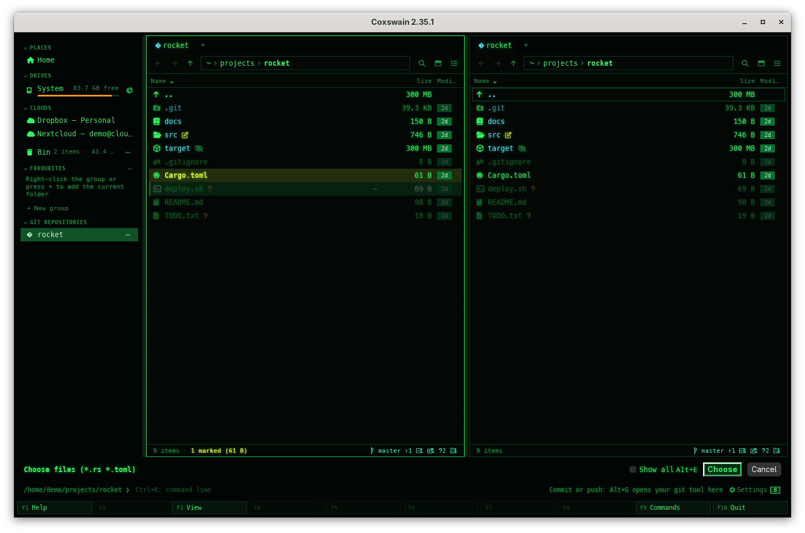
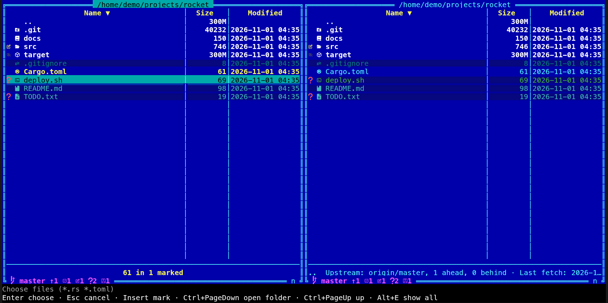

[← README](../../README.md) · [Docs index](../README.md) · [Reference](README.md)

# Pick mode: `coxswain --pick`

Another program can use Coxswain to choose files or folders, or a name to save under, instead of
the system's file dialog. It starts `coxswain --pick` (the terminal app) or `coxswain-gui --pick`
(the desktop app), you choose in the two panels as always, and the paths come back to it.

## Contents

- [Starting it](#starting-it)
- [Choosing](#choosing)
- [Saving under a new name](#saving-under-a-new-name)
- [Only some kinds of files](#only-some-kinds-of-files)
- [What comes back](#what-comes-back)
- [The terminal app and the desktop app](#the-terminal-app-and-the-desktop-app)
- [Questions](#questions)

## Starting it

```
coxswain --pick[=FILE] [--folder] [--multiple] [--save NAME] [--filter EXT,EXT] [--start DIR] [--title TEXT]
coxswain-gui --pick[=FILE] [--folder] [--multiple] [--save NAME] [--filter EXT,EXT] [--start DIR] [--title TEXT]
```

| Flag | Does |
|---|---|
| `--pick` | Pick mode. The paths go to standard output, and only they do: the terminal app draws its panels on the terminal itself (`/dev/tty`, `CONOUT$` on Windows), so `x=$(coxswain --pick)` works; the desktop app prints nothing else there |
| `--pick=FILE` | The paths go to `FILE` instead |
| `--folder` | Folders are chosen, not files |
| `--multiple` | Several may be chosen, the marked ones |
| `--save NAME` | A name to save a new file under is asked for, in the folder you go to, starting with `NAME`. Not with `--folder` or `--multiple`. See [Saving under a new name](#saving-under-a-new-name) |
| `--filter EXT,EXT` | Only files with these extensions can be chosen, and the others are dimmed: `--filter pgn,pgn.gz`. A name before a colon, `"Games:pgn,pgn.gz"`, is ignored. Case does not matter. See [Only some kinds of files](#only-some-kinds-of-files) |
| `--start DIR` | The folder both panels start in; the current folder without it |
| `--title TEXT` | Replaces *Choose a file* on the status line (the bar above it in the desktop app) with your own text |

A flag it does not know, `--save` with `--folder` or `--multiple`, `--start` with a folder that
is not there, or, for the terminal app, no terminal to draw on (a cron job, for one) is said and
nothing starts (exit status 2). The desktop app needs a display, as always.

A picker starts in the folders it is given, not in the tabs of your last session, and it saves no
session: the next normal start finds your tabs as you left them. It uses the same `config.toml`,
the same cache and the same search helper as any other Coxswain window.

## Choosing

The status line says what is asked for, and the key line at the bottom shows the keys of pick
mode instead of the F-keys. In the desktop app a bar above the command line says it, with a
**Choose** button (or **Save**) and **Cancel**.

| Key | Does |
|---|---|
| **Enter** | Chooses the marked entries, or the one under the cursor. On a folder (or an archive) while files are asked for, it opens the folder as usual |
| **Esc** | Cancels. **F10** (or closing the window in the desktop app) does too |
| the *Mark* key (**Insert** by default) | Marks, with `--multiple`. Marks work as always: see [Marking](../panels/marking.md) |
| **Ctrl+PageDown** | Opens the folder or archive under the cursor, also when `--folder` makes **Enter** choose it; in the desktop app a double-click on a folder opens it too |
| the *Parent folder* key | Up a folder |
| **Alt+E** | *Show all*, with `--filter`: see [Only some kinds of files](#only-some-kinds-of-files) |

A double-click on a file chooses it, as **Enter** does; in the desktop app a double-click on a
folder opens it, also with `--folder`. An entry that does not fit (a file with `--folder`, a
folder among the marked files, a file without the extension asked for, two with no `--multiple`)
is not chosen: the status line says why.

A picker only chooses, so it changes nothing: every action that copies, moves, renames, deletes,
writes or edits a file, runs a command (the command line, the user menu) or writes settings is
refused with *The picker only chooses: it changes no files*, whether you reach it by its key,
the action menu (**Shift+F10**), the command list (**F9**), a button or, in the desktop app, by
dragging. Looking, marking, searching, sorting, the preview and moving about work as always.

The desktop app (`coxswain-gui --pick --multiple --filter rs,toml`): a bar with *Show all*,
**Choose** and **Cancel**, the files that do not fit dimmed, and the F-keys of actions that change
files greyed out.



The terminal app (`coxswain --pick --multiple --filter rs,toml`): the status line says what is
asked for, and the key line shows the keys of pick mode.



## Saving under a new name

With `--save NAME` the program asks where to save a new file, and under which name.

- **In the terminal app**, go to the folder, then press **Enter**: a *Save as* box asks for the
  name, with `NAME` in it (or the name of the file under the cursor). **Enter** there saves.
  **Ctrl+PageDown** or a double-click opens the folder under the cursor; a double-click on a
  file asks for the name with that file's.
- **In the desktop app**, the bar has a *Save as* field with `NAME` in it. Go to the folder as
  usual (**Enter** and a double-click open folders), type the name and press **Enter** in the
  field or click **Save**. **Enter** or a double-click on a file puts its name in the field.

When a file of that name is there already, *Replace the file?* asks first: *game.pgn is there
already. Replace it? The program that asked writes over it.* **Enter** or **Y** (or *Replace*)
chooses it, **Esc** or **N** goes back. Coxswain itself writes nothing: the program that asked
does, once it has the path. A name with `/` or `\` in it, a name a folder has, and a folder
inside an archive are refused, the status line saying why.

## Only some kinds of files

With `--filter`, the files with other extensions are dimmed in every view and cannot be chosen
(the status line says *Not a file of the kind asked for*); folders are never dimmed, so you can
still go into them. The status line shows the filter, `Choose a file (*.pgn *.pgn.gz)`.

*Show all* lifts the filter: every file shows as usual and can be chosen. Press **Alt+E** in
either app (the terminal app's key line names it, `Alt+E show all`), or tick *Show all* in the
desktop app's bar; the same key turns the filter on again. A program that must have one of its
own kinds should check the path it gets.

## What comes back

- Each chosen path is one line, UTF-8, in `FILE` or on standard output (nothing else is
  printed there), and the exit status is `0`.
- Cancelling, or closing the terminal or the window, prints nothing and exits `1`; a `FILE` left by an earlier run is not touched, so read the exit status first.
- A file chosen **inside an archive** is first unpacked into the cache folder (`picked/` in
  [the cache](where-things-are-kept.md)), and the path of that copy is what comes back, since the
  other program cannot read into an archive. The copies of a run stay for a day after it ended,
  so the other program can read them, and then go at the next start of either app or the search
  helper; *picked/* in [Disk use](disk-use.md#the-rows) shows them and clears them at once. A folder inside an archive
  cannot be chosen. An archive itself (a `.zip`) is opened by **Enter**; mark it with the *Mark* key to choose it.
- With `--save`, the path of the new file: the folder you were in and the name you typed.
- Nothing is sent anywhere: the paths go to your file or the program that started Coxswain.

## The terminal app and the desktop app

Both take the same flags and give the same answer. The terminal app shows what is asked for on
the status line and its keys on the key line; with `--save` it asks for the name in a box. The
desktop app shows a bar above the command line with what is asked for, the *Save as* field,
*Show all* and the **Choose** (**Save**) and **Cancel** buttons. In the desktop app the program
that started it gets nothing on standard output but the paths; the window opens as any other
Coxswain window.

## Questions

#### How does the program that calls Coxswain get the paths?

Read its standard output (`x=$(coxswain --pick)` or `x=$(coxswain-gui --pick)`), or give it
`--pick=FILE` and read the file after Coxswain exits: one path per line, UTF-8. Exit status `0`
means something was chosen, `1` that it was cancelled.

#### Where are the panels drawn when standard output is a pipe?

The terminal app draws them on the terminal itself, as `fzf` does, so only the paths are printed
on standard output. With no terminal (no controlling terminal in a cron job) it says so and exits
with `2`. The desktop app draws its window as always and prints only the paths.

#### Why does the picker say it changes no files?

You pressed something that would copy, move, delete, edit or run a command. A program that asked
to choose files must not find them changed; use the normal `coxswain` or `coxswain-gui` for that.

#### How do I choose several files, or a folder?

For several, start with `--multiple`, mark the files with **Insert** and press **Enter** (or
click **Choose**). For a folder, start with `--folder`, put the cursor on it and press
**Enter**; open a folder to look inside it with **Ctrl+PageDown** in the terminal app, or a
double-click in the desktop app.

#### Enter opened the folder instead of choosing a file. Why?

While files are asked for, **Enter** on a folder (or an archive) opens it, so you can look for
the file. On a file it chooses. Choosing a folder needs `--folder`.

#### How do I ask for a name to save under?

Start with `--save NAME`. In the terminal app **Enter** asks for the name in the folder shown; in
the desktop app type it in the bar's *Save as* field. A file that is there already is replaced
only after you say yes to *Replace the file?*, and Coxswain never writes it: the program that
asked does.

#### Why are some files dimmed?

The program gave `--filter`, and those files have another extension, so they cannot be chosen.
**Alt+E** (*Show all*) lifts the filter; the same key brings it back.

#### What path comes back for a file inside an archive?

A copy: Coxswain unpacks the file into its cache (`picked/`, a folder of its own per run) and
gives that path. The copy stays for a day after that run ended, so the program can read it,
then goes at the next start of either app or the search helper. **Clear** on the *picked/* row
of [Disk use](disk-use.md#the-rows) (or `coxswain --disk clear picked`) removes them at once.

---
[← Previous: Command-line flags](command-line-flags.md) · [Next: Configuration: every key →](configuration.md)
