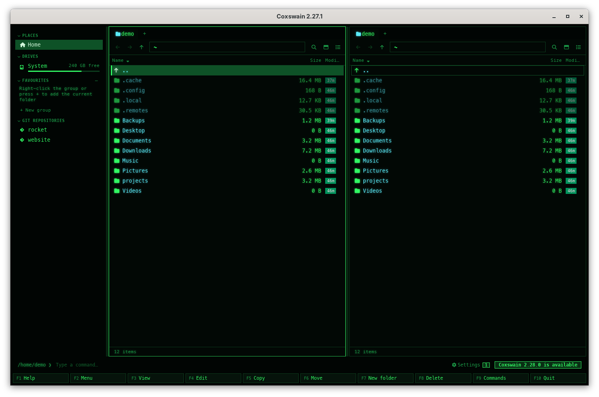

[← README](../../README.md) · [Docs index](../README.md) · [Reference](README.md)

# Update checks

When it starts, and then once a day while it is open, each app asks whether a newer
release exists, and tells you when it does,
with the command that upgrades your copy. It asks where your copy came from: WinGet, Flathub,
nixpkgs or Termux for a copy from those, GitHub for the rest, so it names a version only once the
command it shows can install it. Nothing is downloaded or installed by itself.

## Contents

- [How to use it](#how-to-use-it)
- [What it does](#what-it-does)
- [What you see](#what-you-see)
- [The upgrade command](#the-upgrade-command)
- [Where it asks](#where-it-asks)
- [Settings and config.toml](#settings-and-configtoml)
- [In the terminal app](#in-the-terminal-app)
- [Questions](#questions)

## How to use it

1. Nothing to do: it is on by default.
2. When a newer version exists, a button appears at the right of the command line (desktop app)
   or a line in the status line (terminal app).
3. Run the command it names in a shell, or click the button for the release page.
4. After the upgrade, the desktop app's **⚙ Settings** button shows a count: click it for
   *Settings → Overview → What's new*, with the new version's changes marked *new*. The terminal app says
   once `Coxswain X.Y.Z is installed: coxswain --whats-new says what it brought`
   ([Notices and what's new](../panels/notices.md)).

To turn it off: Settings (**Ctrl+,**) → *Privacy and updates* → untick *Check for a new
version*, or `check_updates = false` in `config.toml`.

## What it does

- It asks one file on GitHub for the newest version your copy's channel has
  ([Where it asks](#where-it-asks)), with `User-Agent: coxswain/X.Y.Z`. Nothing else is sent.
- When that channel gives no answer (it is not listed there yet, or the file cannot be read), it
  asks `https://api.github.com/repos/mwo-dk/coxswain/releases/latest` instead, and the notice
  adds that your channel may not have that version yet.
- It waits at most 5 seconds for each. Offline, or with GitHub unreachable, it simply finds
  nothing and says nothing.
- It uses the system's certificate store, so it works behind a company proxy that inspects TLS.
- Each app asks once when it starts. After that it looks every hour and asks GitHub again only
  when a day has passed since the last answer, kept in `state.json` and shared by every window
  and both apps, with who answered (`latest_from`); so a window or terminal left open for weeks
still hears of a release.
- Only a higher `major.minor.patch` counts as newer.

## What you see

| | Desktop app | Terminal app |
|---|---|---|
| Newer version, installed by a package manager | A button at the right of the command line: *Coxswain X.Y.Z is available: brew upgrade coxswain*. Its tooltip: *Upgrade with: brew upgrade coxswain. Click for the release notes.* | The status line: `Coxswain X.Y.Z is available: brew upgrade coxswain` |
| Newer version, from WinGet, Flathub, Termux or nixpkgs, which could not be asked, so GitHub answered | *Coxswain X.Y.Z is available: winget upgrade mwo-dk.Coxswain.Terminal (it can reach WinGet a few days later; or the release page)*; tooltip and click as above | The status line, the same text |
| Newer version, installed from a download | *Coxswain X.Y.Z is available*, tooltip *Open the releases page* | `Coxswain X.Y.Z is available: https://github.com/mwo-dk/coxswain/releases/latest` |
| Click | Opens the release page in your browser | – |
| How long | Until you update; it has no `×` | Until the status line shows something else |
| After updating | A count on **⚙ Settings**; a click opens *Settings → Overview → What's new*, where the new version's changes are marked *new* | Once, in the status line: `Coxswain X.Y.Z is installed: coxswain --whats-new says what it brought` |

While the update button shows, the desktop app holds back a problem with search in the status
line ([Notices and what's new](../panels/notices.md)).

## The upgrade command

It is worked out from where the program is installed:

| Installed with | Command shown |
|---|---|
| Anything else on FreeBSD (the install script, the archives) | `fetch -qo - https://raw.githubusercontent.com/mwo-dk/coxswain/master/install/install-freebsd.sh \| sh`, which updates both apps where they are ([FreeBSD](../systems/freebsd.md#updating)) |
| Anything else on NetBSD or OpenBSD | `ftp -o - https://raw.githubusercontent.com/mwo-dk/coxswain/master/install/install-unix.sh \| sh` ([NetBSD](../systems/netbsd.md#updating-and-uninstalling), [OpenBSD](../systems/openbsd.md#updating-and-uninstalling)) |
| Anything else on illumos | `curl -fsSL https://raw.githubusercontent.com/mwo-dk/coxswain/master/install/install-unix.sh \| sh` ([illumos](../systems/illumos.md#updating-and-uninstalling)) |
| Flatpak, the desktop app (`io.github.mwo_dk.Coxswain`) | `flatpak update io.github.mwo_dk.Coxswain`. It is not on Flathub yet: a Flatpak you built updates by building it again ([Flatpak](../systems/flatpak.md#updating)) |
| Termux's package (`/data/data/com.termux/files/usr/bin`) | `pkg upgrade coxswain`, once the package is in Termux's repository ([Termux](../systems/termux.md)) |
| Cargo (`~/.cargo/bin`, Termux too) | `cargo install --locked coxswain` |
| Homebrew formula (the terminal app) | `brew upgrade coxswain` |
| Homebrew cask (the desktop app) | `brew upgrade --cask coxswain-gui` |
| WinGet, the terminal app (`mwo-dk.Coxswain.Terminal`) | `winget upgrade mwo-dk.Coxswain.Terminal` |
| WinGet, the desktop app (`mwo-dk.Coxswain`) | `winget upgrade mwo-dk.Coxswain`, when WinGet's own record of what it installed lists the package |
| Nix (the program runs from `/nix/store/`) | `nix profile upgrade coxswain` (`coxswain-gui` for the desktop app from nixpkgs); for the flake as an input of a NixOS or Home Manager config, update the input and rebuild ([Nix](../systems/nix.md#updating)) |
| A download, `.deb`, `.rpm`, AppImage, the Windows installer you ran yourself, a source build | None: it points to the [releases page](https://github.com/mwo-dk/coxswain/releases/latest) |

The Windows desktop installer lands where a download would, so its folder does not show who ran
it. WinGet keeps a record of each package it installs (`installed.db` under its own folder in
`%LOCALAPPDATA%`); when that lists `mwo-dk.Coxswain`, the desktop app names `winget upgrade
mwo-dk.Coxswain`. Coxswain reads that file once when it starts; it does not run `winget`. Its WinGet
package, `mwo-dk.Coxswain`, is waiting for WinGet's review; until it is listed, only
`mwo-dk.Coxswain.Terminal` is on WinGet. There is no Arch (AUR) package yet.

## Where it asks

Each copy asks the channel it came from, so a version is named once your own upgrade command
can find it. All of them are files on GitHub; no other server is asked.

| Your copy | What it reads | Why |
|---|---|---|
| A download, the install scripts, a source build, Cargo (crates.io) | `api.github.com/repos/mwo-dk/coxswain/releases/latest` | The releases page itself. crates.io gets each release in the same run that publishes it, right after GitHub |
| Homebrew, formula and cask | `api.github.com/repos/mwo-dk/coxswain/releases/latest` | Our tap gets the formula and the cask in that same run |
| Nix, from the flake (`github:mwo-dk/coxswain`) | `api.github.com/repos/mwo-dk/coxswain/releases/latest` | The flake builds from our tags |
| WinGet, terminal app or desktop app | The package's folder in `microsoft/winget-pkgs` (`api.github.com/repos/microsoft/winget-pkgs/contents/manifests/m/mwo-dk/Coxswain/Terminal`, or `…/Coxswain` for the desktop app): its highest version folder | That is the index `winget upgrade` reads. A new version is filed there once a week and waits for Microsoft's moderators |
| Flatpak | The app's manifest on Flathub (`raw.githubusercontent.com/flathub/io.github.mwo_dk.Coxswain/master/io.github.mwo_dk.Coxswain.yml`): the release it builds | What Flathub builds and publishes. It is not on Flathub yet, so for now GitHub answers |
| Nix, from nixpkgs | nixpkgs' package file (`raw.githubusercontent.com/NixOS/nixpkgs/master/pkgs/by-name/co/coxswain/package.nix`, `coxswain-gui` for the desktop app): its `version` | nixpkgs' master; a channel such as `nixos-unstable` follows it within days. It is not in nixpkgs yet, so for now GitHub answers |
| Termux's package | termux-packages' recipe (`raw.githubusercontent.com/termux/termux-packages/master/packages/coxswain/build.sh`): its `TERMUX_PKG_VERSION` | What Termux's repository builds. It is not there yet, so for now GitHub answers |

When the channel's file cannot be had, GitHub answers instead and the notice adds *it can reach
… a few days later; or the release page*. Settings → *Privacy and updates* → *What can leave this
machine* names both for your copy, for example *raw.githubusercontent.com (termux/termux-packages),
api.github.com*.

How to install each is in the [README](../../README.md#install) and
[install/INSTALL.md](../../install/INSTALL.md); update the same way.

## Settings and config.toml

| Settings | Key | Type | Default |
|---|---|---|---|
| *Privacy and updates* → *Check for a new version* | `check_updates` | bool | `true` |

The last check is kept in `state.json` as `update_checked` (a time), `latest_version` and
`latest_from` (the channel that answered, or GitHub); the
version whose notice you saw is `seen_version`. None of these are for editing.

## In the terminal app

It checks when it starts, then once a day while it is open, on a thread of its own, so a slow
network never holds up the panels. The answer shows in the status line, once for each new version; there is no button and nothing to click. The same
`check_updates` key turns it off.

## Questions

#### Does Coxswain update itself?

No. It only tells you. Updating is left to the way you installed it, so your package manager
stays in charge.

#### Why does it show a URL instead of a command?

It could not tell a package manager from where the program runs: a download, a `.deb`, an
AppImage, or the Windows desktop installer you ran yourself (one WinGet ran is in WinGet's record,
and gets `winget upgrade mwo-dk.Coxswain`). Update it the way you installed it:
download the new release, or run your package manager's upgrade.

#### The command finds no new version.

The check asks your channel itself, so this happens only when it could not, and GitHub answered
instead: the notice then says so (*it can reach WinGet a few days later*). Run the command again
in a few days, or take the new version from the
[release page](https://github.com/mwo-dk/coxswain/releases/latest) now; the desktop app's
button opens it. With nixpkgs, master can have a version a few days before your channel
(`nixos-unstable`, a release branch) does.

#### I updated, but it still says a newer version is available.

The running app is the old one: quit every Coxswain window and the terminal app, then start
again. `coxswain --version` shows the version you now have.

#### It never tells me about updates.

Check that `check_updates` is not `false`, and that the machine can reach `api.github.com` (and
`raw.githubusercontent.com` for Flatpak, nixpkgs and Termux copies). The
app asks when it starts, then once a day while it is open, so a release out an hour ago shows
when you next start it, or at the latest a day later.

#### Why does GitHub have a release the notice does not name?

Your copy came from WinGet, Flathub, nixpkgs or Termux, and that channel does not have it yet.
The check asks the channel, so it names a version once `winget upgrade`, `flatpak update`,
`nix profile upgrade` or `pkg upgrade` can install it. A download from the
[release page](https://github.com/mwo-dk/coxswain/releases/latest) has it now.

#### How does it know where my copy came from?

From where the program runs (Homebrew's `Cellar` or `Caskroom`, `~/.cargo/bin`, `/nix/store/`,
Termux's `usr/bin`, WinGet's `Packages` folder), from Flatpak's sandbox, and for the Windows
desktop app from WinGet's record of what it installed. Settings → *Privacy and updates* names
where the check goes for your copy.

#### What does the check send?

Only the request for the latest version, with `User-Agent: coxswain/X.Y.Z`. See
[Privacy](privacy.md#what-can-leave-it).

#### How do I get rid of the update button?

Update. Or turn the check off in Settings → *Privacy and updates*; the button then goes at the next hourly look,
or when the app starts again.

---
[← Previous: Privacy](privacy.md) · [Next: Where things are kept →](where-things-are-kept.md)
