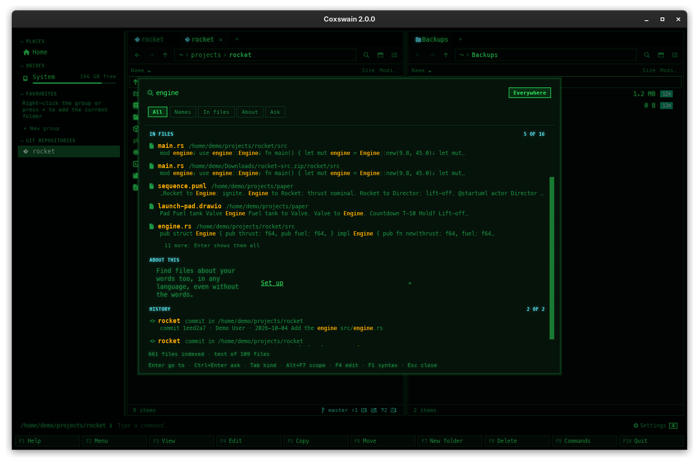

[← README](../../README.md) · [Docs index](../README.md) · [Search](README.md)

# Documents it reads

[Text in files](text.md) reads more than plain text: PDFs, Word and OpenDocument files,
spreadsheets, slides, mail, books, notebooks and diagrams. Coxswain reads all of these itself,
in pure Rust, starting no other program (but calibre for [e-books](../previews/ebooks.md#search),
when you turn them on), so a search finds the words in them like the words in
code.

*One search finds the word in code, a diagram, YAML, a log, a mail and a LaTeX file.*

## How to use it

Nothing to do: every file of these kinds inside a [folder read](folders.md) is read by the
[search helper](helper.md). Search it with **Shift+F7** (or **Ctrl+Shift+F** in the desktop app) and your words.

## Formats

| Kind | Files | What is read |
|---|---|---|
| PDF | `.pdf` | The text, and what is drawn on top of the pages: filled-in form fields, stamps and notes as they show on the page; a very long document is read for three seconds, which is most of it. Text the page does not show is left out ([hidden text](#does-coxswain-read-hidden-text)). A PDF without text is a scan: see [Scans](scans.md) |
| Word and OpenDocument text | `.docx` `.docm` `.dotx` `.odt` `.ott` | The text, with headers, footers, footnotes and comments; in an OpenDocument file also the charts and formulas set into it. Hidden text is left out ([hidden text](#does-coxswain-read-hidden-text)) |
| Rich text | `.rtf` | The text |
| Spreadsheets | `.xlsx` `.xlsm` `.xlsb` `.xls` `.ods` | Every sheet: the values, not the formulas, and the notes on the cells (not in `.xls`) |
| Presentations | `.pptx` `.ppsx` `.potx` `.odp` | The slides, with the speaker notes |
| Mail | `.eml` `.mbox`, Outlook `.msg` | Subject, sender, receivers, the message and the names of its attachments |
| Chess, xiangqi, Go, draughts and shogi games, bridge deals | `.pgn` `.pgn.gz` `.pgn.zst`, `.si4` (SCID), `.sgf`, `.pdn`, `.kif` `.kifu` `.csa`, `.pbn` | A line per game: the players (with their ranks in SGF), event, place, date, the opening (PGN) and the result ([Chess](../previews/chess.md#finding-games), [Go](../previews/go.md#finding-games), [Draughts](../previews/draughts.md#finding-games), [Xiangqi](../previews/xiangqi.md#finding-games), [Shogi](../previews/shogi.md#finding-games), [Bridge](../previews/bridge.md#finding-deals)) |
| dBase tables | `.dbf` | The field names and the records ([Old pictures and files](../previews/old-formats.md#dbase-tables)) |
| Books and web pages | `.epub` `.html` `.htm` `.xhtml` | The text, without the markup |
| Notebooks | Jupyter `.ipynb` | The cells, with what they printed |
| Diagrams | draw.io `.drawio` `.dio`, Mermaid `.mmd` `.mermaid`, Graphviz `.dot` `.gv`, PlantUML `.puml` `.plantuml` `.pu` `.iuml` `.wsd` | The words in the boxes, and [a sentence per arrow](diagrams.md) |
| Markdown | `.md` `.markdown` `.mdx` | The text, and a sentence per arrow of each Mermaid block |
| Plain text | Everything else that is text: code, CSV, JSON, logs, `.tex` … | As it stands |

Older formats (`.doc`, `.ppt`, Publisher, Visio, Apple's `.pages` and `.key`) and the words in
pictures need a program you install: see [Scans, pictures and older Office files](scans.md), or
Apache Tika in a container when you turn it on. OneNote, XPS, CHM, Outlook `.pst` and `.ost`,
MHTML, Hangul and Access files are read only with Tika ([Other formats with Apache Tika](tika.md)).
MOBI, Kindle (`.azw`, `.azw3`), FictionBook, LIT and Palm e-books are read through calibre when
you turn on *Settings → Previews → E-books with calibre*: their title, authors and chapters
([E-books](../previews/ebooks.md#search)).

## What you see

A hit in a document looks like any text hit: the name, the folder, and the passage with your
words highlighted. Text is tidied first: runs of spaces become one space, blank lines one line
break, so passages from a spreadsheet or a slide read as a line of words.

## Settings and config.toml

| Key | Type | Default | Does |
|---|---|---|---|
| `search.text_max_size` | bytes | `20971520` (20 MB) | Files larger than this are not read, except plain text, code, CSV and logs: they are read line by line, whatever their size, until 4 MB of text is kept (or 256 MB of the file is read) |

The formats themselves cannot be switched off one by one; leave a folder out instead
([Choosing the folders](folders.md)). At most 4 MB of text is kept from one file, and at most
64 MB is unpacked from one part of a zipped document (`.docx`, `.xlsx`, `.epub` …); neither is
a setting.

## In the terminal app

The same: the helper reads the documents for both apps.

## Questions

#### Why is a Word document not found by its text?

Check that it is `.docx` (or `.odt` …), not the older `.doc`: that one needs
[LibreOffice](scans.md), or [Apache Tika](tika.md) when it is turned on. Check that it is smaller than 20 MB, not locked with a password, and in a
[folder read](folders.md).

#### Does Coxswain read hidden text?

No: what a document hides from whoever reads it is not found by its words, not found by its
meaning and never given to [Ask](ask.md) as a source. Left out are:

- in Word (`.docx` `.docm` `.dotx`), text marked *Hidden* (Font → Hidden, `w:vanish`), on the
  text itself, by its character or paragraph style (or a style that one is based on) or by the
  document's defaults; text marked *not hidden* on itself stays;
- in OpenDocument (`.odt` `.ott`), text whose style (or the style it is based on) says it is
  not shown, and hidden sections;
- in a PDF, text drawn invisibly (render mode 3 or 7), wholly transparent text, text smaller
  than 2 points, and white text (in any colour space whose white is known) where nothing was
  painted on the page before it, forms included.

Invisible text over a scanned picture drawn before it is kept: it is the scan's words, which an
OCR program put there. A very long PDF is looked through for hidden text for a third of its
reading time; pages after that are read as they are drawn. After the
update that brought this, every PDF and Word file is read again once, and its passages for search
by meaning are made again. That takes in PDFs of scanned pages: when [OCR](scans.md) is on
(tesseract and pdftoppm installed), each is read by OCR once more, which takes a while when there
are many. Until a file is read, its old text is not found at all. Find's footer shows the files
still to go.

#### Does it find the formulas in my spreadsheet?

No, the values: what the cells show. A formula's result is found; the formula is not.

#### Are the notes on cells and the fields of a PDF form found?

Yes. The notes on the cells of an `.xlsx`, `.xlsm`, `.xlsb` or `.ods` are read after the sheets,
without who wrote them; an `.xls`'s notes are not. In a PDF, what a filled-in form field, a stamp
or a note shows on the page is found. The text of a sticky note that only shows in its pop-up is
not.

#### Are the attachments of a mail read?

Their names are, so `budget.xlsx` finds the mail that had it attached. Their contents are not.

#### Does it read `.tex`, CSV and JSON?

Yes, as plain text, like code and Markdown.

#### Is a 300 MB log file read?

Yes. Plain text, code, CSV and logs are read line by line, whatever their size, and reading stops
once 4 MB of text is kept: a log of any size costs the same few megabytes of memory and is found
by the words of its first 4 MB. Other kinds larger than *Largest file read* (`text_max_size`,
20 MB) are found by name only.

#### Why does a long PDF miss words near its end?

A PDF is read for at most three seconds, which covers most documents but not every page of a very
long one. Its words are also cut at 4 MB of text.

#### Does opening a document for search change it, or start Word?

No. The readers only read, in Coxswain itself, and touch no network. Only the optional programs of
[Scans](scans.md) are started, and only when installed, and calibre for
[e-books](../previews/ebooks.md#search) when you turn them on.

#### A file that failed to read: is it tried again?

Yes, when it changes. Until then it is marked as without text, so the helper does not keep trying.

---
[← Previous: Text in files](text.md) · [Next: Scans, pictures and older Office files →](scans.md)
