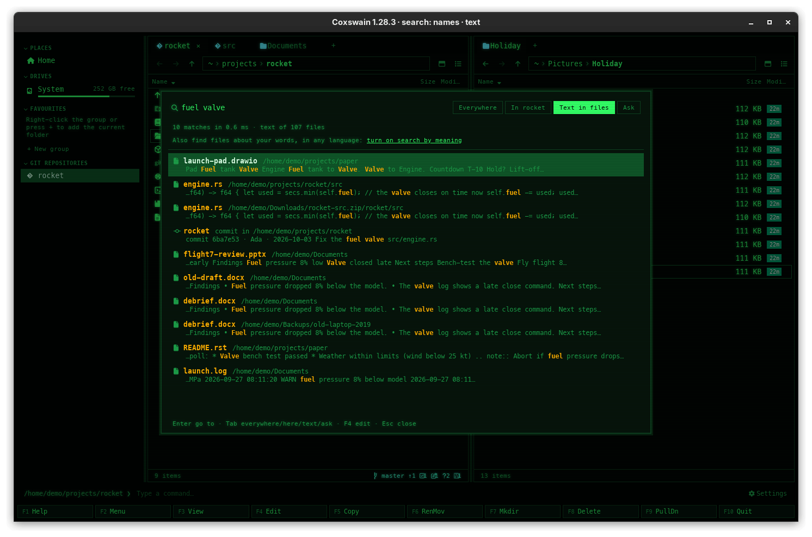

[← README](../../README.md) · [Docs index](../README.md) · [Search](README.md)

# Git history in search

Find searches the history of your git, [Mercurial](../panels/mercurial.md) and
[Jujutsu](../panels/jujutsu.md) repositories as well as your files: the message of
every commit, who wrote it, the paths and the functions it changed. Type `fuel valve` in Find and
the commit *Fix the fuel valve* is found under *History*, marked as a commit; type `parse_config`
and the commits that changed that function are found too; **Enter** opens the repository as
it was at that commit. With [search by meaning](meaning.md) on, commits about your words are
found too, and [Ask](ask.md) may answer from commit messages. Both apps have it, through the
[search helper](helper.md).



## Contents

- [How to use it](#how-to-use-it)
- [What you see](#what-you-see)
- [What is kept, and when](#what-is-kept-and-when)
- [The text of the changes](#the-text-of-the-changes)
- [Settings and config.toml](#settings-and-configtoml)
- [In the terminal app](#in-the-terminal-app)
- [Questions](#questions)

## How to use it

1. Press **Ctrl+F** for [Find](find-file.md), or **Shift+F7** (**Ctrl+Shift+F** in the
   desktop app) for its *In files* kind, which shows *In files* and *History* alone.
2. Type words from a commit message, an author's name, or a path a commit changed:
   `valve`, `Ada`, `engine.rs`.
3. Commits show in the **History** group, after the files. **Enter** on one: the active panel shows the repository's top
   folder as it was at that commit ([Git history as folders](../panels/git-history.md)).
   **Backspace** goes to the list of commits, and again to the repository on disk.

## What you see

A commit hit has the git commit glyph, the repository's name in bold, *commit in
/home/me/projects/rocket* after it, and a passage that starts with which commit it is:

```
rocket   commit in /home/me/projects/rocket
   commit a1b2c3d · Ada · 2026-09-30 · Fix the fuel valve
```

Your words are highlighted, as in any text hit; a commit found by meaning alone is under
*History* too, its passage in italics. In Ask, a commit is a numbered source like a file; **Enter** on it opens the
commit.

Find's footer, *text of 31,208 files*, counts the commits kept as well.

## What is kept, and when

| | |
|---|---|
| Which repositories | Every git work tree (a folder holding `.git`), Mercurial repository (`.hg`) and Jujutsu repository (`.jj`; with `.git` next to it, git's) inside the [folders read](folders.md), outside the folders left out (`node_modules`, hidden folders, `.nosearch`) |
| Which commits | The newest 2000 reachable from HEAD of each repository: in Mercurial from the working folder's commit (`.`), in Jujutsu from the parent of the working-copy commit (`@-`) |
| What of each | Its short id, author, date, the whole message, up to 200 paths it changed, and (git, Jujutsu) up to 40 names of the functions it changed, as *Changed functions: fn parse_config, impl Store* at the end: the name in each hunk's header and each item a changed line starts. Not the changes themselves, unless [the text of the changes](#the-text-of-the-changes) is on |
| When | At each scan of the helper (at its start and every ten minutes). A repository whose HEAD moved on gets only the new commits; one whose history was rewritten (rebase, reset) is read again; one that is gone loses its commits |
| How fast | 2000 commits of a big repository take git well under a second; the helper rests after each repository as it does after reading files |
| Where | In the [search store](text.md), `search.db`, with the text of your files. **Delete what was read** in Settings empties it too |

A new commit is found within ten minutes; a change of a search setting in the desktop app
restarts the helper, which then reads at once.

## The text of the changes

Off by default: *Settings → Finding files → Details → What is read → Text of each commit's
changes* keeps what each commit changed, its diff, so Find finds `valve` in a line a commit
added. Under it, *Changes of commits, for these folders' repositories* turns it on for some
repositories alone.

| | |
|---|---|
| What is kept | Each commit's diff (the same 2000 commits as above), at most 64 KB a commit and 64 MB a repository; found by Find's words, under *History* with the passage starting `commit a1b2c3d · Ada · 2026-09-30 · changes`. No vectors are made of it: search by meaning and Ask use the message and the function names |
| Before it starts | Ticking it says what it costs first, from git's count of the lines changed: *Reading the changes of 1,950 commits in 3 repositories adds about 48 MB to search.db and takes about 5 s in the background. Nothing leaves the machine.* **Apply** saves it, **Cancel** leaves it off |
| While it reads | The search helper starts again and reads them at its next scan of the repositories; the status of *Words in files* says *Reading the changes of 1,950 commits…* |
| Turning it off | Says first that the changes go and the room comes back. The helper takes them out when it starts, before anything else, gives the room back to the disk (`search.db` is made smaller), and the status says *Changes of commits taken out at 14:05: 48 MB freed* |
| Disk use | Its own row, *search.db: changes of commits*, with its size ([Disk use](../reference/disk-use.md)); clearing it turns the option off |


In the terminal app the same, in **F12** → *Finding files* → *What is read*: the cost shows red
at the bottom, **Enter** applies it, **Esc** keeps the setting as it was.

## Settings and config.toml

| Setting | config.toml | Default |
|---|---|---|
| *Settings → Finding files → Details → What is read → Git history* | `[search] history` | `true` |
| *… → Text of each commit's changes* | `[search] commit_changes` | `false` |
| *… → Changes of commits, for these folders' repositories* | `[search] commit_changes_in` | `[]` |
| Which folders are read (and so which repositories) | `[search] text_roots`, `names_only`, `text_exclude` | your home folder |

Turned off, the commits are taken out of the store at the next scan. It needs *Words inside
files* (`[search] text`) on.

## In the terminal app

The same: commits are hits in *text:*, with the passage starting `commit a1b2c3d · Ada · …`.
**Enter** opens the commit in the panel; **F3** and **F4** do nothing on a commit hit. Turn it
off in its Settings (**F12** → *Finding files* → *What is read* → *Git history*), or with
`history = false` under `[search]` in `config.toml`, which the helper uses from its next start.

## Questions

#### Why does Find miss my latest commit?

The helper reads repositories at its scans, at most ten minutes apart, so wait a little.
Commits in a repository outside the folders read are never kept.

#### Why does it not find an old commit?

Only the newest 2000 of each repository are kept. Use `git log --grep=…` on the command line
for older ones.

#### Does it search the code as it was in old commits?

It keeps the names of the functions each commit changed, not the code. Turn on *Text of each
commit's changes* in Settings to search the changes themselves ([The text of the
changes](#the-text-of-the-changes)). To read a file as it was, open the commit and preview it
([Git history as folders](../panels/git-history.md)).

#### Who last changed parse_config?

Type `parse_config` in Find: the commits whose *Changed functions* name it are under
*History*, newest first, each with its author and date. In Ask, ask it in words: the commits are
among its sources.

#### Why did my commits get read again after updating?

Commits kept before this version had no function names: each repository's newest 2000 are
read once again, with their vectors when search by meaning is on. It happens once.

#### How much room do the changes take, and how do I get it back?

*Disk use* shows the row *search.db: changes of commits* with its size. Turn the option off
(or clear that row): the helper takes them out when it starts and `search.db` shrinks.

#### Does it send my commits anywhere?

No. They stay in the store on your machine. With search by meaning on a server, their text goes
to that server for vectors, as your files' text does ([Servers](servers.md)).

#### Does it search Mercurial and Jujutsu repositories?

Yes, both apps. Mercurial's commits come from `hg log`, run without the repository's own
`.hg/hgrc` (its hooks and extensions never run), so `hg` must be installed. A Jujutsu repository
with `.git` next to `.jj` is read as git's; one without is read from Jujutsu's own store below
`.jj`, with `jj` asked only which commit is the working copy's parent. Subversion and CVS keep
their history on a server and are not searched.

#### Can I keep one repository's history out?

Put an empty `.nosearch` file in the repository, or add it to *Names only*: then neither its files
nor its commits are read.

---
[← Previous: Diagrams read as sentences](diagrams.md) · [Next: Inside archives →](archives.md)
