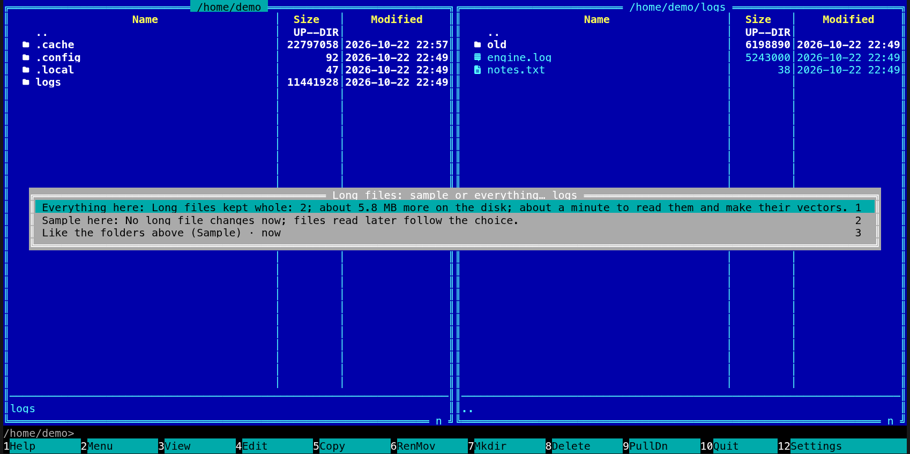

[← README](../../README.md) · [Docs index](../README.md) · [Search](README.md)

# Long files: sample or everything

A long log, a book or a data dump is more than search keeps of most files. By default it keeps a
**sample**: the first 4 MB of a file's text for [search by words](text.md), and 256 passages
spread from the file's start to its end for [search by meaning](meaning.md). That is plenty for
almost every file, and it keeps `search.db` small. **Everything** keeps all of a long file's text
and gives every part of it a passage with a vector of its own, so a line deep inside a 300 MB log
is found by its words and by what it is about. Choose it for every folder in Settings, or for one
folder from the action menu. Before a choice is saved, Coxswain says what it costs here: how many
long files it touches, about how much more room they take, and about how long reading them and
making their vectors takes on this machine.


## Contents

- [How to use it](#how-to-use-it)
- [One folder](#one-folder)
- [What each keeps](#what-each-keeps)
- [What it costs](#what-it-costs)
- [Back to Sample](#back-to-sample)
- [What is read again](#what-is-read-again)
- [Settings and config.toml](#settings-and-configtoml)
- [In the terminal app](#in-the-terminal-app)
- [Questions](#questions)

## How to use it

For every folder: *Settings → Finding files → Details → Meaning → Long files*, *Sample* or
*Everything*. In the terminal app: **F12** → *Finding files*, the *Long files* row, **Enter**,
the choice, **Enter**. The cost shows before anything is written: under the option in the desktop
app, with **Apply** and **Cancel**; on the line at the bottom of Settings in the terminal app,
with **Enter** to apply and **Esc** to cancel.

For one folder, see [below](#one-folder): the action menu on it.

It needs *Words inside files* (`text`, on by default). Without [search by meaning](meaning.md) it
keeps all the text for words and makes no vectors. With *Words inside files* off and *Everything* chosen, a
notice says once that nothing is kept of any file until it is on.

## One folder

Put the cursor on a folder and open the action menu (**Shift+F10**, or the Menu key; in the
desktop app also a right-click when *Right-click* is set to the menu). Under *Search*: *Long
files: sample or everything…*. It is in the **F9** command list under *Search* too. It has no key
of its own. A menu opens with three choices, each with what it would cost:

| Choice | Does |
|---|---|
| **1** *Everything here* | The folder's long files, and those of the folders inside it, are kept whole, whatever *Long files* says |
| **2** *Sample here* | They are sampled, whatever *Long files* says |
| **3** *Like the folders above (Sample)* | The folder follows the nearest folder above it that has a choice of its own, else *Long files* |



The one in force ends with *· now*. Choosing one writes `long_files_everything` or
`long_files_sample` in `config.toml`; the status line says *Long files in logs: saved; the search
helper takes it up.* and the [search helper](helper.md) restarts with it. The deepest folder
listed decides: *Everything* for `~/logs` and *Sample* for `~/logs/old` keeps `~/logs/today.log`
whole and samples `~/logs/old/2019.log`. A folder in both lists is sampled.

Settings shows the folders chosen this way under *Folders kept whole* and *Folders sampled*, each
with **Remove**; removing one says its cost first too.

A hint on the status line names the action menu a few times when the cursor is on a folder.

## What each keeps

| | Sample (the default) | Everything |
|---|---|---|
| Text for words, of text, code, CSV and logs | The first 4 MB | All of it, up to 256 MB a file |
| Text for words, of PDF, Word, slides and other documents | The first 4 MB | The first 4 MB: their readers stop there |
| Passages for meaning | 256 at most: the first 16, the last 4, the first under each heading, the rest spread evenly over the whole file | One for every part of the file, about 120 words each (of a PDF, of its first 4 MB of text) |
| A short file (under 4 MB of text and 256 passages) | All of it | The same: nothing differs |
| Files inside archives | Sampled | As on disk: read out of the archive again as it is unpacked, never copied (a document, from a copy of up to 256 MB) |
| Git commits | Sampled | Sampled: *Everything* is for files |

A text, code, CSV or log file kept whole is read line by line, never held whole, and its passages
go to the model 64 at a time. Its passages are kept in `search.db` with their vectors, with where
each section starts.

A file kept whole that cannot be read to its end keeps the vectors it had: a part of it never
takes the place of all of it. One whose reader stops at a fault is noted among the store's [latest
errors](../previews/data.md#coxswains-own-index-and-store) as *could not be read to its end* and
is not tried again until it changes.

A Word or OpenDocument text, book or web page is read for at most 20 seconds, the time the model
takes on its passages not counted. One that needs longer:

- **with no vectors yet** gets those of the part read in that time, rather than none, and is
  noted among the latest errors as *read only in part: its reader's time ran out*. The next day
  (at the first scan 24 hours later) it is read once more; out of time again, it keeps the larger
  of the two parts and is not read again until it changes;
- **with the vectors of all of it** from before keeps them, and is not read again until it
  changes.

Earlier versions counted the model's time as reading time, so a long Word or OpenDocument text
kept whole was taken as done after its first 20 seconds of passages. A store from before gives
those files their vectors again, once: only the ones kept whole with fewer passages than the text
kept of them gives, which a file streamed to its end never has. Nothing is read again for search
by words, and the vectors they have stay until the new ones are in. A file whose model got
through more than its first 4 MB of text in those 20 seconds cannot be told from one read to its
end, so every long Word and OpenDocument text kept whole with at least as many passages as its
first 4 MB gives gets its vectors again too, once (books and web pages, which no released version
read that way, are left as they are).

The text kept of a Word or OpenDocument text for search by words also stops after 16 MB of its
XML. A document heavy with tags (each word in a run of its own with its fonts, as Word writes
pasted or tracked text) can reach that with well under 4 MB of text. Such a file gets its
passages from all of it too, read as it is unpacked, in *Everything* and *Sample* alike. Earlier
versions made them from the cut text only. A store from before gives those files alone their
vectors again, once: Word and OpenDocument texts on disk with more than 16 MB of XML in their
text parts and less than 3 MB of text kept. Nothing is read again for search by words. A file
inside an archive keeps its passages from the text kept.

Search by meaning finds such a file by its part read, as it finds any other. One that is not there when it is looked at (a disk
unplugged) is tried again at the next scan. A file that changes or goes while it is read gets
nothing of what was read: it is read again as it is now.

## What it costs

Room on the disk and time, for the long files only. The cost is worked out from what the store
knows about each file, before anything is read:

- **Long files kept whole**: the files in the folders the choice reaches with 4 MB of text or
  256 passages or more.
- **More on the disk**: their extra text twice over (the text and its index), and each extra
  passage's vector and text, about 1 KB to 2 KB a passage.
- **Time**: the extra passages at the speed the helper measured making vectors here (kept from
  one run to the next), or the speed test of [*Measure speed*](meaning.md#how-fast-is-it-here-and-would-another-model-be-faster)
  when it has measured nothing yet, plus reading the files again. With [meaning
  search](meaning.md) off no vectors are made, so the time is the reading alone and the line
  ends *… to read them.*

A line such as *Long files kept whole: 3; about 180 MB more on the disk; about 25 minutes to read
them and make their vectors.* When the choice touches no long file now: *No long file changes
now; files read later follow the choice.* When the helper does not answer, or *Words inside
files* is off: *What this costs cannot be said now …*.

## Back to Sample

*Sample* is a part of *Everything*: the passages Sample keeps are among those Everything made. So
going back reads nothing again and makes no vector again. For each file the helper keeps the
passages Sample would choose and drops the rest with their vectors, cuts the text back to its
first 4 MB as reading it again would, and then gives the room back to the disk (`search.db`
shrinks; a store from an older version is compacted whole once, after which it frees room bit by
bit). The choice says first what it frees: *Long files sampled again: 2; frees about 1.2 GB;
nothing is read again.*

## What is read again

A change of the choice is work your machine does once, for the long files it reaches:

| Change | Files | What is redone |
|---|---|---|
| To *Everything* | Text, code, CSV and logs whose text was cut at 4 MB | Read again, and all their passages get vectors |
| To *Everything* | Other files with more than 256 passages | Their vectors made again from the text kept, every passage |
| To *Sample* | Files kept whole | Nothing read or made: passages and text pruned, the store compacted |

Short files are never redone. An older version of Coxswain leaves what *Everything* made in
place: it reads and searches it, and only cuts a file back when the file itself changes.

## Settings and config.toml

| Settings item | Key under `[search]` | Type | Default |
|---|---|---|---|
| *Long files* | `long_files` | `"sample"` or `"everything"` | `"sample"` |
| *Folders kept whole* | `long_files_everything` | list of paths | `[]` |
| *Folders sampled* | `long_files_sample` | list of paths | `[]` |

```toml
[search]
long_files = "sample"
long_files_everything = ["/home/me/logs"]
long_files_sample = ["/home/me/logs/old"]
```

`--settings=long_files` opens Settings at the option.

## In the terminal app

The same choices and the same costs. The action menu (**Shift+F10**) and **F9** list *Long files:
sample or everything…*; its menu takes **1**, **2** and **3**, or **Up**/**Down** and **Enter**.
In Settings (**F12** → *Finding files*) the cost is the red line at the bottom, *Enter: Apply ·
Esc: Cancel*.

## Questions

#### Why does search by meaning miss something deep inside a long log?

With *Sample* a long file gets 256 passages spread from its start to its end, so a part between
them has no vector of its own. Choose *Everything* for its folder: the action menu on the folder
(**Shift+F10**) → *Long files: sample or everything…* → *Everything here*.

#### Why are the last lines of a big log not found by their words?

*Sample* keeps the first 4 MB of a file's text for words. *Everything* keeps all of it, up to
256 MB a file, for text, code, CSV and logs.

#### What does Everything cost?

Room on the disk and time. Before the choice is saved it says how many long files it touches,
about how much more room they take and how long reading them and making their vectors takes on
this machine ([What it costs](#what-it-costs)).

#### Does going back to Sample read the files again?

No. Sample is a part of Everything: the passages Sample keeps stay, the rest go with their
vectors, the text is cut back to its first 4 MB and the store gives the room back to the disk.

#### Does Everything keep all the text of a big PDF?

No. PDF, Word, slides and the other documents have readers that stop at 4 MB of text for
search by words. For meaning, Word, OpenDocument, spreadsheet (`.xlsx`, `.xlsm`, `.xlsb`, `.xls`, `.ods`),
presentation files, books (`.epub`) and web pages are read again as they are unpacked, so Everything gives every part of the
whole file a passage; a PDF gets a passage for every part of its first 4 MB of text. Text, code,
CSV and logs keep all of theirs, up to 256 MB a file.

#### Why is the time only a guess?

It is the passages still to make times the time a passage took here, measured by the helper (or
by the speed test until it has measured anything), plus reading. A busy machine, a server that
is faster on long batches, or files that changed meanwhile make it differ.

#### Can I use Everything for my whole home folder?

Yes, *Long files → Everything* in Settings. Only long files cost more; the warning says how
many there are and what they take before you apply it. Folders you want sampled can still be
set to *Sample here*.

---
[← Previous: Search by meaning](meaning.md) · [Next: Search by meaning on a server →](servers.md)
