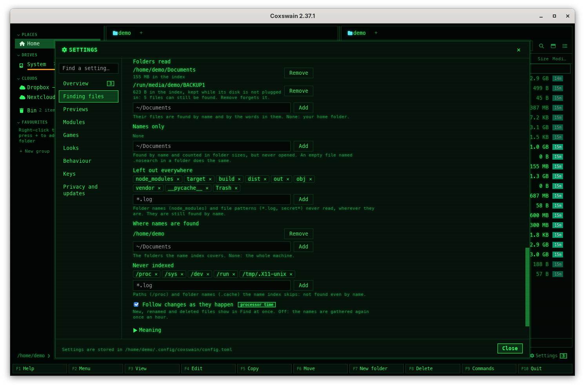

[← README](../../README.md) · [Docs index](../README.md) · [Search](README.md)

# Removable disks

A folder on a USB stick or an external drive can be one of the *Folders read*. Coxswain knows it
by its disk, not only by its path, so its text is kept while the disk is away and found again
wherever the disk is mounted next, without being read afresh. While the disk is away its files
can still be found by name, words and meaning, and Ask can answer from them; each is marked
*on BACKUP1 — not plugged in*, and opening one asks you to plug the disk in.

## Contents

- [How to use it](#how-to-use-it)
- [What you see](#what-you-see)
- [Opening a file of a disk that is away](#opening-a-file-of-a-disk-that-is-away)
- [Hiding the hits of a disk that is away](#hiding-the-hits-of-a-disk-that-is-away)
- [Settings and config.toml](#settings-and-configtoml)
- [In the terminal app](#in-the-terminal-app)
- [Questions](#questions)

<!-- screenshot: search-removable-away.png: retake, Settings → Finding files → Details → Folders with /run/media/demo/BACKUP1 saying "412 MB in the index, kept while its disk is not plugged in: 1,204 files can still be found. Remove forgets it." -->

## How to use it

1. Plug the disk in and open a folder on it in the active panel.
2. *Settings → Finding files → Details → Folders → Folders read*: type `.` and press **Add** (or type
   the path, `/media/me/BACKUP1/papers`). In the terminal app: **F12** → *Finding files* →
   *Folders* → *Folders read*, **Enter**, and type `.` or the path on the *+ Add* line.
3. Add your home folder too, if the list was empty: listing folders replaces the default.

From then on:

| The disk is | What happens |
|---|---|
| **Unplugged** | Its text and vectors stay in the index. Find shows its files by name, words and meaning, each marked *on BACKUP1 — not plugged in*, and Ask may use them as sources, marked the same. Settings shows it as away |
| **Plugged in again**, at the same place or another (`/media/me/BACKUP1` one day, `E:\` the next) | A hit opens at the new place at once. At the helper's next pass the marks go, without the disk being read afresh; only what changed is read |
| **Replaced** by another disk with files at the same place | The new disk is taken as it is, and read |
| **Removed** from *Folders read* | Its text is forgotten |

The disk is told apart by the file system's UUID on Linux and macOS, and by the volume serial on
Windows, with the folder's place inside that file system. A disk that cannot be told apart (a
network share, tmpfs) is known by its path only, and so is every disk on
[FreeBSD](../systems/freebsd.md#how-freebsd-differs-from-linux-here), NetBSD, OpenBSD and illumos for now.

Nothing is read or made again for this: what the store already holds of the disk is what is
found, and a store from before this version needs nothing redone.

## What you see

**In Find**, a hit on a disk that is away is listed in its group as any other (*Names*, *In
files*, *About this*), after the name and the folder:

| Desktop app | Terminal app |
|---|---|
| A small grey badge, *on BACKUP1 — not plugged in* | `[on BACKUP1 — not plugged in]` at the right of the line, dim |

*BACKUP1* is the name of the folder the disk was mounted on (`/run/media/me/BACKUP1`, or `E:\` on
Windows). For a disk that was mounted inside one of the folders read, it is that folder's name
(`backup` for `~/backup`). The names of its files come from what the store kept: folders of the
disk are not found by name while it is away, and neither are files inside its archives.

Under the list, one more line names every disk that is away and has hits: *Not plugged in:
BACKUP1. Their hits are shown · Enter: hide them* (see [Hiding the hits](#hiding-the-hits-of-a-disk-that-is-away)).

<!-- screenshot: search-away-find.gif: desktop app (Cyber), Find for "orbit" with a hit on BACKUP1 marked "on BACKUP1 — not plugged in" and the line "Not plugged in: BACKUP1" under the list; the disk is then mounted at another place under /run/media and the mark goes, with nothing read again (with its first-frame still search-away-find.png) -->
<!-- screenshot: search-away-find-tui.png: terminal app (Classic blue), Find for "orbit" with a hit marked [on BACKUP1 — not plugged in] and the line under the list -->

**In Ask**, a source on a disk that is away has the same mark after its folder, in both apps.

<!-- screenshot: search-away-ask.png: desktop app (Cyber), an Ask answer citing a source on BACKUP1 with its badge "on BACKUP1 — not plugged in" -->

**In Settings**, under *Folders read*: *412 MB in the index* while the disk is there, and *412 MB
in the index, kept while its disk is not plugged in: 1,204 files can still be found. Remove
forgets it.* while it is away.

## Opening a file of a disk that is away

**Enter** (go to the file), **F3** (view, terminal app), **F4** (edit) and a double-click on a hit,
and **Enter** or a click on a source of Ask, first look for the file:

- The disk is back at its old place: the file opens there.
- The disk is mounted somewhere else (found by its UUID or volume serial, as when it is read):
  the file opens at the new place, at once, before the helper's next pass has moved the hits.
- The disk is not plugged in: Find stays open and the status line says *Plug in BACKUP1 to open
  this file*.

A disk known by its path only (a network share, a disk mounted inside a folder read, and every
disk on the BSDs and illumos) opens only at its old place.

*Find and replace* from Find leaves out the files of a disk that is away: they cannot be changed.

## Hiding the hits of a disk that is away

The line under Find's list, *Not plugged in: BACKUP1. Their hits are shown · Enter: hide them*,
is a row like the others: move onto it with **↓** and press **Enter** (or click it in the desktop
app). The hits of every disk that is away go from the list, and the line says *Not plugged in:
BACKUP1. Their hits are hidden · Enter: show them*, naming every disk that is away; **Enter** on
it again shows them. While they are hidden Ask leaves those files out of its sources too. The
choice is kept in the state file, so both apps follow it, and stays until you change it.

## Settings and config.toml

| Key | Type | Default | Does |
|---|---|---|---|
| `search.text_roots` | list of paths | `[]` | The folders read, a folder on a removable disk among them |

Nothing else: the disk is recognised by itself. Whether the hits of a disk that is away are hidden
is kept in the state file, not in `config.toml` (see [Hiding the hits](#hiding-the-hits-of-a-disk-that-is-away)).

## In the terminal app

The same, with *Folders read* in its Settings (**F12** → *Finding files* → *Folders*) or
`text_roots` in `config.toml`. Press **Enter** on *Folders read* to see each folder: one whose
disk is away has the same line as in the desktop app under it, dimmed. In Find a hit is marked at
the right of its line, and **F3** views a file at the disk's new place too.

## Questions

#### Why are my disk's files marked "not plugged in"?

The disk is not plugged in (or not mounted). Its text and vectors are kept, so its files are still
found by name, words and meaning, and Ask may use them; each is marked *on BACKUP1 — not plugged
in*. Settings shows the disk as away. The marks go when it is mounted again, wherever.

#### I opened a hit and it says "Plug in BACKUP1 to open this file".

The file is on a disk that is not plugged in, so there is nothing to open. Plug the disk in and
press **Enter** on the hit again: it opens wherever the disk is mounted now.

#### How do I hide the files of a disk that is away?

Move onto the last line of Find's list, *Not plugged in: BACKUP1. Their hits are shown · Enter:
hide them*, and press **Enter**. **Enter** on it again shows them. Both apps keep the choice.

#### I plugged the disk back in; when do the marks go?

At the helper's next pass over the folders, within ten minutes. **Read now** in Settings starts
one at once. Until then a hit already opens at the disk's new place.

#### Is anything read again for this?

No. The files of a disk that is away are found from what the store already holds; nothing is read,
and no vectors are made, when the disk goes or comes back, except files that changed meanwhile.

#### I replaced the disk with a new one at the same place.

A folder with files in it on another disk is taken as it is: the new disk is read.

#### It was mounted at `/media/me/BACKUP1`, now at `/run/media/me/BACKUP1`. Is it read again?

No. The helper finds it by its UUID at the new place and moves what it knows there; only files
that changed are read.

#### Does this work for network shares?

A share has no UUID Coxswain can read, so it is known by its path. While the path is gone its text
is kept and its files are found, marked, like a disk's, but it is not found at another path.

#### A network folder inside my home folder dropped. Is it read again when it is back?

No. A folder the helper cannot list for now (an sshfs or NFS mount that dropped, a folder the system
refuses, a read error) keeps its text and its vectors, and its files are still found. When it
answers again, only the files that changed are read. Only a folder that is not there any more
loses its text.

#### A disk is mounted inside my home folder. What happens when it is unplugged?

Its text and vectors stay, and its files are found marked, as for a disk that is one of the *Folders read*. The
helper notes each folder inside the folders read where another disk is mounted (an external
drive at `~/backup`, an encrypted folder at `~/Private`). When such a folder is later empty and
on its parent's disk, the disk is taken as away: Find marks its files with the folder's name
(*on backup — not plugged in*) until it is mounted there again, and then only the files that
changed are read. An empty folder there cannot be told
from one emptied by hand: to let its text go, delete the empty folder. Links left in it (a locked
ecryptfs folder holds two) and a Finder's `.DS_Store` do not count as files. A folder that goes
with its disk (one an automounter made under `/run/media`) is gone, not away: when it sits inside
a folder read, its text goes. On Windows a disk mounted in a folder is not walked into, so this
does not arise there.

#### How do I get rid of an old disk's text?

**Remove** next to it under *Folders read*, or take it out of `text_roots`. For a disk that was
mounted inside one of the folders read, delete the empty folder it was mounted on: at the next
pass its text goes.

---
[← Previous: Cloud files](cloud-files.md) · [Next: Search by meaning →](meaning.md)
