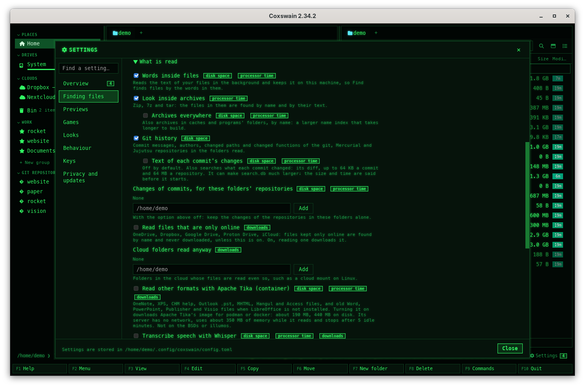

[← README](../../README.md) · [Docs index](../README.md) · [Search](README.md)

# Search settings

Everything about search sits in one area of Settings, in both apps: **Finding files**. At
its top, how each part of search stands and its next step; then how far Find looks, in four
levels; then **Details**, with every switch on its own. Every option is also a key under
`[search]` in `config.toml`.

*Settings → Finding files.*

## Contents

- [How to use it](#how-to-use-it)
- [The status block](#the-status-block)
- [The levels](#the-levels)
- [Details](#details)
- [What you see](#what-you-see)
- [Settings and config.toml](#settings-and-configtoml)
- [In the terminal app](#in-the-terminal-app)
- [Questions](#questions)

## How to use it

| To open | Desktop app | Terminal app |
|---|---|---|
| Settings at Finding files | **Ctrl+,** or **F12** (or the *Settings* button, or *Settings* in **Shift+F10** or **F9**), then *Finding files* on the left; or `coxswain-gui --settings=search`; or **Show me** on the tesseract or cloud tip | **F12** (*12 Settings* on the F-key bar), then **→** to *Finding files*; or `coxswain --settings=search` |
| …at *Meaning* | `coxswain-gui --settings=search_meaning`, or **Show me** on the meaning or Ollama tip | `coxswain --settings=search_meaning` |
| …at *Ask* | `coxswain-gui --settings=ask_model` | `coxswain --settings=ask_model` |
| The setup guide | **Set up…** in Finding files or Overview, or *Set up* in Find | *Set up…* in Settings (**Space**), *Set up* in Find, or `coxswain --setup-search` |

A change is saved at once; a change to what the [helper](helper.md) reads starts a new helper
with it. *Find a setting…* above the areas finds any option by its name, its explanation or its
key: `name_exclude`, `archives`, `cloud`.

## The status block

| Line | Shows | Its button |
|---|---|---|
| *Names* | *Files on this machine: 912 330*, or *Still counting … so far* while the [name index](names.md) is built | |
| *Words* | *Files read: 31 208 · waiting: 412 · 1.1 GB on disk*; on battery *Paused while the machine runs on its battery.*; an error in red (*Reading stopped: …*). Off: *Find looks at names only.* No helper: *Not running* | **Read now** (the backlog at full speed, on battery too) · **Turn on** · **Start it** |
| *Meaning* | *8 120 of 31 208 files · the built-in model on the CPU* or *· bge-m3 at localhost:11434*; *About 3 hours until every file is done.*; a server that does not answer: *The server at localhost:11434 does not answer. Is it running?* | **Set up…** when off or failing |
| *Tika* (only while *Read other formats with Apache Tika* is on) | *Downloading docker.io/apache/tika:4.1.0…* with the progress line; *Reads OneNote, XPS, CHM, Outlook files and more*; *Off* with, in red, *Needs podman or docker, which run its Linux image; on FreeBSD, the other BSDs and illumos it cannot run.* or *It stopped: …*; no helper: *Not running* ([Other formats with Apache Tika](tika.md)) | |
| *Speech* (only while *Transcribe speech with Whisper* is on) | *Transcribed: 3 · waiting: 11*; *Now: interview.m4a, 40 %. About 52 min left.*; *Downloading the model from Hugging Face: …* with a bar; *Paused: Go on carries on where it was.*; on battery *Paused while the machine runs on its battery.*; why it cannot run, in red ([Transcripts of speech](transcripts.md)) | **Pause** · **Go on** · **Let the rest go** |
| *Ask* | *qwen3:8b at localhost:11434* or *Qwen3 1.7B, built in*, or *Ask needs meaning first.* / *No chat model chosen yet.* | **Try it**: *It answered: the first word came after 0.4 s.* · **Set up…** |

## The levels

*How far should Find look?*

| Level | `text` | `meaning` | `ask_model` | When it needs something first |
|---|---|---|---|---|
| *Names only* | off | off | kept | |
| *Names and text* | on | off | kept | |
| *Names, text and meaning* | on | on | emptied | The built-in model not downloaded and no server chosen: the [setup guide](setup.md) opens |
| *Names, text, meaning and Ask* | on | on | kept | No chat model, or no model for meaning: the setup guide opens |

With meaning on and words off (set by hand) no level is chosen, and a red line says meaning
needs the words.

## Details

Six groups: *What is read* (open at first), *Folders*, *Meaning*, *Ask*, *Built-in models* and
*Background reading*. Every key is under `[search]`.

| Group | Option | Key | Type, default | Does |
|---|---|---|---|---|
| What is read | *Words inside files* | `text` | bool, `true` | Off: no [words](text.md), no meaning, and folder sizes and duplicates lose the store's help |
| | *Look inside archives* | `archives` | bool, `true` | See [Inside archives](archives.md). Off: an archive is found by its own name only |
| | *Archives everywhere* (while the one above is on) | `archives_everywhere` | bool, `false` | The entries of every archive on the machine by name, caches included; their text is still read only in the folders read ([Which archives](archives.md#which-archives)) |
| | *Git history* | `history` | bool, `true` | The newest 2000 commits of each repository in the folders read ([Git history in search](history.md)) |
| | *Read files that are only online* | `cloud` | `"local-only"` or `"all"`, `"local-only"` | Off: files only in OneDrive, Dropbox, Google Drive, Proton Drive or iCloud are found by name, never read or downloaded ([Cloud files](cloud-files.md)) |
| | *Cloud folders read anyway* | `cloud_read` | list, `[]` | The clouds found, each with **Read its files**, and folders added ([Cloud files](cloud-files.md)) |
| | *Read other formats with Apache Tika (container)* | `tika` | bool, `false` | OneNote, XPS, CHM, Outlook data files and more, read by Apache Tika in a container without network; pulls its image (about 190 MB) when ticked ([Other formats with Apache Tika](tika.md)) |
| | *Transcribe speech with Whisper* | `whisper` | bool, `false` | Recordings and videos you choose are transcribed in the background; the model is downloaded from Hugging Face when ticked ([Transcripts of speech](transcripts.md)) |
| | *Whisper model* (while the one above is on) | `whisper_model` | text, `""` = chosen for this machine | `tiny`, `base`, `small`, `large-v3-turbo`, each with its size, *recommended* or *slow here* |
| | *Programs that read more* | | | tesseract, pdftoppm and LibreOffice, each ✓ or ✗ *not installed*; a missing one with the line that installs it and **Copy** ([Installing what is missing](scans.md#installing-what-is-missing)) |
| | *Largest file read (MB)* | `text_max_size` | bytes, 20 MB | Larger files are found by name only; plain text, code, CSV and logs are read whatever their size, their first 4 MB of text |
| | *Most hits* | `max_results` | number, `10000` | The most rows Find lists for one kind of hit |
| Folders | *Folders read* | `text_roots` | list, `[]` = *Your home folder* | [Choosing the folders](folders.md) |
| | *Names only* | `names_only` | list, `[]` | [Choosing the folders](folders.md) |
| | *Left out everywhere* | `text_exclude` | list of names and patterns | Never read, wherever they are; still found by name |
| | *Where names are found* | `name_roots` | list, `[]` = the whole machine | The [name index](names.md)'s folders |
| | *Never indexed* | `name_exclude` | list, `/proc`, `/sys` … | Not found even by name |
| | *Follow changes as they happen* | `watch` | bool, `true` | Off: names gathered again once an hour |
| Meaning | *Meaning* | `meaning` | bool, `false` | **Download the model (465 MB) and turn on** (*Downloading the model: … of …*, a bar, **Cancel**), **Turn on** (words too), **Turn off**, **Delete the model**; the model's folder with **Show in panel** |
| | *Made by* | `meaning_engine` | `"builtin"` / `"ollama"` / `"openai"` | *Built-in model, on this machine (465 MB once)*, *Ollama*, or *A server with the OpenAI API (Lemonade, LM Studio, llama.cpp …)* ([servers](servers.md)). A change that makes every file's meaning again asks first: **Change and re-read** or **Keep the current model** |
| | *Server* | `meaning_url` | string, `""` | The server's base URL; empty is Ollama on this machine |
| | *Model* | `meaning_model` | string, `""` | The server's model; empty is `bge-m3` for Ollama. **Pull bge-m3 with Ollama** when Ollama lacks it |
| | *API key from the environment variable* | `meaning_key_env` | string, `""` | OpenAI API only: the variable that holds the key |
| | *Use the CPU only* | `meaning_device` | `"auto"` / `"cpu"`, `"auto"` | On a Mac only ([on a Mac's GPU](meaning.md#on-a-macs-gpu)) |
| Ask | *Chat model* | `ask_model` | string, `""` | Chat models only; `builtin:qwen3-1.7b`, `builtin:qwen3-4b` or `builtin:qwen3-14b` for a built-in one. **Try it** asks a test question ([Ask](ask.md)) |
| | *Chat model*, the list | none | | The server's chat models and the built-in ones under where each runs, with size and speed; a pick downloads a built-in one first, with a bar ([Ask without a server](ask-builtin.md)) |
| | *Model for code questions* | `ask_code_model` | string, `""` (*Same as Ask*) | The chat model that answers questions about code, on the same server, such as `qwen3-coder:30b` ([A model for code questions](ask-code.md#a-model-for-code-questions)) |
| | *Let the model think first* | `ask_think` | bool, `false` | Off: a model that thinks first (Qwen3 …) is asked not to ([Thinking](ask.md#thinking)) |
| | *Context for a server's model (tokens)* | `ask_context` | number, `8192` (2,048 to 131,072) | How much a server's chat model is given: sources, question and answer together. Ollama is asked for this much; an OpenAI-style server must be set to at least as much. Not used by the built-in models ([How much it reads](ask.md#how-much-it-reads)) |
| Built-in models (`--settings=models`) | each model | none | | *for Ask · 8.4 GB · in use · loaded on the CPU … · last used 2026-10-08*, its folder with **Show in panel**, **Unload now**, **Delete** (a second click on the one in use); **Delete all not in use (size)**, unfinished downloads and older versions too ([Built-in models](models.md)) |
| Background reading | *Start with my session* | none | off | [The search helper](helper.md) |
| | **Read now** | | | The backlog at full speed |
| | **Delete what was read (size)** | | | A second click confirms (*Click again to delete*); text, sizes, hashes and meaning go, and are read again from the start |

## What you see

The status block and the counts update every two seconds while Settings is open. Options that
cost something carry badges: *disk space*, *processor time*, *downloads*, *can leave this
machine*. Under *Server* and *Chat model*, in bold, when the server is another machine: what is
sent to it. See [The Settings window](../customise/settings.md#finding-files) for every part.

## Settings and config.toml

Every key of `[search]` with its type, default and what it does:
[Configuration → `[search]`](../reference/configuration.md#search). Which Settings item writes
which key, and the name `--settings=` takes for it:
[Configuration → Settings and config.toml](../reference/configuration.md#settings-and-configtoml).

## In the terminal app

Settings → *Finding files* holds the same status block, levels and options, one per row
([Settings in the terminal app](../customise/settings.md#in-the-terminal-app)). A line's next
step is in brackets at its end (`[Read now]`, `[Set up…]`, `[Try it]`): **Space** or **Enter**
on the line takes it. **Space** on a level chooses it, or starts the setup guide when it needs a
model. Under *Programs that read more*, a missing program's row shows the line that installs it;
**Space** on it copies the line to the terminal's clipboard. The flags still do what the buttons
do, for scripts:

| Flag | Does |
|---|---|
| `coxswain --setup-search` | The setup guide, step by step in the terminal |
| `coxswain --meaning on` / `off` / `delete` | Download and turn on / turn off / turn off and delete the model |
| `coxswain --meaning ollama [MODEL]` | Ollama on this machine, the model pulled when missing |
| `coxswain --meaning server URL MODEL` | A server with the OpenAI API |
| `coxswain --meaning builtin` | Back to the built-in model |
| `coxswain --meaning` | Prints `on` or `off` |
| `coxswain --index-service on` / `off` | The helper with your session, or not |
| `coxswain --paths` | Where the config, state, index, search store and model are |

*Delete what was read* is under *Privacy and updates* → *Disk use* in the terminal app: the
search store's row, **Delete** clears it ([Disk use](../reference/disk-use.md)). More in [Command-line flags](../reference/command-line-flags.md).

## Questions

#### Where are Search inside files and Search by meaning?

Both are in *Finding files*: the levels turn them on and off, **Details** → *What is read* and
*Meaning* hold their switches. `--settings=search` opens there, `--settings=search_meaning` at
the *Meaning* group. (1.x's `--settings=meaning` opens the Overview since 2.0.)

#### Why does `--settings=meaning` open the Overview now?

Since 2.0 it takes an area or an option's name: `--settings=search_meaning`. See
[The Settings window](../customise/settings.md#why-does---settingsmeaning-open-the-overview-now).

#### I wrote `roots` and `exclude` under `[search]` and they no longer work.

2.0 calls them `name_roots` and `name_exclude`, the names Settings shows for *Where names are
found* and *Never indexed*. The first start of 2.0 renames them in `config.toml` and says so in a
notice; an old name written in afterwards is ignored, as any unknown key is. See
[Renamed in 2.0](../reference/configuration.md#renamed-in-20).

#### Why does a level open the setup guide instead of turning on?

It needs a model that is not there yet: the built-in model (465 MB, downloaded only when you
say so) or a server for meaning, a chat model for Ask. The guide finds the servers on this
machine and says what suits it.

#### Why is *Read now* greyed out?

Nothing waits to be read, or the helper cannot be reached (the *Words* line then says *Not
running*, with **Start it**).

#### I edited `config.toml` while Settings was open. Which wins?

Settings writes only the key you change, into the same file. The helper takes the file as it is
when it starts; make a change in Settings to start it again.

#### Where is *Start with my session* kept?

Not in `config.toml`: it is the systemd unit, LaunchAgent, *Run* entry or autostart entry itself. Settings shows
whether it is there.

#### Can I set these per folder or per window?

No. The search settings are for the machine: one helper serves every window. Per folder there
are *Names only* and a `.nosearch` file.

---
[← Previous: Battery](battery.md) · [Next: The preview pane →](../previews/README.md)
