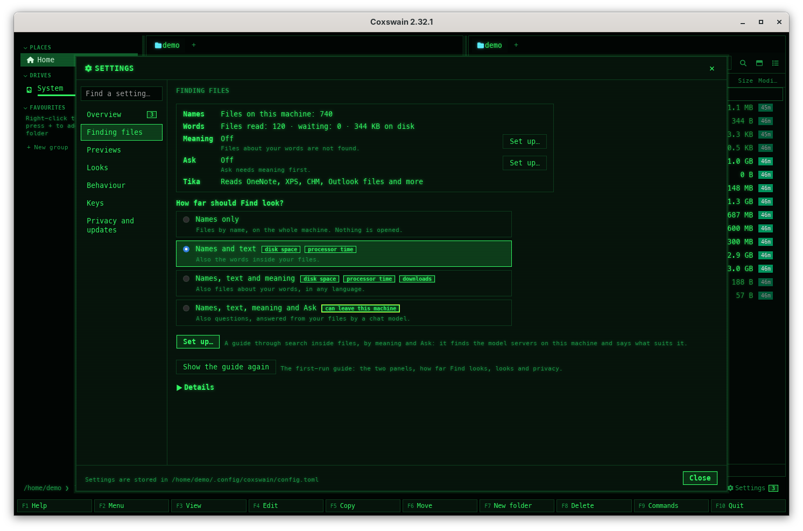

[← README](../../README.md) · [Docs index](../README.md) · [Search](README.md)

# Other formats with Apache Tika

Some files hold words no reader of Coxswain's knows: OneNote notebooks, XPS documents, CHM help
files, Outlook data files. Turn on *Read other formats with Apache Tika (container)* and the
[search helper](helper.md) reads them with [Apache Tika](https://tika.apache.org/), in a container
with no network, so Find finds their words like any [text](text.md). It is off until you turn it
on.

## Contents

- [How to use it](#how-to-use-it)
- [What it reads](#what-it-reads)
- [What it needs and costs](#what-it-needs-and-costs)
- [What the container may do](#what-the-container-may-do)
- [What you see](#what-you-see)
- [What is read again](#what-is-read-again)
- [Settings and config.toml](#settings-and-configtoml)
- [In the terminal app](#in-the-terminal-app)
- [Questions](#questions)

## How to use it

1. Install podman (or docker). On FreeBSD, the other BSDs and illumos neither runs Tika's Linux
   image, so the option has nothing to run it in there: the line under it says so.
2. *Settings → Finding files → Details → What is read*: tick *Read other formats with Apache Tika
   (container)*. Its hint says what you get, the size of the download and what it costs, before
   you tick it. In the terminal app: **F12** → *Finding files*, the same row, **Space**.
3. The helper starts again and pulls `docker.io/apache/tika:4.1.0` (about 190 MB) in the
   background. The status block at the top of *Finding files* shows *Tika: Downloading
   docker.io/apache/tika:4.1.0…* with the runtime's progress line, then *Reads OneNote, XPS, CHM, Outlook files and more*.
4. The files of those kinds are then read, by themselves. Search them as any text: **Shift+F7**,
   your words.

To stop: untick it. What was read stays searchable; nothing more is read with Tika, and the
image stays until you remove it in *Settings → Previews → Container images* (**Remove**).
Untick it before you remove the image: while it is ticked, the helper pulls the image again
the next time it starts.

## What it reads

Only formats no reader here knows, so nothing Coxswain reads itself goes to Tika:

| Kind | Endings |
|---|---|
| OneNote notebooks | `.one` |
| XPS and OpenXPS documents | `.xps` `.oxps` |
| Compiled HTML help | `.chm` |
| Outlook data files | `.pst` `.ost` |
| MHTML web archives (a page saved as one file) | `.mht` `.mhtml` |
| Hangul word processor files | `.hwp` |
| Access databases | `.mdb` `.accdb` |

And, only while LibreOffice is not installed (it reads them first, see
[Scans, pictures and older Office files](scans.md)): Word and PowerPoint 97–2003 (`.doc` `.dot`
`.ppt` `.pps` `.pot`), Publisher (`.pub`), Visio (`.vsd` `.vsdx`), WordPerfect (`.wpd`),
OpenDocument drawings (`.odg`) and StarOffice files (`.sxw` `.sxc` `.sxi` `.sxd`).

The usual limits hold: no file larger than *Largest file read* (`text_max_size`, 20 MB), only in
the [folders read](folders.md), and at most 4 MB of text from one file.

## What it needs and costs

| | |
|---|---|
| Needs | Words inside files on (the default), and podman or docker. Not on FreeBSD, the other BSDs or illumos |
| Download | `docker.io/apache/tika:4.1.0`: about 190 MB, once, when you turn it on; 440 MB on disk |
| Memory | Tika's server, Java, about 350 MB while files are read (1 GB at most) |
| Processor | A fraction of a second per file, at the lowest priority; reading pauses on [battery](battery.md) like all reading |
| When it runs | Only while there are such files to read: it starts with the first one and stops itself after 5 minutes without a file |
| Network | None. The image comes from Docker Hub (`docker.io`), which *Settings → Privacy and updates → What can leave this machine* names |

The image is Apache's own (`apache/tika` on Docker Hub, Apache-2.0), made by the Tika project
with each release, monthly in 2026. Coxswain takes release 4.1.0, pinned to its digest: the text
it reads stays the same until a Coxswain release moves it on, and *Keep images up to date*
leaves it as it is.

## What the container may do

The server runs as `podman run` (or `docker run`) with:

| Option | Why |
|---|---|
| `--network=none` | No network: only the container's own loopback, where the server listens (`-h 127.0.0.1`) |
| No `-v`, `--mount` or `-p` | No folder of yours is in it, and no port is opened on your machine |
| `--cap-drop=ALL`, `--security-opt no-new-privileges` | It can gain no rights |
| `--read-only`, `--tmpfs /tmp:rw,size=1g` | Nothing it writes outlives it: its own files are read-only, and `/tmp` is in memory |
| `--memory=3g`, `--pids-limit=256` (the bounds every sealed container of Coxswain's has) | It cannot take the machine's memory or start processes without end. Where rootless podman has no memory or process controller to give (some systems with cgroups v2 not delegated), the server runs without these two, with Java's own 1 GB bound, and `helper.log` says so. Whether they work is found once, with a container that only runs `true`, never from what a file made a run print; a probe that fails any other way (the image not pulled yet) keeps them on |
| `--pull=never` | A run never fetches the image; only the helper's pull when the option is ticked does |
| `--rm`, `--name coxswain-tika-…` | Removed when it stops; one per user |

A file reaches it as the body of a request on `podman exec -i`'s standard input, which a short
script in the container passes to the server on its own `127.0.0.1`. The file's name is never an
argument; only its ending is sent, so Tika knows the format. The answer is read up to 4 MB,
tidied like every reader's text, and kept in `search.db`; [Ask](ask.md) gets it only as passages,
the same way as every other file's text. A file that takes longer than two minutes is given up
and the server stopped; the next file starts a fresh one.

A fresh server also takes over after every 100 files, and at once after a file Tika could not
parse or a crash: a parser that a hostile file got hold of does not stay to read the files that
come after it, and with its root read-only nothing of it is left for the next one. SELinux
stays on: nothing is mounted, so nothing needs relabelling.

## What you see

- The status block of *Settings → Finding files*, in both apps, gets a line *Tika* while
  the option is on: *Downloading docker.io/apache/tika:4.1.0…* with the progress line, *Reads
  OneNote, XPS, CHM, Outlook files and more*, or *Off* with why in red: *Needs podman or docker, which run its Linux image;
  on FreeBSD, the other BSDs and illumos it cannot run*, or *It stopped: …* with the runtime's
  error.
- When neither podman nor docker is installed, a [notice](../panels/notices.md) says so once:
  *Read other formats with Apache Tika is on, but neither podman nor docker is installed: install
  one to read OneNote, XPS, CHM and Outlook files.*
- A hit from such a file shows its passage in *In files*, as any text hit does.
- *Settings → Previews → Container images* (desktop app) lists the image with what it gives, its
  size and cost, *Pulled, 440 MB*, **Pull** and **Remove**; [Disk use](../reference/disk-use.md)
  has its row in both apps.

## What is read again

Turning it on reads the files of the kinds above once, with Tika: only those, and nothing that
was read before by another reader. Files of other kinds, and their vectors for
[search by meaning](meaning.md), stay as they are. Turning it off keeps what Tika read; turning it
on again reads its kinds once more. A later version that reads more with Tika reads only its
kinds again (the store keeps Tika's own reader version, `readers.tika`).

## Settings and config.toml

| Settings → Finding files → Details → What is read | config.toml | Default |
|---|---|---|
| *Read other formats with Apache Tika (container)* | `[search] tika` | `false` |
| – (Settings → Previews → Container images lists it) | `[preview.images] tika` | `"docker.io/apache/tika:4.1.0@sha256:06bc…"`, pinned |
| *Container runtime* (Settings → Previews) | `[preview] container` | `"auto"`; `"off"` turns Tika off too |

`coxswain-gui --settings=search_tika` (or `coxswain --settings=search_tika`) opens Settings at the
option, lit up for a moment.

An image you set must be an `apache/tika` server image: Coxswain starts its server with `java`
and Tika's jars in `/opt/tika-server`. *Keep images up to date* and *Remove images not used for
90 days* ([Containers](../previews/containers.md#keeping-images-up-to-date)) treat it like the
preview images; each day it reads a file counts as a use.

## In the terminal app

The same: the helper reads for both apps. **F12** (or *Settings* in **F9**) → *Finding files*
shows the row under *What is read* and the *Tika* line in the status block; **Space**
turns it on or off. The terminal app has no *Container images* list: remove the image with
`podman image rm docker.io/apache/tika:4.1.0`, or in the desktop app.

## Questions

#### Which files does it read?

Only formats no reader of Coxswain's knows: OneNote, XPS, CHM, Outlook `.pst` and `.ost`, MHTML,
Hangul and Access files, and older Word, PowerPoint, Publisher and Visio files when LibreOffice
is not installed. The full list: [What it reads](#what-it-reads).

#### Can a file reach the network through it?

No. The container has no network and no folder of yours: each file is handed to it on its
standard input, and the server listens only inside the container. Nothing is mounted and no port
is opened on your machine.

#### What does it cost?

One download of about 190 MB when you turn it on (440 MB on disk), and about 350 MB of memory
while files are read. The server stops itself after 5 minutes without a file.

#### Will turning it on read all my files again?

No. Only the files of Tika's kinds are read, once; everything else, and its vectors, stays.

#### I ticked it and nothing happens.

Look at the *Tika* line at the top of *Settings → Finding files*. *Downloading …*: the
image is on its way. *Needs podman or docker …*: install one; on the BSDs and illumos it cannot
run. *It stopped: …*: the runtime's error, such as no space for the image.

#### Why not run Tika for every file?

Coxswain's own readers are faster and need no container. Tika only fills the gaps, so the
server runs only while such files are read.

#### Does it use Tika's OCR for pictures?

No. The image is the one without tesseract; pictures and scans are read by an installed
tesseract ([Scans, pictures and older Office files](scans.md)).

---
[← Previous: Scans, pictures and older Office files](scans.md) · [Next: Transcripts of speech →](transcripts.md)
