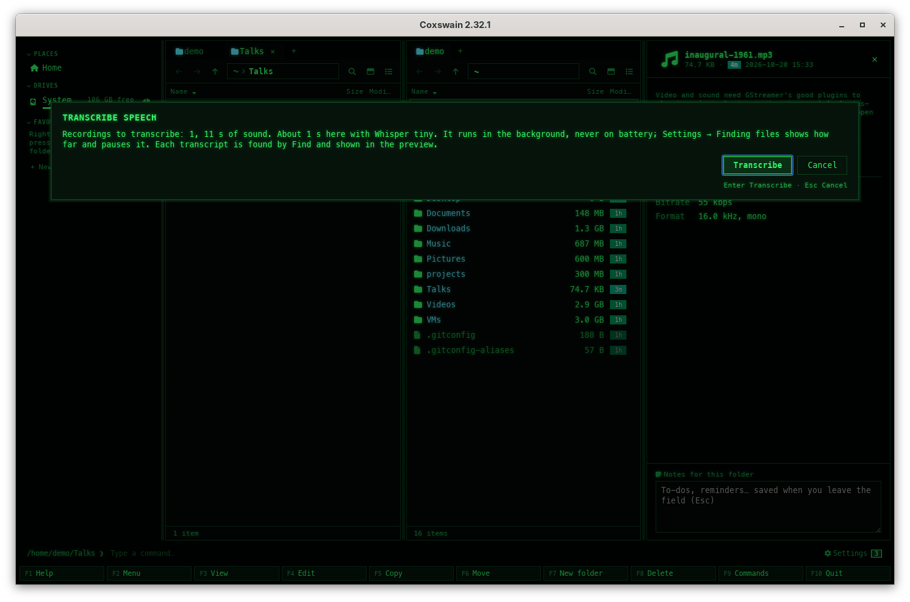

[← README](../../README.md) · [Docs index](../README.md) · [Search](README.md)

# Transcripts of speech

A talk, an interview, a voice memo or a lecture video holds words no reader can get at. With
*Transcribe speech with Whisper* turned on, you choose a recording or a folder of them, and the
[search helper](helper.md) writes down what is said with [Whisper](https://github.com/ggml-org/whisper.cpp),
on this machine, in the background. Find then finds those words like any [text](text.md), and
the desktop app's preview shows the transcript under the player. It is off until you turn it on,
and nothing is ever transcribed unless you ask.

![The desktop app with inaugural-1961.mp3 under the cursor: the preview pane shows Transcript and the line [0:00] And so, my fellow Americans, ask not what your country can do for you, ask what you can do for your country, above the length, bit rate and format](../screenshots/search-transcripts.png)

## Contents

- [How to use it](#how-to-use-it)
- [What it reads and how long it takes](#what-it-reads-and-how-long-it-takes)
- [The model](#the-model)
- [What it needs and costs](#what-it-needs-and-costs)
- [What you see](#what-you-see)
- [Pausing, the battery and changed files](#pausing-the-battery-and-changed-files)
- [How it runs](#how-it-runs)
- [Settings and config.toml](#settings-and-configtoml)
- [In the terminal app](#in-the-terminal-app)
- [Questions](#questions)

## How to use it

1. *Settings → Finding files → Details → What is read*: tick *Transcribe speech with Whisper*.
   Its hint says what it downloads and what it costs before you tick it. In the terminal app:
   **F12** → *Finding files*, the same row, **Space**.
2. The helper downloads the model chosen for this machine from Hugging Face, and, when no
   whisper.cpp is installed, pulls its container image. The *Speech* line at the top of
   *Finding files* shows *Downloading the model from Hugging Face: 12.0 MB of 465 MB.* meanwhile.
3. Put the cursor on a recording or a video, or on a folder, or mark several, and open the action
   menu (**Shift+F10**) → *Transcribe speech*; it is also in **F9** under *Search*, and the
   desktop app's preview of a recording has a **Transcribe speech** button.
4. A question says how much sound that is and how long it takes here: *Recordings to transcribe:
   14, 6 h 20 min of sound. About 1 h 10 min here with Whisper small. It runs in the background,
   never on battery; …*. **Transcribe** (**Enter**, or **y**) hands them to the helper; **Esc**
   leaves it.
5. Go on working. The *Speech* line shows how far it is; each transcript is searchable as soon as
   its file is done.

## What it reads and how long it takes

Sound: `.mp3` `.m4a` `.m4b` `.aac` `.wav` `.flac` `.ogg` `.oga` `.opus` `.wma` `.aiff` `.aif`;
and the sound of a video: `.mp4` `.m4v` `.mov` `.mkv` `.webm` `.avi`. On a folder, every such file
in it and below it (links not followed), at most 10 000. A file only in the cloud is left out: it
is not downloaded to be heard.

The length of each file is read from its header (not for `.wma`, `.mkv`, `.webm` and `.avi`, which count
as *Length not known*). The time it takes is worked out from this machine's speed, measured the
same way as for the built-in chat models, and after the first files from how long they really
took here. Whisper finds the language by itself, file by file, part by part.

Lines are kept with the time they start at: `[12:04] and the second engine came on`. A file
already transcribed and not changed since is not done again when you ask again.

## The model

Whisper comes in sizes. A larger one hears better and takes longer:

| Model | Download | Speed on a recent laptop processor (Core Ultra 9 185H) | |
|---|---|---|---|
| Whisper tiny | 74.1 MB | about 30 times as fast as it plays | For a slow machine |
| Whisper base | 141 MB | about 18 times | |
| Whisper small | 465 MB | about 5 times | The usual choice on a processor |
| Whisper large-v3-turbo | 547 MB | about twice as fast on a processor; much faster on a Mac's GPU | Chosen on Apple silicon with whisper.cpp installed |

*Whisper model* (`whisper_model`) is *Chosen for this machine* until you pick one: the largest
model that runs at least four times as fast as the sound plays here, from the same measure of
this machine's processor every model choice in Coxswain uses. On a Mac with Apple silicon and
an installed whisper.cpp, which uses Metal, that is large-v3-turbo. The list marks the
recommended one *recommended*, and one that would take more than half as long as the sound plays
*slow here*. When none is quick here, the tiny one is chosen; until the processor's speed is
measured, base.

The models are whisper.cpp's own, from its repository on Hugging Face (`ggerganov/whisper.cpp`,
MIT licence), at a fixed revision, and each download is checked against its SHA-256 before it is
used. They are kept in the cache folder, `coxswain/models/whisper`, and
[Disk use](../reference/disk-use.md) shows them.

## What it needs and costs

| | |
|---|---|
| Needs | *Words inside files* on (the default). An installed whisper.cpp (`whisper-cli`), else podman or docker for its container image. On FreeBSD, the other BSDs and illumos the image does not run: install whisper.cpp there. In the [Flatpak](../systems/flatpak.md#does-whisper-work-in-the-flatpak), the host's `whisper-cli` in `/usr/bin` or `/usr/local/bin`, or the host's podman or docker |
| Download | The model, once, from Hugging Face (`huggingface.co`): 141 MB for base, 465 MB for small. Without whisper.cpp installed, `ghcr.io/ggml-org/whisper.cpp:main` too: about 505 MB, 1.1 GB on disk |
| Processor | Half its threads (at most 8), at the lowest priority, only while it transcribes: an hour of sound takes about 10 minutes with small on a recent processor |
| Memory | The model's size and a little more: about 1 GB for small |
| Network | None while it transcribes. *Settings → Privacy and updates → What can leave this machine* names Hugging Face for the model, and, when no whisper.cpp is installed, `ghcr.io` for the image |

The image is whisper.cpp's own (`ghcr.io/ggml-org/whisper.cpp`, built by the project from every
change, MIT licence, with ffmpeg in it). It is for 64-bit Intel and AMD only: on ARM, install
whisper.cpp.

## What you see

- **The question** before it starts: how many recordings, how many hours of sound, how long here
  and with which model, what it downloads first (*First the model is downloaded from Hugging
  Face: Whisper small, 465 MB.*, *First ghcr.io/ggml-org/whisper.cpp:main is pulled (about
  505 MB).*). With transcribing off, it says how to turn it on instead (the desktop app adds
  **Show me**, which opens Settings at the option).
- **The status line** after it: *Taken in to transcribe: 14. F12 → Finding files shows how far.*
- **Settings → Finding files**, the *Speech* line in the status block (both apps): *Transcribed:
  3 · waiting: 11*, under it *Now: interview.m4a, 40 %. About 52 min left.*, and its button:
  **Pause** while it works, **Go on** while paused, **Let the rest go** while files wait. While
  the model downloads: *Downloading the model from Hugging Face: …* with a progress bar; on
  battery: *Paused while the machine runs on its battery.*; when it cannot run, why, in red.
- **The desktop app's preview** of a recording or video, under the player: *Transcript* with the
  lines and their times; *Waiting to be transcribed: number 3 in the queue.* or *Transcribing:
  12:00 done so far.* with the lines so far, every few seconds; *Could not transcribe: …* with
  why; and **Transcribe speech** when there is none yet.
- **Find**: a recording's words in *In files*, the passage with its time, like any text hit.

  ![Find with fellow americans typed: In files lists inaugural-1961.mp3 with the passage [0:00] And so, my fellow Americans, ask not what your country can do for you, the words marked](../screenshots/search-transcripts-find.png)

- **A notice**, once, when transcribing is on but cannot run here (no whisper.cpp, no podman or
  docker).

## Pausing, the battery and changed files

- **Pause** stops the part under way at once; **Go on** does that part again. A recording is
  transcribed ten minutes at a time, so a pause, the battery or a restart of the helper loses at
  most ten minutes of work; a file whose length is not known, or one an installed whisper.cpp
  reads without ffmpeg, goes whole, and loses that file's work. A part shorter than ten minutes
  is the end of the sound, whatever the file's header claims: a file that says it lasts ten hours
  and holds five seconds is done after its first part. A pause lasts until **Go on**, or until the helper starts again.
- **On battery** it waits, as all reading does ([Battery](battery.md)), and goes on by itself on
  mains power.
- **Let the rest go** forgets every file still waiting; the transcripts done stay.
- **A file that changes** (another recording saved over it) is transcribed again, by itself, the
  next time the helper reads it: it was asked for once. One that does not change is never done
  again.
- **Delete what was read** under *Background reading* (and *Clear* of the search store in
  [Disk use](../reference/disk-use.md)) keeps the transcripts: each comes back as its file's text
  when the file is read again. Deleting `search.db` while no Coxswain runs takes them too.
- **Reading on battery** (**Read now**) does not transcribe: transcripts wait for mains power.

## How it runs

With whisper.cpp installed (`whisper-cli` on `PATH`), it runs that, at the lowest priority, with
ffmpeg (when installed) cutting out each ten minutes as the 16 kHz WAV Whisper hears. Without
ffmpeg it reads WAV, MP3, FLAC and Ogg itself, a file at a time; other files then say *This kind
of file needs ffmpeg installed*.

Without it, the image runs as `podman run` (or `docker run`) with no network (`--network=none`),
only the file itself, read-only, as `/src/in.<its ending>` (nothing else of its folder), the model
folder read-only, `--cap-drop=ALL`, `--security-opt no-new-privileges`, its own files read-only
with `/tmp` in memory (`--read-only`, `--tmpfs /tmp:rw,size=1g`), `--memory=3g` and
`--pids-limit=256` (the bounds of every sealed container of Coxswain's; the last two only where
the runtime can keep them, as a separate probe finds), and `--pull=never`. A short script in the
container runs ffmpeg and whisper-cli at the lowest priority; the file's own name never reaches
the container, and ffmpeg reads `file:/src/in.…`, so no name is ever read as an option. A part
that runs past three times its length (at least half an hour) is stopped.

## Settings and config.toml

| Settings → Finding files → Details → What is read | config.toml | Default |
|---|---|---|
| *Transcribe speech with Whisper* | `[search] whisper` | `false` |
| *Whisper model* (while it is on) | `[search] whisper_model` | `""`: chosen for this machine; or `"tiny"`, `"base"`, `"small"`, `"large-v3-turbo"` |
| *Preview tools* → *Transcripts (Whisper)* (Pull, Remove) | `[preview.images] whisper` | `"ghcr.io/ggml-org/whisper.cpp:main"` |
| *Preview tools* → *Transcripts (Whisper)*, else *How previews are made* | `[preview.tools] transcripts`, `[preview] prefer` | `"auto"`: whisper.cpp installed first; `"container"` takes the image first |

`coxswain-gui --settings=search_whisper` (or `coxswain --settings=search_whisper`) opens Settings
at the option. *Transcribe speech* has no key of its own: the action menu and **F9** list it, and
`[keys] transcribe = "…"` gives it one ([Changing keys](../customise/keys.md)).

## In the terminal app

The same helper transcribes for both apps. **Shift+F10** → *Transcribe speech* (or **F9**) asks
the same question in a box (**Enter** or **y** starts, **Esc** leaves). **F3** on a recording that
has a transcript shows it in the viewer, with *Transcribing: 12:00 done so far.* above it while it
is under way. **F12** → *Finding files* has the option, *Whisper model*, and the *Speech* line with
its button (**Space** or **Enter**).

![The terminal app's viewer titled inaugural-1961.mp3 · Transcript, with the line [0:00] And so, my fellow Americans, ask not what your country can do for you, ask what you can do for your country](../screenshots/tui-transcript.png)

## Questions

#### Does it transcribe all my music?

No. Only what you choose: *Transcribe speech* in the action menu (**Shift+F10**) on a recording,
or on a folder, after the question that says how many hours of sound it holds and how long they
take here. Nothing is transcribed in the background unless you asked for it.

#### Does anything leave my machine?

Only the model's download from Hugging Face, once, and the container image when whisper.cpp is
not installed. The sound is transcribed here, in a container without network or by your own
whisper.cpp.

#### Why did it stop?

It waits while the machine runs on its battery, and while you have paused it (**Go on** on the
*Speech* line). A file that changes is transcribed again.

#### How long will a folder take?

The question says, before anything starts: the hours of sound and the time here with the chosen
model. It is worked out from this machine's speed, and after the first files from how long they
really took. *Length not known* counts files whose length could not be read.

#### Which model should I take?

The one *Chosen for this machine*: the largest that runs at least four times as fast as the sound
plays here. A larger one hears names and quiet speech better and takes longer; the list marks one
that would be *slow here*.

#### It says it needs ffmpeg.

Your whisper.cpp reads WAV, MP3, FLAC and Ogg by itself. For `.m4a`, `.m4b`, `.aac`, `.opus`, `.wma`, `.aiff` and videos,
install ffmpeg, or let the container image do it (*Container* on the *Transcripts (Whisper)* row of *Settings → Previews → Preview tools*, `[preview.tools] transcripts = "container"`).

#### Can I transcribe on FreeBSD?

Yes, with whisper.cpp installed (`pkg install whisper.cpp` where the package exists, or built from
its source). The container image is a Linux one and does not run on the BSDs or illumos.

---
[← Previous: Other formats with Apache Tika](tika.md) · [Next: Diagrams read as sentences →](diagrams.md)
